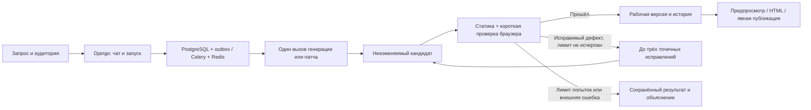

# Архитектура быстрых мини-игр

23 октября 2026 года. **Архитектура конкурсной версии, ветка `mini-games`.**
Объём задают [требования](requirements.ru.md), порядок — [план](development-plan.md).
Фактические ограничения проверки и ремонта перечислены в [сверке с ML-планом](source-review.ru.md).
Этапы ниже — серверные проверки и ограниченные ремонты, а не полноценная декомпозиция
модельной генерации на независимые модули.

## 1. Короткий путь

После исчерпания сохранённого лимита повторная ошибка ведёт в E; бесконечной петли F нет.
Нормальное создание и обычная правка — **по одному продуктовому вызову модели**.
Полный ответ проходит узкую нормализацию известных пустых метаданных и алиаса статуса,
затем строгую валидацию. Нормализация не меняет исходники, действия проверок или ограничения.
Invocation сохраняет исходный raw_response отдельно от канонического response; публичная
сериализация их не раскрывает. Восстановление старого invalid_schema выполняет локальная
команда recover_saved_response: новый Run с allow_model_calls=false и сохранённым кандидатом.
Очередь проверяет его обычным изолированным валидатором, но не может вызвать LLM даже после
ошибки или рестарта. Исходный Invocation, usage, стоимость и неудачный Run не переписываются.
Нет отдельных обязательных вызовов спецификатора, планировщика, критика и исследователя.
Модель в одном ответе формирует краткий замысел, визуальный подход, код и небольшие
проверочные сценарии. Ответ не должен содержать длинную исследовательскую переписку.

В `design.visual` модель до кода рассчитывает полезную сцену для телефона и ПК:
геометрические ограничения из запроса, доступную область после управления, размеры
самого поля/объектов и преобразование координат. Расчёт проходит через всю цепочку
контейнеров до отрисовки; размеры DOM Canvas и однотонный фон не считаются размером
игрового поля. Рисование, ввод, размещение объектов и игровые границы согласованы.
Приоритет — полезная площадь сцены и читаемость, а не большие заголовки и декоративные
подписи. Длинные инструкции уходят в начало/справку; текстовые механики сохраняются.
Свободные размеры адаптируются к обеим сторонам доступной области, фиксированная
правилами геометрия сохраняется и масштабируется без искажений. Общего шаблона HUD,
универсального процента площади и обязательного bridge нет. Это уточнение того же
модельного ответа (до 1200 символов `visual`), без новых этапов, runtime или миграций.
Проверки механик по-прежнему обязательны и не являются художественной приёмкой;
качество компоновки проверяется отдельными живыми испытаниями.

При невозможном для мини-игры запросе приложение объясняет границу объёма и предлагает
краткий вариант; не сокращает явно запрошенную функцию молча. Не требуется обходиться
одним жанром: правила и механики генерируются, общими остаются инфраструктура и инструменты.

## 2. Стек и границы процессов

- Django/DRF: сессии, права, чаты, сообщения, версии, публикации, запуск и состояния.
- PostgreSQL **18+**: источник истины. Celery/Redis: доставка работы, не хранилище версий.
- React/TypeScript/SCSS: интерфейс по F01–F14, Vite для сборки.
- Model runner: единственная роль с доступом к провайдеру. В локальном режиме — доверенный
  процесс пользователя с Codex-login; в серверном — worker с доступом к relay/vLLM.
  Для закрытого стенда разрешён отдельный вход Codex с явным списком пользователей Pro.
- Validation controller передаёт конкретный кандидат в браузерный sandbox. Процесс,
  исполняющий игру, не получает доступ к БД, Redis, кодовой базе платформы и секретам.
- nginx: единая внешняя точка входа с отдельными virtual hosts для приложения и preview.

Одна кодовая база backend, без FastAPI/SQLAlchemy рядом с Django и без собственного
AI HTTP-микросервиса поверх очереди. Контейнерное разделение ролей оправдано изоляцией,
а не стремлением разбить продукт на сервисы. Только образ проверки содержит Chromium.
Контейнер проверки готов заранее; Chromium запускается для конкретного отчёта, контекст
каждого сценария чистый. Общего browser pool пока нет; его необходимость определяется
замерами накладного времени, а не обещанием в документации.

Миграции и bootstrap администратора выполняются init-командой при запуске, не при сборке
образа. Пароль берётся из runtime environment, не из Dockerfile/ARG. Повторный запуск
не перезаписывает пароль существующей учётной записи. Уникальность username проверяется
на уровне БД по нормализованному регистру, включая одновременные запросы создания.

## 3. Что хранится

| Сущность | Назначение |
| --- | --- |
| User / Preference | Django-пользователь, тема, компактные явные предпочтения качества |
| Chat / Message | Одна игра, её запросы/ответы, владелец и текущая рабочая версия |
| Run | create/edit/repair, базовая версия, состояние, провайдер, attempt, отмена, журнал |
| Invocation | Отправленный запрос, ответ/ошибка, usage, latency, состояние доставки |
| Revision | Неизменяемые исходники, parent, экспорт, hashes, краткая карточка игры |
| CheckReport | Проверенные эффекты, браузерные факты, ошибки и точный hash кандидата |
| Publication | Владелец, публичное название, UUID и собственная ссылка на выбранную Revision |
| Like / Feedback | Один лайк пользователя на публикацию; оценка и причины по своему чату |

Сохранённая публикация и ремиксы удерживают артефакт независимо от существования чата.
Удаление чата прекращает его задания, но не каскадно уничтожает опубликованные снимки.
Удаление чата мягкое: история и финансовые записи сохраняются; автоматический сборщик
артефактов и политика долгосрочного удаления персональных данных сейчас не реализованы.

Один активный меняющий запуск на чат. Другие чаты независимы; их лимит одновременности
зависит от провайдера. Два редактирования одной версии не применяются молча друг поверх друга.

## 4. Создание и точечное редактирование

Рабочий формат — небольшой набор обычных HTML/CSS/JS-файлов и необязательный JSON
параметров/уровней. Для первой версии достаточно `index.html`, `styles.css`, `game.js`;
не требовать файл, если он не нужен. Нет обязательного игрового runtime или npm-сборки
на каждую игру. Начальный профиль — обычный Canvas2D; WebGL допустим по запросу.

Результат `create` содержит исходники, название при его отсутствии, краткий замысел,
управление, исход игры и сценарии основных проверок. Имя провайдера не входит в схему игры.
Визуальный подход включает палитру, композицию и обратную связь действий, но не отдельный
многостраничный дизайн-план. Допустимы общие helpers; нельзя выдавать готовую змейку по
условию `genre == snake` вместо генерации.

Результат `edit` содержит `base_revision`, список изменений и ожидаемый эффект.
Первый формат патча — точные замены `{path, old_text, new_text}` с hash исходного файла;
JSON-параметры меняются такими же точными заменами. Отдельного typed-path редактора нет.
Каждый `old_text` должен совпасть ровно один раз.
Все изменения сначала проверяются на копии, затем применяются атомарно. Новые локальные
файлы разрешены для запрошенной небольшой функции. Путь вне игры, несовпавшая версия,
неоднозначная замена и незавершённый ответ не применяются.

Нет fallback «патч не получился — перепиши всю игру». Модель получает короткую причину
конфликта и актуальный фрагмент в пределах оставшейся попытки. Не делать fuzzy replace
с риском изменить соседнюю механику. Для простого цвета/размера/скорости сохраняются
байты нетронутых модулей; для двух уровней разрешены изменения данных и связанного кода.
Размер diff измеряется, но не служит универсальным процентным запретом на обоснованную правку.

Упаковщик делает самодостаточный `index.html` из этих файлов. Его пересоздание — обычная
локальная операция, не модельная перегенерация. Проверяется именно экспортируемый HTML;
одни и те же байты используются для preview, скачивания и публикации.

Контекст правки: запрос, краткая карточка игры, текущая версия, актуальные исходники
или связанные фрагменты, последний релевантный результат. Не передавать всю историю
чата и прежние версии на каждом шаге. Для небольшой игры полный текущий код во **входе**
допустим: требование M12 ограничивает ненужную переработку, а не чтение исходника.
Общий prefix стабилен; провайдерская сессия — ускорение, не единственный источник состояния.

## 5. Проверка без возврата к прежней тяжёлой системе

Проверяем каждый новый кандидат один раз. Успех сохраняется по hash артефакта,
версии проверок и профилю среды. Публикация тех же байтов не запускает модель/браузер повторно.

Базовые проверки: корректная упаковка и JavaScript, загрузка без блокирующих ошибок,
локальные ресурсы, содержательная сцена, телефонный viewport, доступность управления,
настоящее действие → ожидаемый эффект и осмысленный конечный исход по правилам игры.
Пошаговая игра не обязана содержать таймер; запрещённый ход может правильно ничего не менять.
Для удержания клавиши проверяются отпускание и потеря фокуса, если такое управление есть.

Модель предлагает короткий план браузерных действий и наблюдений конкретной игры.
Исполнитель использует реальные pointer/touch/key события. Для Canvas доступны явные
дробные координаты элемента, обычные координаты остаются CSS-пикселями. В ответе правки
можно вернуть только изменённые/новые сценарии: остальные наследуются, после объединения
проверяется весь короткий набор и его полнота. Он записывает факты сам;
`passed:true` из HTML, тестового bridge или ответа модели не является вердиктом.
Нельзя заменять проверку клавиатуры внутренним `dispatch`, нажимать вслепую первую кнопку
и считать любое изменение счётчика доказательством исправности.

Наблюдение DOM/состояния допустимо для точных ожиданий. Универсальный `score/phase/lives`
и тестовые кнопки не встраиваются. Тестовая подготовка/seed допустимы, но не должны
подменять реальную механику или задавать успешный исход напрямую. Условия проверки
хранятся с версией игры; малая правка наследует прежние эффекты и добавляет затронутый тест.

Весь сформированный короткий набор выполняется целиком; отдельного отбора расширенных
сценариев по графу зависимостей нет. Для мини-игры это дешевле отдельного графа зависимостей
и нескольких приёмочных ролей. Заведомо плохие тесты/самоотчёты проверяются отрицательными fixtures
самого генератора. Это повышает достоверность, но не доказывает отсутствие всех ошибок.

Полное прохождение всех уровней не входит в каждую генерацию. Если автоматизация не
подтвердила обязательный эффект, показать конкретное непроверенное условие и дать
проверить его человеку в безопасном preview. Не ставить зелёный статус и не публиковать
как проверенную игру до подтверждения. В отчёте различать автоматическую и ручную проверку.
Такой исход считается неполным автоматическим успехом в метриках, а не скрытым pass.

Обычный дефект возвращается модели одним пакетом с местом ошибки и браузерными фактами.
Автоматический repair наследует полный обязательный набор проверок без изменения.
Если ошибочен сценарий, требуется отдельное решение приложения с независимым подтверждением
эффекта; изменение одних тестов останавливается как needs_attention.
Неудача инфраструктуры возвращается как проблема среды, а не просьба переписать игру.
Общую платформу исправляет команда вне пользовательского задания.

Контракт генерации v3 выбирает отдельные схемы create/edit/repair для Codex и API.
Версия сохраняется в Invocation; существующий v2 Run сохраняет прежний wire-формат.
Исходные незакрытые дефекты восстанавливаются из CheckReport, ошибка последнего ответа —
из Invocation.error; они передаются раздельно и сохраняются после перезапуска.
Карта упаковки связывает синтаксические и runtime-координаты с исходным файлом,
фрагментом и hash; неподтверждённое сопоставление сохраняет координату экспорта.

## 6. Сменный провайдер

Общий интерфейс: запрос create/patch, streaming progress, законченный результат,
typed error, usage и cancel. Состояние версий, публикаций и проверок принадлежит приложению.

**Первый адаптер — локальный Codex App Server.** Один ephemeral thread/turn с JSON schema,
progress, usage и отменой.
`baseInstructions` задаёт короткий игровой контракт, `environments: []`, пустые runtime roots,
выключенные shell/patch/MCP и безопасный каталог моделей обеспечивают режим без инструментов.
Код генератора и другие проекты модели не доступны. CLI-профиль проверен на
`0.163.0-alpha.10.2`; смена версии требует повторной проверки до платного запуска.
Подробности — [контракт адаптера](../generation/README.md).

Скрытые request/stream retries отключены. Приложение сохраняет идентификаторы thread/turn,
usage и время; число продуктовых вызовов не объявляется измерением внутренней реализации
серверной модели. Этот режим только для доверенного локального оператора. Авторизация
остаётся в Codex, не копируется в frontend, Git и Docker images. Общедоступное размещение
использует API-провайдер. Закрытый стенд может использовать отдельный Codex-login только
у worker с явным списком разрешённых аккаунтов; новые аккаунты не получают его автоматически.

**Второй адаптер — vLLM на отдельном сервере.** Настраиваются base URL, model, ключ при
наличии и параметры фактически установленной модели. Базовый контракт можно реализовать
через Chat Completions; доступность streaming/schema/usage/cancel проверяется на реальном
endpoint. Совместимость с OpenAI по названию не гарантирует одинаковые функции и качество.
При отсутствии schema-режима допустим валидируемый JSON-ответ с явным ограничением возможностей.
Не требовать Responses API, CLI tools, vision и vendor-specific reasoning от любой модели.

**Третий адаптер — `relay`, сохраняемая очередь для того же vLLM.** Два самостоятельных репозитория
`llm-relay` и `llm-gpu-worker`: WSGI-реле с SQLite/WAL и отдельный исходящий GPU-исполнитель с локальным
SQLite spool. Нагрузка модели не идёт через долгоживущее внешнее HTTP-соединение.
Исполнитель получает задания по HTTPS, вызывает localhost vLLM, фиксирует результат на
диск и повторяет его доставку до подтверждения хеша. Реле хранит payload, владельца,
назначение исполнителя, отмену и receipt. Client/worker-токены имеют разные маршруты;
в БД хранятся только их хеши. Модель, команды ОС и управление Docker через очередь не доступны.

UUID Invocation и точный payload сохраняются в PostgreSQL до отправки. Реле отклоняет
повтор того же UUID с другим payload, не перераспределяет назначение по таймауту и принимает
идентичный receipt повторно. Временный обрыв переводит обработку GameForge в ожидание с тем
же UUID. Перезапуск Celery возобновляет получение результата, не создаёт новую Invocation.
Отмена доставляется отдельной фоновой задачей, включая отмену до потерянного подтверждения
первого submit. Поздний ответ остаётся в учёте, но не применяется к отменённой игре.

Авария GPU-исполнителя во время inference или потеря его spool оставляет неизвестный исход.
Нельзя автоматически повторять такой вызов или удалять идентификаторы старых заданий.
В этой версии один GPU-исполнитель, фиксированный список моделей/лимиты, доставка небольшого
полного JSON. Файловая дозагрузка, управление моделями, горизонтальная GPU-очередь и
автоматическое удаление истории не реализованы. [Установка и ограничения](relay-deployment.md).

Проверено по [OpenAI Docs: вход](https://learn.chatgpt.com/docs/auth) и
[неинтерактивный режим](https://learn.chatgpt.com/docs/non-interactive-mode): CLI умеет
использовать сохранённую авторизацию, JSON events и schema результата. Профиль установленного адаптера и живой пилот дополнительно
описаны в [отчёте испытаний](verification.md). Возможности API vLLM описаны в
[официальной документации](https://docs.vllm.ai/en/stable/serving/online_serving/);
конкретная конфигурация сервера команды пока неизвестна.

## 7. Быстродействие, ошибки и учёт

По умолчанию один create/patch и до трёх автоматических исправлений результата
или его формата. GAMEFORGE_MAX_REPAIR_ATTEMPTS допускает 2 или 3; значение фиксируется
в Run.max_repair_attempts при создании. Старые Run сохраняют прежний лимит.
После упаковки Chromium сначала компилирует все классические скрипты без выполнения
кода игры. При синтаксической ошибке игровые сценарии не запускаются. При успешном
разборе выполняется полный прежний набор проверок. CheckReport.stages хранит этапы.
Модель исправления получает максимум три причины с приоритетом синтаксиса, затем
ошибок исполнения/сети, затем игровых эффектов. Полный отчёт остаётся в БД. Внутренние SDK retries не должны скрыто умножать этот цикл. Безопасный
повтор до отправки и неоднозначный обрыв после отправки различаются.
После исчерпания лимита исправлений — сохранить кандидат, причину и последнюю рабочую версию;
явное «Продолжить исправление» использует их, не начинает генерацию заново.

Цели времени — сигнал качества, не общий kill-таймер. Отмена доступна всегда.
После cancel новый вызов не отправляется, поздний ответ не меняет выбранную версию.
Транспортный guard отсутствия данных и watchdog изолированного браузера защищают
от зависших операций, а не обрывают игру
ровно через целевое время. Для очереди показываются очередь, фактический этап и задержка.

PostgreSQL фиксирует запуск и outbox в одной транзакции. Celery получает ID, а не исходники
и секреты. Захват имеет lease/fence; повторы доставки не создают второй результат.
Подтверждённый ответ сохраняется до перехода; неизвестный исход вызова требует сверки.
Нельзя обещать exactly-once для внешней модели без подтверждения от транспорта.

Журнал связывает chat/run/invocation/revision, этапы, версии prompt/model, время, patch size,
findings и расход. Приватный пакет диагностики хранит точный запрос, ответ, diff и screenshots
с ограниченным доступом. Обычная телеметрия — без исходников и секретов.
Input, cached input и output учитываются раздельно; отсутствующий usage — unknown, не ноль.
API-эквивалент для подписки — оценка, не списание; у локальной модели может не быть цены.
Если включён денежный предел, допуск и резерв считаются приложением; неизвестный расход
не освобождается как «точно не потрачен». Предыдущая сложная ledger-система не переносится целиком.

## 8. UI, публикации и безопасность

Корневой `/` зависит от авторизации: лендинг или лента. Маршруты чата и просмотра
не требуют `/app`/`/studio`; API может иметь собственный `/api/`.
Сессия HttpOnly, SameSite=Lax, CSRF на мутации, проверка владельца каждого приватного объекта.
Secure-cookie включается `DJANGO_SECURE_COOKIES=1` при размещении за HTTPS; локально используется HTTP.
Fullscreen — управление оболочки с доступным выходом; не обязательная кнопка внутри игры.
Он расширяет тот же iframe и сохраняет игровое состояние при входе и выходе.
Макет телефона — оформление, а не доказательство WebView-совместимости.

Feed доступен авторизованным пользователям, как в F. Внешний просмотр опубликованной
игры по ссылке — отдельная read-only поверхность без приватного чата. Публикация всегда
явная; новая рабочая версия не заменяет public revision без «Обновить».
Ремикс копирует опубликованный снимок, а не последнюю неопубликованную работу автора.
Лайк имеет уникальность `(user, publication)` и безопасен при повторе запроса.

В ленте статичная миниатюра заменяется живым preview при наведении: одновременно
смонтирован не более чем один iframe, уход указателя снимает его. Отдельной реакции
на скрытие вкладки или уход карточки за границы экрана пока нет. На touch — кнопка
«Попробовать», без зависимости от hover. Оболочка не запрашивает autoplay для iframe;
поведение звука самой игры зависит от её кода и политики браузера.
Сворачивание всей панели preview в чате размонтирует iframe: повторное открытие начинает
игру заново. Это отличается от fullscreen, который сохраняет iframe. Сохранённые исходники,
версии и задания при сворачивании не меняются; произвольное игровое состояние не сериализуется.

Sandbox игры: без сети и внутренних адресов, cookies, секретов, небезопасных mounts,
доступа к Docker socket, навигации верхнего окна, downloads и permissions. Preview origin
не получает cookie домена приложения. CSP/iframe и контейнерные ограничения дополняют друг
друга. Regex не является защитой. При optional `postMessage` проверять окно-источник,
идентичность версии, схему и лимиты; не доверять произвольному сообщению от игры.

Отчёты/оценки пользователя влияют на компактный preference context следующих генераций.
Они не переобучают модель и не запускают новый запрос автоматически. Предпочтения доступны
для изменения/сброса и не имеют приоритета над текущим явным запросом.

### Выбор модели в клиенте (24.10.2026)

Клиент отправляет `model_profile=pro|lite` при создании и продолжении Run.
`Preference.model_profile` хранит пользовательский default; `Run.model_profile`,
`provider` и `model` — неизменяемый снимок конкретного запуска. Сервер задаёт соответствие
Pro → codex/gpt-6-sol, Lite → настроенный API. Client-supplied provider не используется.
Idempotency включает provider/profile; повтор с тем же ключом наследует сохранённый
выбор даже после изменения настроек. Старые fingerprint поддерживаются без второго вызова.
Продолжение может явно сменить профиль, сохраняя candidate/base и учет неизвестного расхода.
Проверка доступа выполняется по фактическому provider внутри create_run до записи/schedule,
включая legacy API и продолжения, а не по глобальному GAMEFORGE_PROVIDER. Pro требует
opt-in и по умолчанию staff, loopback host/peer и локальный APP_ORIGIN.
Отдельный режим restricted требует HTTPS, совпадения host с APP_ORIGIN и активного
пользователя из явного списка ID. Staff не обходит этот список. Cloud app получает только
экспортированные сведения о моделях; каталог авторизации монтируется исключительно worker.
Публичный Lite не получает Codex-login.
