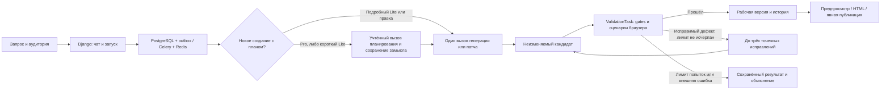

# Архитектура быстрых мини-игр

28 октября 2026 года. **Архитектура конкурсной версии, ветка `mini-games`.**
Объём задают [требования](requirements.ru.md), порядок — [план](development-plan.md).
Фактические ограничения проверки и ремонта перечислены в [сверке с ML-планом](source-review.ru.md).
Этапы ниже — серверные проверки и ограниченные ремонты, а не полноценная декомпозиция
модельной генерации на независимые модули.

**Текущий контракт v9 (planning 2, checks policy 7, runtime 2):** полный и экспериментальный компактный профили. Компактный
профиль использует один сгенерированный модуль правил и встроенные в экспорт общие
утилиты Canvas/ввода. Run закрепляет профиль/формат; Codex продолжает поддерживать
полные исходники и может редактировать компактную игру в её собственном формате.

Наблюдения встроенного плеера имеют строгие типы: graphicsReady — количество
загруженных изображений, не boolean. Prompt/schema описывают это явно, а ошибка
вложенного assert/await_condition называет конкретное поле и необходимый тип.
Неверное ожидание не преобразуется в более слабое и не разрешает ремонт игры.

P4–P5 закрепляют RequirementManifest и снимки предпочтений/политик до исходников.
Код и сценарии не могут ослаблять обещания, но модельный замысел не является
независимым доказательством понимания запроса. Смена политики блокирует новые
отправки; ранее отправленные ответы продолжают получать и учитывать.
Эксперимент `lite_code_then_checks` (выключен по умолчанию) отделяет код от создания
сценариев обязательными gates, сохраняя лимит 4/5 и источник каждой проверки.
[Реализация, ограничения и порядок выпуска](generation-improvement-p4-p5-implementation.ru.md).

P6–P8: `GameForgeMotion` v1 — закреплённая локальная библиотека числовых переходов,
в compact через `api.motion`, в full по явному подключению. Игровые правила отдельны.
Эксперимент Pro `visual_review → visual_patch` включается флагом только для новых Run
и использует общий лимит вызовов. После игровых gates собираются шесть обычных кадров;
одна проверенная контактная таблица поступает Codex. Независимые проверки, точные
привязки и неизменные требования ограничивают правку. Регрессия/недоступная повторная
съёмка возвращают прежнюю игру; unknown не повторяется. [Ревью и выпуск](generation-improvement-p6-p8-implementation.ru.md).

Пользовательское сообщение содержит точные source_revision_id/hash показанной игры,
включая непринятый черновик. Run.source_revision отделена от Run.base_revision,
которая остаётся принятой базой для проверки конкурентного изменения. Исходный замысел
хранится отдельно от новой ограниченной правки.

Существующая Invocation обрабатывается раньше решения по старому кандидату. Истёкший
срок новых отправок не запрещает получить уже отправленный receipt; неизвестный
прямой вызов не повторяется автоматически. Ремонт не меняет требования и сценарии,
а check_repair не меняет код. Принятие изменённых моделью сценариев требует человека.

Браузер записывает независимые syntax/load/surface receipts; компактный профиль также
требует регистрации/отрисовки модуля и доступных объявленных кнопок. Произвольное
перекрытие модельного selector остаётся неопределённостью сценария. Для control/outcome
есть отдельный запуск с пропуском последнего полезного ввода; совпадающее утверждение
не доказывает эффект. Наблюдение, созданное самим вводом, проверяется с учётом его
доказанного отсутствия в контрольном запуске, без вызова getters.

Проверяющий контроллер требует artifact receipt для любого результата, кроме
ошибки инфраструктуры. Клавиатурный ввод переводит фокус в iframe без клика по игре.
Контрольный запуск сохраняет подготовку до checkpoint, учитывает отдельное отпускание
клавиши и не признаёт собственную ошибку выполнения доказательством игрового эффекта.
В ремонте после правки draft нетронутые модули определяются относительно выбранной
`source_revision`, а не только принятой базы. Compact edit независимо объединяет
наблюдения и probes по ID и проверяет ограничения уже объединённого manifest.

Старые игровые контракты удаляются через retire_games только после обязательного
backup; публикации остаются недоступными (HTTP 410), учёт вызовов/неизвестного
расхода сохраняется. Подробности, миграции и ревью — в [отчёте v8](lite-v8-implementation.ru.md).

## 1. Короткий путь

Ручная «Проверить игру» адресует выбранную Revision/hash и создаёт ValidationTask
без Run/Invocation/сообщений. Общий с автоматическим путём исполнитель сохраняет
отчёт; только автоматический Run решает о ремонте/принятии. Ручная проверка не меняет
текущую версию. Snapshot, fence/lease, idempotency aliases и сохранённые пакеты
защищают результат от повторной доставки, отмены и перезапуска. Браузер один,
health/control обслуживаются независимо; ожидание очереди и исполнение измеряются
раздельно. [API, семантика ожиданий и ограничения](validation-v4-implementation.ru.md).

После исчерпания сохранённого лимита повторная ошибка ведёт в E; бесконечной петли F нет.
Pro/Sol сначала делает отдельный ограниченный замысел новой игры. Lite делает это
только для запросов до 320 символов; длина — явная эвристика, а не классификатор намерения.
Для подробного Lite и обычной правки исходники формируются одним продуктовым вызовом.
`Run.generation_strategy`, `planning_required` и `game_plan` сохраняются в БД до следующего
этапа. План не является Revision или доказательством приёмки. Его receipt и запись плана
завершаются одной транзакцией; возобновление не повторяет полученный ответ. Продолжение
наследует план, новая явная правка имеет приоритет над прежними дополнениями модели.

Максимум: один план + одно создание + до трёх исправлений. Общий пользовательский
`model_call_limit` (1–5) и deadline ограничивают **все** отправки. При лимите 1 после
планирования сохраняется только замысел с явным объяснением, что кода ещё нет.
High у Pro относится к plan/create/repair, medium — к edit/check_repair. Lite сохраняет
малый объём и прежний API-транспорт. Выбор стратегии не меняет формат артефакта:
Pro редактирует full/compact в закреплённом формате. Разделены инструкции и контекст;
очередь, бюджет, безопасность, патчи и приёмка общие.

Pro получает ограниченные факты проверок и, при наличии, PNG/JPEG не более 512 КиБ
из актуального отчёта своего кандидата. До записи запроса и при сборке Codex input
проверяются hash/ID отчёта, тип и размер. Передаётся только data URL; изображения
не дают доступ к хосту. Кадр не доказывает игровой эффект. Повторные Codex turn/start
внутри одного Invocation, инструменты и произвольный агентный цикл не включены:
цикл выполнения и обратной связи принадлежит приложению.

По запросу владельца от 26.10 Pro также использует `presentation_policy=1`, которую
приложение закрепляет в новом запросе до резервирования. Новый успешный Pro-план
обязательно содержит `presentation.art_direction` и `presentation.motion`: конкретное
художественное направление и описание видимого движения/отклика. Они сохраняются
в game_plan, передаются реализации и ремонту, доступны в раскрываемом замысле игры.
Требования охватывают цельную палитру/типографику/рисунок сцены, использование площади
экрана, плавное движение и реакции на действия, переходы прогресса/финала/повтора.
Это авторский бриф и инструкции, а не независимое доказательство красоты.

В полном формате Canvas-анимации опираются на прошедшее время и один scheduler,
в compact — на штатные update(dt)/render(ctx). Косметическая анимация отделена от
правил и ввода; эффекты ограничены, resize и повтор сохраняют корректность состояния.
Явные стилевые пожелания, статичность и prefers-reduced-motion имеют приоритет.
Локальная правка/ремонт сохраняет оформление без несвязанного редизайна; check_repair
по-прежнему не получает разрешения реализовывать графику или анимацию.

Маркер политики сохраняется в Invocation.request и request_profile. Его отсутствие
означает прежнюю зафиксированную схему/инструкцию уже сохранённого запроса: новые
обязательные поля не переинтерпретируют старый receipt. Это сохранение состояния
вызовов; политика оформления сама по себе не меняет контракт артефакта или модель Codex. Lite не получает этот бриф.
Для новой политики художественные результаты и плавность ещё не измерены живой моделью:
один screenshot или изменение пикселей не являются проверкой анимации.

Полный ответ проходит узкую нормализацию известных пустых метаданных и алиаса статуса,
затем строгую валидацию. Нормализация не меняет исходники, действия проверок или ограничения.
Invocation сохраняет исходный raw_response отдельно от канонического response; публичная
сериализация их не раскрывает. Восстановление старого invalid_schema выполняет локальная
команда recover_saved_response: новый Run с allow_model_calls=false и сохранённым кандидатом.
Очередь проверяет его обычным изолированным валидатором, но не может вызвать LLM даже после
ошибки или рестарта. Исходный Invocation, usage, стоимость и неудачный Run не переписываются.
Нет цепочки спецификатора, критика и исследователя. После сохранённого замысла модель
возвращает код и небольшие проверочные сценарии. Ответ не должен содержать длинную
исследовательскую переписку. Проверки исполнения не измеряют привлекательность игры
и не доказывают полноту реализации замысла: это отдельная оценка живых результатов.

Уточнение ответов от 27.10: общий prompt для full/compact и пользовательских исходов
требует короткого нетехнического `message` (1–2 предложения, до 500 символов).
Create/edit/repair/visual_patch получают краткий осмотр итоговой игры в том же вызове:
правила, управление, исход, повтор игры и доступность управления на телефоне/ПК.
Нового этапа, вызова или поля нет; `message` перенесён после исходников/правок в
порядке полей схемы, инструкция также требует его последним. Это осмотр, не исполнение.
Сервис дополняет текст результатом проверок только при passed/accept/gates_passed,
совпадении сохранённых сценариев и hash игры в отчёте выбранной версии. HTTP-чтение
не запускает валидатор. Сообщение другой версии или этапа ремонта сценариев не
подменяет итог игры. Ручное подтверждение названо отдельно. Частые признаки кода,
технических терминов и неподтверждённых гарантий заменяют весь модельный текст
нейтральным ответом; это защитная эвристика, не полная языковая классификация.
Исходные ответы и диагностика остаются приватными. Если сохранённого сообщения
нет, интерфейс выводит подготовленное публичное сообщение, а не внутреннюю ошибку.
История сообщений не переписывается. Изменение prompt входит в существующий снимок
политики: отправленные ответы учитываются, новые вызовы старой политики блокируются.

В полном профиле `design.visual` модель до кода рассчитывает полезную сцену для телефона и ПК:
геометрические ограничения из запроса, доступную область после управления, размеры
самого поля/объектов и преобразование координат. Расчёт проходит через всю цепочку
контейнеров до отрисовки; размеры DOM Canvas и однотонный фон не считаются размером
игрового поля. Рисование, ввод, размещение объектов и игровые границы согласованы.
Приоритет — полезная площадь сцены и читаемость, а не большие заголовки и декоративные
подписи. Длинные инструкции уходят в начало/справку; текстовые механики сохраняются.
Свободные размеры адаптируются к обеим сторонам доступной области, фиксированная
правилами геометрия сохраняется и масштабируется без искажений. Общего шаблона HUD,
универсального процента площади и обязательного bridge у полного профиля нет. Это уточнение того же
модельного ответа (до 1200 символов `visual`), без новых этапов, runtime или миграций.
Проверки механик по-прежнему обязательны и не являются художественной приёмкой;
качество компоновки проверяется отдельными живыми испытаниями.

При невозможном для мини-игры запросе приложение объясняет границу объёма и предлагает
краткий вариант; не сокращает явно запрошенную функцию молча. Не требуется обходиться
одним жанром: правила и механики генерируются, общими остаются инфраструктура и инструменты.

## 2. Стек и границы процессов

- Django/DRF: сессии, права, чаты, сообщения, версии, публикации, запуск и состояния.
- PostgreSQL **18+**: источник истины. Celery/Redis: доставка работы, не хранилище версий.
- React/TypeScript/SCSS: интерфейс по F01–F14, Vite для сборки.
- Model runner: единственная роль с доступом к провайдеру. В локальном режиме — доверенный
  процесс пользователя с Codex-login; в серверном — worker с доступом к relay/vLLM.
  Для закрытого стенда разрешён отдельный вход Codex с явным списком пользователей Pro.
- Validation controller передаёт конкретный кандидат в браузерный sandbox. Процесс,
  исполняющий игру, не получает доступ к БД, Redis, кодовой базе платформы и секретам.
- nginx: единая внешняя точка входа с отдельными virtual hosts для приложения и preview.

Одна кодовая база backend, без FastAPI/SQLAlchemy рядом с Django и без собственного
AI HTTP-микросервиса поверх очереди. Контейнерное разделение ролей оправдано изоляцией,
а не стремлением разбить продукт на сервисы. Только образ проверки содержит Chromium.
Контейнер проверки готов заранее; Chromium запускается для конкретного отчёта, контекст
каждого сценария чистый. Общего browser pool пока нет; его необходимость определяется
замерами накладного времени, а не обещанием в документации.

Миграции и bootstrap администратора выполняются init-командой при запуске, не при сборке
образа. Пароль берётся из runtime environment, не из Dockerfile/ARG. Повторный запуск
не перезаписывает пароль существующей учётной записи. Уникальность username проверяется
на уровне БД по нормализованному регистру, включая одновременные запросы создания.

## 3. Что хранится

| Сущность | Назначение |
| --- | --- |
| User / Preference | Django-пользователь, модель по умолчанию, компактные явные предпочтения качества; прежнее поле темы не управляет новым клиентом |
| Chat / Message | Одна игра, её запросы/ответы, владелец и текущая рабочая версия |
| Run | create/edit/repair, базовая версия, состояние, провайдер, attempt, отмена, журнал |
| Invocation | Отправленный запрос, ответ/ошибка, usage, latency, состояние доставки |
| Revision | Неизменяемые исходники, parent, экспорт, hashes, краткая карточка игры |
| CheckReport | Проверенные эффекты, браузерные факты, ошибки и точный hash кандидата |
| Publication | Владелец, публичное название, UUID и собственная ссылка на выбранную Revision |
| Like / Feedback | Один лайк пользователя на публикацию; оценка и причины по своему чату |

Сохранённая публикация и ремиксы удерживают артефакт независимо от существования чата.
Удаление чата прекращает его задания, но не каскадно уничтожает опубликованные снимки.
Удаление чата мягкое: история и финансовые записи сохраняются; автоматический сборщик
артефактов и политика долгосрочного удаления персональных данных сейчас не реализованы.

Один активный меняющий запуск на чат. Другие чаты независимы; их лимит одновременности
зависит от провайдера. Два редактирования одной версии не применяются молча друг поверх друга.

Новый чат получает «Новая игра». Первый запрос задаёт короткое имя из текста
(1–3 слова, до 48 символов, без вызова модели); сохранённый кандидат уточняет имя
по названию игры с тем же ограничением. Ручное имя не сокращается.
`Chat.title_is_custom` защищает имя, выбранное пользователем через создание или PATCH:
оно не заменяется поздним результатом, в том числе при ручном подтверждении кандидата.
Переименование и принятие результата блокируют ту же строку Chat. Имя публикации,
название и исходники Revision не меняются. Миграция `0011_chat_titles` сохраняет все прежние
непустые имена как пользовательские: надёжных данных об их происхождении нет.

## 4. Создание и точечное редактирование

Рабочий формат — небольшой набор обычных HTML/CSS/JS-файлов и необязательный JSON
параметров/уровней. Для первой версии достаточно `index.html`, `styles.css`, `game.js`;
не требовать файл, если он не нужен. Нет обязательного игрового runtime или npm-сборки
на каждую игру. Начальный профиль — обычный Canvas2D; WebGL допустим по запросу.

Результат `create` содержит исходники, название при его отсутствии, краткий замысел,
управление, исход игры и сценарии основных проверок. Имя провайдера не входит в схему игры.
Визуальный подход включает палитру, композицию и обратную связь действий, но не отдельный
многостраничный дизайн-план. Допустимы общие helpers; нельзя выдавать готовую змейку по
условию `genre == snake` вместо генерации.

Результат `edit` содержит `base_revision`, список изменений и ожидаемый эффект.
Первый формат патча — точные замены `{path, old_text, new_text}` с hash исходного файла;
JSON-параметры меняются такими же точными заменами. Отдельного typed-path редактора нет.
Каждый `old_text` должен совпасть ровно один раз.
Все изменения сначала проверяются на копии, затем применяются атомарно. Новые локальные
файлы разрешены для запрошенной небольшой функции. Путь вне игры, несовпавшая версия,
неоднозначная замена и незавершённый ответ не применяются.

Нет fallback «патч не получился — перепиши всю игру». Модель получает короткую причину
конфликта и актуальный фрагмент в пределах оставшейся попытки. Не делать fuzzy replace
с риском изменить соседнюю механику. Для простого цвета/размера/скорости сохраняются
байты нетронутых модулей; для двух уровней разрешены изменения данных и связанного кода.
Размер diff измеряется, но не служит универсальным процентным запретом на обоснованную правку.

Для отклонённого edit приложение выдаёт `patch_repair`: UUID/hash исходной версии,
hash сохранённого ответа и индексы всех ошибочных/пересекающихся фрагментов. Следующий
ответ содержит только исправления этих индексов в тех же файлах. Корректные патчи,
название, design и checks восстанавливаются из сохранённого ответа; вся комбинация
снова проходит атомарное применение. Неудачная коррекция не расширяет разрешение
на нетронутые индексы. Этот шаг занимает обычную попытку из общего лимита, действует
для full/compact и обоих транспортов Codex. Сохранённый receipt можно обработать
после перезапуска без нового вызова; неизвестный результат не повторяется.

Create не создаёт кандидата из пустых/комментарийных исходников и отсутствующих
ресурсов. Семантически неполный checks сохраняет комплектный код. Разрешённый ремонт
одного JS/CSS/JSON-файла ограничен 12 КиБ и точным hash; соседние файлы сохраняются.
Компактный профиль защищает runtime/HTML/CSS от модельных правок, разрешая edit только
точными заменами game.js и repair в одном выбранном приложением формате.

Семантическая ошибка checks при edit также сохраняет корректно применённый код
и исходные сценарии в кандидате. Дубликаты не удаляются при слиянии наборов. Если
унаследованный набор превышает 12 сценариев, исполнитель планирует пакеты до 12
из сохранённого набора до 48, начиная с startup/mobile input/outcome. Неисполненные
сценарии получают not_run, неполный отчёт не допускает автоматическое принятие. Исходный набор
целиком остаётся в Revision/Invocation. Структурные ограничения ответа и лимиты
компактного manifest остаются обязательными.

Сценарии изменяются отдельным check_repair с привязкой к базе/HTML/checks hash и
исходной идентичности требований. Новый сценарный снимок не объявляет игру проверенной
без независимого решения. Упаковка автономна, preview/download/publication используют
одинаковые сохранённые байты. Старые контракты не переинтерпретируются как v9.

При повторном ID одинаковые `(id, category, requirement, viewport)` представляют
одно обещание; его сценарий пересоставляется с учётом всех исходных вариантов.
Разные обещания с одним ID получают детерминированные уникальные ID. Связь каждого
исходного индекса с новым ID сохраняется в `identity_repairs`. Уникальные обещания
не удаляются ради лимита 12; если они не помещаются, код остаётся черновиком.
Даже прошедший новые проверки результат требует подтверждения пользователя.

Контекст правки: запрос, краткая карточка игры, текущая версия, актуальные исходники
или связанные фрагменты, последний релевантный результат. Не передавать всю историю
чата и прежние версии на каждом шаге. Для небольшой игры полный текущий код во **входе**
допустим: требование M12 ограничивает ненужную переработку, а не чтение исходника.
Общий prefix стабилен; провайдерская сессия — ускорение, не единственный источник состояния.

Системный промпт состоит из общего ядра, правил коротких проверок и инструкций
выбранной операции. Создание не получает правил применения патча; правка и исправление
получают их вместе со своими полномочиями. Hash инструкций выбранной операции
записывается в журнал отдельно от hash JSON-схемы. Ориентир 4–6 сценариев сохраняет
обязательные эффекты и прежние регрессии; при необходимости разрешено до 12.

## 5. Проверка без возврата к прежней тяжёлой системе

Проверяем каждый новый кандидат один раз. Успех сохраняется по hash артефакта,
версии проверок и профилю среды. Публикация тех же байтов не запускает модель/браузер повторно.

Базовые проверки: корректная упаковка и JavaScript, загрузка без блокирующих ошибок,
локальные ресурсы, содержательная сцена, телефонный viewport, доступность управления,
настоящее действие → ожидаемый эффект и осмысленный конечный исход по правилам игры.
Пошаговая игра не обязана содержать таймер; запрещённый ход может правильно ничего не менять.
Для удержания клавиши проверяются отпускание и потеря фокуса, если такое управление есть.

Полный набор обязан включать `start` в мобильном viewport и `control` с реальным
`tap`/`tap_fraction` без клавиатуры в этом сценарии. Отдельные desktop-сценарии
дополняют мобильную проверку. Для новых игр с GameForgeExperience обязателен также
`control` в desktop с `press`/`key_down` и без pointer-действий. Desktop имеет
`has_touch=False`; viewport-профили 390×844, 844×390, 1280×800. Для размера без сценария
исполняется один маршрут открытия сцены, а не все сценарии повторно. Перевод tap
в click допустим только в таком desktop probe и не доказывает игровое управление.
Отсутствие клавиатурного сценария — основание ремонта проверок, не кода; новый сценарий
потребует подтверждения. Эти условия проверяют схема после объединения
унаследованных сценариев, браузерный исполнитель и контроллер его отчёта.
Для повторного раунда поддерживается категория `restart`: реальный ввод должен
сбросить раунд и подтвердить возможность играть снова. Промпт требует такой сценарий
при наличии повтора; наличие самой функции нельзя определить одной JSON-схемой.

Модель предлагает короткий план браузерных действий и наблюдений конкретной игры.
Исполнитель использует реальные pointer/touch/key события. Для Canvas доступны явные
дробные координаты элемента, обычные координаты остаются CSS-пикселями. В ответе правки
можно вернуть только изменённые/новые сценарии: остальные наследуются, после объединения
проверяется весь короткий набор и его полнота. Он записывает факты сам;
`passed:true` из HTML, тестового bridge или ответа модели не является вердиктом.
Нельзя заменять проверку клавиатуры внутренним `dispatch`, нажимать вслепую первую кнопку
и считать любое изменение счётчика доказательством исправности.

Наблюдение DOM/состояния допустимо для точных ожиданий. Универсальный `score/phase/lives`
и тестовые кнопки не встраиваются. Тестовая подготовка/seed допустимы, но не должны
подменять реальную механику или задавать успешный исход напрямую. Условия проверки
хранятся с версией игры; малая правка наследует прежние эффекты и добавляет затронутый тест.

Весь сформированный короткий набор выполняется целиком; отдельного отбора расширенных
сценариев по графу зависимостей нет. Для мини-игры это дешевле отдельного графа зависимостей
и нескольких приёмочных ролей. Заведомо плохие тесты/самоотчёты проверяются отрицательными fixtures
самого генератора. Это повышает достоверность, но не доказывает отсутствие всех ошибок.

Полное прохождение всех уровней не входит в каждую генерацию. Если автоматизация не
подтвердила обязательный эффект, показать конкретное непроверенное условие и дать
проверить его человеку в безопасном preview. Не ставить зелёный статус и не публиковать
как проверенную игру до подтверждения. В отчёте различать автоматическую и ручную проверку.
Такой исход считается неполным автоматическим успехом в метриках, а не скрытым pass.

В политике завершения 2 ошибка сценария/недостаток наблюдений завершает обработку
без code repair. `unverified` с доказанными gates допускает ручную проверку;
при отсутствии этих доказательств сохраняется `needs_attention`, без кнопки принятия.
Обязательные gates выполняются даже при неверном selector. Ручное подтверждение
привязано к hash кандидата, ID отчёта, версии проверяющей среды и неизменной рабочей базе.
Ручная проверка создаёт ValidationTask без генерационного запуска; исходники не изменяются.
Прежний Run recheck endpoint закрыт (410). Успешная перепроверка сохранённого кандидата
сама не принимает игру; ручное принятие остаётся отдельным явно подтверждаемым действием.
После одинаковых неудачных проверок автоматический ремонт прекращается; при доказанной
регрессии возвращается кандидат с более полным сопоставимым набором проверенных эффектов.

Обычный дефект возвращается модели одним пакетом с местом ошибки и браузерными фактами.
Автоматический repair наследует полный обязательный набор проверок без изменения.
Если ошибочен сценарий, требуется отдельное решение приложения с независимым подтверждением
эффекта; изменение одних тестов останавливается как needs_attention.
Неудача инфраструктуры возвращается как проблема среды, а не просьба переписать игру.
Общую платформу исправляет команда вне пользовательского задания.

Схема текущего контракта выбирается по сохранённым операции и профилю. Числовые
наблюдения, checkpoint, bounded wait_for и unchanged поддерживают точные проверки
движения/паузы. Диагностика содержит только факты игрового кадра, ограниченный каталог
наблюдений и фрагмент вокруг точной UTF-16 колонки. Полный отчёт и исходный checks
сохраняются; фокусный контекст модели ограничен. Seed/clock имеют отдельную идентичность.

## 6. Сменный провайдер

Общий интерфейс: запрос create/patch, streaming progress, законченный результат,
typed error, usage и cancel. Состояние версий, публикаций и проверок принадлежит приложению.

**Первый адаптер — локальный Codex App Server.** Один ephemeral thread/turn с JSON schema,
progress, usage и отменой.
`baseInstructions` задаёт короткий игровой контракт, `environments: []`, пустые runtime roots,
выключенные shell/patch/MCP и безопасный каталог моделей обеспечивают режим без инструментов.
Код генератора и другие проекты модели не доступны. CLI-профиль проверен на
`0.163.0-alpha.10.2`; смена версии требует повторной проверки до платного запуска.
Подробности — [контракт адаптера](../generation/README.md).

Скрытые request/stream retries отключены. Приложение сохраняет идентификаторы thread/turn,
usage и время; число продуктовых вызовов не объявляется измерением внутренней реализации
серверной модели. Этот режим только для доверенного локального оператора. Авторизация
остаётся в Codex, не копируется в frontend, Git и Docker images. Общедоступное размещение
использует API-провайдер. Закрытый стенд может использовать отдельный Codex-login только
у worker с явным списком разрешённых аккаунтов; новые аккаунты не получают его автоматически.

**Второй адаптер — vLLM на отдельном сервере.** Настраиваются base URL, model, ключ при
наличии и параметры фактически установленной модели. Базовый контракт можно реализовать
через Chat Completions; доступность streaming/schema/usage/cancel проверяется на реальном
endpoint. Совместимость с OpenAI по названию не гарантирует одинаковые функции и качество.
При отсутствии schema-режима допустим валидируемый JSON-ответ с явным ограничением возможностей.
Не требовать Responses API, CLI tools, vision и vendor-specific reasoning от любой модели.

**Третий адаптер — `relay`, сохраняемая очередь для того же vLLM.** Два самостоятельных репозитория
`llm-relay` и `llm-gpu-worker`: WSGI-реле с SQLite/WAL и отдельный исходящий GPU-исполнитель с локальным
SQLite spool. Нагрузка модели не идёт через долгоживущее внешнее HTTP-соединение.
Исполнитель получает задания по HTTPS, вызывает localhost vLLM, фиксирует результат на
диск и повторяет его доставку до подтверждения хеша. Реле хранит payload, владельца,
назначение исполнителя, отмену и receipt. Client/worker-токены имеют разные маршруты;
в БД хранятся только их хеши. Модель, команды ОС и управление Docker через очередь не доступны.

UUID Invocation и точный payload сохраняются в PostgreSQL до отправки. Реле отклоняет
повтор того же UUID с другим payload, не перераспределяет назначение по таймауту и принимает
идентичный receipt повторно. Временный обрыв переводит обработку GameForge в ожидание с тем
же UUID. Перезапуск Celery возобновляет получение результата, не создаёт новую Invocation.
Отмена доставляется отдельной фоновой задачей, включая отмену до потерянного подтверждения
первого submit. Поздний ответ остаётся в учёте, но не применяется к отменённой игре.

Авария GPU-исполнителя во время inference или потеря его spool оставляет неизвестный исход.
Нельзя автоматически повторять такой вызов или удалять идентификаторы старых заданий.
В этой версии один GPU-исполнитель, фиксированный список моделей/лимиты, доставка небольшого
полного JSON. Файловая дозагрузка, управление моделями, горизонтальная GPU-очередь и
автоматическое удаление истории не реализованы. [Установка и ограничения](relay-deployment.md).

Проверено по [OpenAI Docs: вход](https://learn.chatgpt.com/docs/auth) и
[неинтерактивный режим](https://learn.chatgpt.com/docs/non-interactive-mode): CLI умеет
использовать сохранённую авторизацию, JSON events и schema результата. Профиль установленного адаптера и живой пилот дополнительно
описаны в [отчёте испытаний](verification.md). Возможности API vLLM описаны в
[официальной документации](https://docs.vllm.ai/en/stable/serving/online_serving/);
конкретная конфигурация сервера команды пока неизвестна.

## 7. Быстродействие, ошибки и учёт

По умолчанию один create/patch и до трёх автоматических исправлений результата
или его формата. GAMEFORGE_MAX_REPAIR_ATTEMPTS допускает 2 или 3; значение фиксируется
в Run.max_repair_attempts при создании. Старые Run сохраняют прежний лимит.
После упаковки Chromium сначала компилирует все классические скрипты без выполнения
кода игры. При синтаксической ошибке игровые сценарии не запускаются. При успешном
разборе выполняется полный прежний набор проверок. CheckReport.stages хранит этапы.
Модель исправления получает максимум три причины с приоритетом синтаксиса, затем
ошибок исполнения/сети, затем игровых эффектов. Полный отчёт остаётся в БД. Внутренние SDK retries не должны скрыто умножать этот цикл. Безопасный
повтор до отправки и неоднозначный обрыв после отправки различаются.
После исчерпания лимита исправлений — сохранить кандидат, причину и последнюю рабочую версию;
явное «Продолжить исправление» использует их, не начинает генерацию заново.

Цели времени — сигнал качества, не общий kill-таймер. Отмена доступна всегда.
После cancel новый вызов не отправляется, поздний ответ не меняет выбранную версию.
Транспортный guard отсутствия данных и watchdog изолированного браузера защищают
от зависших операций, а не обрывают игру
ровно через целевое время. Для очереди показываются очередь, фактический этап и задержка.

PostgreSQL фиксирует запуск и outbox в одной транзакции. Celery получает ID, а не исходники
и секреты. Захват имеет lease/fence; повторы доставки не создают второй результат.
Подтверждённый ответ сохраняется до перехода; неизвестный исход вызова требует сверки.
Нельзя обещать exactly-once для внешней модели без подтверждения от транспорта.

Журнал связывает chat/run/invocation/revision, этапы, версии prompt/model, время, patch size,
findings и расход. Приватный пакет диагностики хранит точный запрос, ответ, diff и screenshots
с ограниченным доступом. Обычная телеметрия — без исходников и секретов.
Input, cached input и output учитываются раздельно; отсутствующий usage — unknown, не ноль.
API-эквивалент для подписки — оценка, не списание; у локальной модели может не быть цены.
Если включён денежный предел, допуск и резерв считаются приложением; неизвестный расход
не освобождается как «точно не потрачен». Предыдущая сложная ledger-система не переносится целиком.

## 8. UI, публикации и безопасность

Тема интерфейса управляется клиентом: `localStorage` хранит system/light/dark,
по умолчанию system с подпиской на `prefers-color-scheme`. Смена темы не вызывает API
и не зависит от сессии/серверного поля темы. В настройках модель сохраняется отдельным
PATCH при выборе; форма сохранения отправляет только пожелания.
Модель и тема находятся в отдельной карточке слева, пожелания — справа; на узком экране
карточки идут друг под другом. Заголовок выровнен по их общему левому краю.
Названия Lite/Pro не раскрывают провайдера в выборе модели. Расходы и синтетическая
аналитика не показываются в настройках; серверный учёт сохраняется.

Чаты перечислены как «Недавние» без счётчика. Переименование и удаление доступны
через отдельное меню строки; имя открытого чата используется в заголовке вкладки.
Ширина развернутого сайдбара и мобильной панели — 300 px. Свернутая ПК-панель — 81 px,
все основные кнопки имеют размер 48×48. Список чатов вместе с «Недавними» плавно
скрывается, сохраняя прокрутку; скрытый список исключён из фокуса и дерева доступности.
В мобильной панели список всегда показан. Кнопка профиля высотой 48 px в обоих режимах,
отступы сверху и снизу по 12 px (снизу учитывается safe area на mobile).
Кнопка профиля открывает меню с username, разделителями, настройками и выходом.
Меню профиля и чатов вынесены в общий ActionMenu: позиция измеряется и ограничивается
viewport, Escape возвращает фокус, стрелки перемещают его между пунктами. Все четыре
всплывающих меню используют единый стиль и анимацию с учётом reduced motion.
Иконки сайта включают SVG, PNG/ICO fallback и Apple Touch Icon 180×180; корневые PNG/ICO
маршруты обслуживаются явно перед SPA fallback.
В шапке остаются модель и preview/fullscreen; версии, экспорт, публикация, оценка и
восстановление доступны у поля ввода и продублированы у desktop-preview. Оценка стоит
перед последней кнопкой публикации. Активное задание останавливается у поля ввода.
Enter отправляет, Shift+Enter переносит строку; ввод IME не запускает отправку.
Сообщение и время появляются сразу при отправке, до HTTP-ответов. Полученный Run и
сохранённое сообщение заменяют локальное ожидание без дублей; секунды не зависят от polling.
Итоговая длительность сохранённого запуска остаётся серверной. Новые ответы
содержат пользовательское сообщение, без дублирующих run-карточек, ручного принятия
и диагностических блоков. Внутренние проверки и API подтверждения сохраняются.
По уточнению владельца публикация/оценка доступны выбранной сохранённой версии текущего
контракта с непустым HTML, включая непринятый черновик. Они не меняют accepted/verification
или рабочую версию. В ремиксе сохраняются исходные verification/accepted/checks_review_required.
Права владельца, изоляция исполнения, CSRF и запрет устаревшего формата остаются обязательными.

Кнопка «Опубликовать» создаёт снимок именно показанной Revision; «Опубликовано» открывает
её существующую публикацию и изменение названия. Новая версия получает отдельную публикацию.
POST повторной публикации возвращает существующую запись (200), не изменяя название или
снимок. POST/PATCH/DELETE сериализуются блокировкой User; PATCH не может занять уже
опубликованную тем же автором Revision (409). Старые дубли не удаляются автоматически,
для повторного POST выбирается первая запись. Чтение по revision_id выполняется до лимита
ленты в 100 записей; metadata Revision содержит собственную публикацию и последнюю оценку.
Оценка отправляет revision_id выбранной версии, включая черновик; цель фиксируется при
открытии окна. Переключение версий меняет состояние кнопок, обновление страницы сохраняет
серверную оценку/публикацию. HTTP-чтения не запускают модель. Сохранение нового текста
отзыва ставит отдельное фоновое задание, не ожидая модель или брокер в HTTP-запросе.

Режимы аудитории everyone/gamers/children/seniors дополнены beginners/family/learning/relax
с отдельными SVG. Кнопки идут одной строкой на любой ширине; при переполнении
доступна нативная горизонтальная прокрутка. Кнопки листания занимают отдельные колонки
32 px с отступом 6 px от ленты; режимы под ними не размещаются и не маскируются.
Недоступная стрелка остаётся приглушённой, чтобы при достижении края лента не смещалась.
ResizeObserver обновляет подсказки при изменении ширины и загрузке шрифта; выбранная
кнопка и клавиатурный фокус остаются видимыми. Стрелки учитывают reduced motion,
листать можно без изменения выбора и отправки запроса. Единый серверный каталог валидирует
выбор и добавляет конкретные требования в планирование/создание/правку/ремонт. Требуется
описать и реализовать адаптацию правил/темпа/инструкций/управления; явный запрос приоритетен.
Каталог входит в снимок политики, аудитория закреплена в Run. Это гарантирует передачу
режима модели, но не является независимым доказательством её семантического соблюдения.

Корневой `/` зависит от авторизации: лендинг или лента. Маршруты чата и просмотра
не требуют `/app`/`/studio`; API может иметь собственный `/api/`.
При выходе закрытый интерфейс заменяется экраном ожидания в текущей теме до готовности
анонимной сессии и маршрута лендинга. Запоздалые чтения/сохранения старой сессии игнорируются,
включая CSRF-токен. Ответ logout содержит новую анонимную сессию.
Сессия HttpOnly, SameSite=Lax, CSRF на мутации, проверка владельца каждого приватного объекта.
Secure-cookie включается `DJANGO_SECURE_COOKIES=1` при размещении за HTTPS; локально используется HTTP.
Fullscreen — управление оболочки с доступным выходом; не обязательная кнопка внутри игры.
Он расширяет тот же iframe и сохраняет игровое состояние при входе и выходе.
Макет телефона — оформление, а не доказательство WebView-совместимости.

Feed доступен авторизованным пользователям, как в F. Внешний просмотр опубликованной
игры по ссылке — отдельная read-only поверхность без приватного чата. Публикация всегда
явная; новая рабочая версия не заменяет public revision без «Обновить».
Ремикс копирует опубликованный снимок, а не последнюю неопубликованную работу автора.
Лайк имеет уникальность `(user, publication)` и безопасен при повторе запроса.

В ленте обложка показывает весь исходный кадр через object-fit: contain. Размытая
декоративная копия заполняет фон; исходник не обрезается и не пересоздаётся. Повреждённая
обложка заменяется нейтральным оформлением. Hover не запускает игру. По нажатию мышью,
касанием или клавиатурой открывается один крупный dialog; закрытие удаляет iframe.
Три логических viewport 390×844, 844×390 и 1280×800 масштабируются целиком по доступному
месту; смена размера и mute сохраняют iframe/состояние. Это проверка размеров экрана,
не эмуляция физического устройства или его типа ввода. Звук изначально выключен,
скрытие вкладки также выключает его через существующий мост. Отдельная ссылка открывает
публичный проигрыватель. Escape из sandbox передаёт доверенная preview-оболочка;
родитель принимает только сообщение своего iframe с совпадающим artifact hash.
Native dialog удерживает фокус; при закрытии он возвращается к исходной карточке.
Новые кадры валидатора сохраняются в PNG без потерь до 512 КиБ. Более сложная сцена
снимается в JPEG с качеством 90/75/60 до того же лимита; если даже последний кадр больше,
он не прикладывается. MIME сохраняется вместе с кадром. Viewport, плотность пикселей,
проверки игры и привязка к точной версии не меняются; дополнительного вызова модели нет.
Существующие обложки не пересоздаются автоматически. При выпуске нужно обновить образ
валидатора вместе с приложением; его implementation hash учитывает новый способ снимка.
Сворачивание панели preview и fullscreen сохраняют тот же iframe и игровое состояние.
Скрытый preview недоступен для фокуса. Выбор другой версии или уход из чата создаёт новый
iframe; произвольное игровое состояние не сериализуется.
Управляемый preview в чате и публичном проигрывателе получает доверенный audio-prelude только при выдаче
`?audio_control=1`; исходные артефакты, hash и скачиваемый HTML не меняются.
Скрытие preview/вкладки выключает звук. Web Audio проходит через общий GainNode,
HTML-медиа учитывают собственное muted; команды сверяют окно/домен родителя и hash игры.
Кнопки звука есть в desktop-preview, fullscreen и меню у поля ввода. На публичной странице
«Попробовать» переключатель стоит рядом с fullscreen и доступен внутри полного экрана;
его состояние сохраняется при входе/выходе без перезагрузки игры. CSP и sandbox сохранены.
Выбор mute хранится в браузере и синхронизируется между открытыми проигрывателями;
при недоступном хранилище переключение остаётся рабочим в текущем сеансе.
Зона нажатия звука не меньше 48×48 CSS px.

GameForgeExperience v1 включается в новые Runs через закреплённый helper_catalog.
Модель возвращает типизированный объект assets вместе с реализацией в full и compact;
game-assets.json сериализует приложение. Схема ограничивает SVG, инструменты, эффекты и ноты;
ссылки, скрипты, DTD и внешние ресурсы в SVG запрещены. Приложение материализует
gf-assets/*.svg, встраивает JSON до кода игры и добавляет неизменяемый helper.
Общий синтез не содержит готового игрового контента: лишь осцилляторы/шум, огибающие,
фильтр, ограничитель уровня, до 16 голосов и короткий планировщик нот. Нет отдельной
генерации или загрузки WAV/MP3. Партитура хранится в снимке игры и проигрывается локально.
Остановка музыки сохраняет эффект действия; скрытие вкладки останавливает источники
и сохраняет позицию музыкального цикла. Mute меняет уровень плавно за 25 мс.
Скачанный HTML имеет кнопку звука в правом верхнем углу; управляемый iframe скрывает
её и использует кнопку оболочки. Full получает сведения о safe area и свободной зоне,
compact переставляет управление сбоку в невысокой горизонтальной компоновке.

bindInput обеспечивает Pointer Capture, физические клавиши независимо от раскладки,
нативную активацию кнопки клавиатурой, независимые источники удержания, отпускание при
blur/скрытии. Compact предоставляет ту же experience через api.experience. Правила,
композиция, элементы игры и дополнительные способы ввода остаются в сгенерированном коде.
При правках модель видит рецепт, но не байты helper и производных SVG. Full/compact assets=null
сохраняет медиа; source repair требует null, check_repair сохраняет все исходные байты.
Происхождение/хеш рецепта фиксируются в design.assets. Метрики браузера включают состояние
аудиографа, загрузку картинок и компоновку, но не выдают прослушивание/оценку аудитории за факт.
В ленте аватар автора имеет фиксированный размер 24×24 px. На публичной странице
убрана строка «МАЛЕНЬКИЙ МИР ОТ …»; название игры и нижнее приглашение доработать сохранены.

Sandbox игры: без сети и внутренних адресов, cookies, секретов, небезопасных mounts,
доступа к Docker socket, навигации верхнего окна, downloads и permissions. Preview origin
не получает cookie домена приложения. CSP/iframe и контейнерные ограничения дополняют друг
друга. Regex не является защитой. При optional `postMessage` проверять окно-источник,
идентичность версии, схему и лимиты; не доверять произвольному сообщению от игры.

Отзывы пользователя влияют на preference context следующих генераций, но не переобучают модель.
По запросу 28.10 полный Feedback сохраняется сразу. `selected_reasons` и `custom_reason`
возвращаются с рейтингом для выбранной Revision, включая черновик; `feedback_rating` сохранён.
Прежний объединённый список reasons читается без потерь: известные варианты становятся
галочками, остальной текст — свободным полем. Старые отзывы автоматически не обрабатываются.
Поле текста и шесть готовых вариантов видны до выбора звёзд и при любой оценке. Сохранение
требует 1–5 звёзд; до пяти пожеланий суммарно, свой текст до 300 символов. Повтор того же
отзыва и смена только рейтинга сохраняют прежнее задание; модель не анализирует звёзды.

`FeedbackProcessing` — отдельный долговечный outbox и журнал одного вызова, без игрового
Run/сообщений. Выбор модели/провайдера закрепляется из Preference при сохранении отзыва,
не берётся из модели игры/клиентского тела и не подменяется при недоступности. Worker
повторно проверяет допуск; dispatcher существующего Celery beat подбирает задания.
Сырые причины больше не копируются в настройки. Модель получает только текущие пожелания,
галочки и текст; контракт требует новые краткие общие пункты. По уточнению 29.10
конкретные барьеры устройства, ориентации, чтения, доступности и способа ввода считаются
повторно применимыми потребностями даже без слов «в следующих играх». Похвала в смешанном
отзыве не скрывает такую потребность. Похвала сама по себе, локальные ошибки механики
и правки только этой версии, смысловые повторы и противоречия исключаются.
Противоречащие пункты пропускаются: ручной текст не заменяется даже просьбой из отзыва.
Сервер проверяет схему, точную цитату-основание, длину/однострочность, буквальные повторы
и общий объём; семантический отбор остаётся оценкой модели, а не доказанной гарантией.

Задания одного аккаунта сериализованы: следующий анализ видит дополнения предыдущего.
Точное содержимое и notes_version защищают применение: ручная правка/сброс, включая
возврат прежнего текста, делают запоздавший ответ stale. Новая редакция отзыва отменяет
применение старого ответа. Добавления только целые, после исходного текста, до лимита.
Ошибка модели/брокера не удаляет Feedback. Состояние обработки возвращается в metadata.
Запрос/UUID и резерв закрепляются до отправки; durable relay/Pro API получают тот же
receipt, неопределённый прямой вызов не отправляется повторно. Отдельные поля расхода
входят в общий budget_snapshot и общий лимит провайдера; нет скрытого бесплатного вызова.
Сохранённый результат применяется после сбоя без новой генерации; fence/lease защищают
двойного worker. Даже при удалении Feedback/User журнал расхода остаётся через SET_NULL.

По уточнению 28.10 общие пожелания ограничены суммарно 3000 Unicode code points, включая пробелы и LF.
Количество строк и длина отдельной строки не ограничиваются дополнительно. JSON-список
`Preference.notes` сохранён для прежних данных и снимков генерации; редактор/API соединяют
его через LF. Внутренние пустые строки и повторяющийся текст сохраняются. Длина проверяется
до удаления краевых пробелов; клиент использует `Array.from(text).length`, сервер — `len`.
Все исходные причины остаются в Feedback. Нехватка места отражается состоянием full,
пустой отбор — unchanged; модель не обрезает прежние пожелания. Настройки и применение
обработанного ответа используют блокировку Preference. Явный текущий запрос игры
по-прежнему приоритетнее общих пожеланий.

`PromptTemplate` — личный текстовый шаблон с owner, UUID, названием до 60 символов,
описанием до 2500 и датами. `/api/templates/` и `/api/templates/:id/` требуют сессию,
фильтруют записи по владельцу, защищают записи CSRF и возвращают 404 для чужого UUID.
Это черновик запроса, не сохранённая игра/код и не публикация. CRUD/выбор не создают Run.
Кнопка у поля ввода открывает поиск/выбор; текст дописывается после существующего черновика.
Заголовок карточки заменяет надпись «Личный шаблон»: h2, одна строка и ellipsis, полный
текст в title. Абзацы описания сохраняются; полный текст выбранного шаблона раскрывается
по желанию. Миграция 0020 только расширяет поле title. Старые длинные описания/пожелания
не обрезаются; шаблоны проверяются на 2500, общие пожелания на 3000. Новый Run требует сократить
слишком длинные пожелания. Снимки прежних Run остаются неизменными. Лимит — продуктовое
ограничение контекста, не доказанный способ предотвратить ошибки модели.
Шаблоны загружаются при нажатии кнопки выбора; автоматического предложения в новом
чате и отдельной настройки нет. Миграция 0018 добавляет таблицу шаблонов; миграция 0019
удаляет прежний флаг предложения из Preference, сохраняя шаблоны, notes, чаты, игры
и сведения о вызовах.

### Выбор модели в клиенте (24.10.2026)

Клиент отправляет `model_profile=pro|lite` при создании и продолжении Run.
`Preference.model_profile` хранит пользовательский default; `Run.model_profile`,
`provider` и `model` — неизменяемый снимок конкретного запуска. Сервер задаёт соответствие
Pro → codex/gpt-6-sol, Lite → настроенный API. Client-supplied provider не используется.
С 28.10 новые Preference создаются с `model_profile=pro`. Миграция 0021 меняет только
прежние пустые предпочтения на Pro; явный Lite/Pro и существующие Run не переписываются.
Новый запрос без профиля использует предпочтение аккаунта, пустое предпочтение — Pro.
Клиентский default также Pro, даже если подключение временно недоступно: скрытого
перехода на Lite нет. Пользователь может выбрать Lite и сохранить его для новых чатов.
Режим fake по-прежнему не выбирает реального провайдера.
Idempotency включает provider/profile; повтор с тем же ключом наследует сохранённый
выбор даже после изменения настроек. Старые fingerprint поддерживаются без второго вызова.
Продолжение может явно сменить профиль, сохраняя candidate/base и учет неизвестного расхода.
Проверка доступа выполняется по фактическому provider внутри create_run до записи/schedule,
включая legacy API и продолжения, а не по глобальному GAMEFORGE_PROVIDER. Pro требует
включённого подключения и активного вошедшего пользователя; staff не нужен. Режим local
сохраняет loopback host/peer и локальный APP_ORIGIN. Облачные Compose-конфигурации
по умолчанию задают authenticated: HTTPS, совпадение host с APP_ORIGIN, любой активный
аккаунт, включая созданный позднее. Прежний список ID в этом режиме игнорируется.
Опциональный restricted дополнительно требует ID в списке; staff его не обходит.
Гостям и неактивным аккаунтам доступ не предоставляется. Cloud app получает только
экспортированные сведения о моделях; каталог авторизации монтируется исключительно worker.
Публичный Lite не получает Codex-login.
