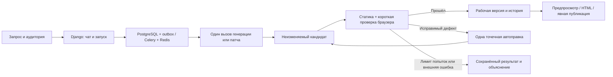

# Архитектура быстрых мини-игр

18 октября 2026 года. **Целевая архитектура; приложение ещё не реализовано.**
Объём задают [требования](requirements.ru.md), порядок — [план](development-plan.md).

## 1. Короткий путь

На исправлении повторная ошибка ведёт в E, а не в бесконечную петлю F.
Нормальное создание и обычная правка — **по одному продуктовому вызову модели**.
Нет отдельных обязательных вызовов спецификатора, планировщика, критика и исследователя.
Модель в одном ответе формирует краткий замысел, визуальный подход, код и небольшие
проверочные сценарии. Ответ не должен содержать длинную исследовательскую переписку.

При невозможном для мини-игры запросе приложение объясняет границу объёма и предлагает
краткий вариант; не сокращает явно запрошенную функцию молча. Не требуется обходиться
одним жанром: правила и механики генерируются, общими остаются инфраструктура и инструменты.

## 2. Стек и границы процессов

- Django/DRF: сессии, права, чаты, сообщения, версии, публикации, запуск и состояния.
- PostgreSQL **18+**: источник истины. Celery/Redis: доставка работы, не хранилище версий.
- React/TypeScript/SCSS: интерфейс по F01–F14, Vite для сборки.
- Model runner: единственная роль с доступом к провайдеру. В локальном режиме — доверенный
  процесс пользователя с Codex-login; в серверном — worker с доступом к vLLM.
- Validation controller передаёт конкретный кандидат в браузерный sandbox. Процесс,
  исполняющий игру, не получает доступ к БД, Redis, кодовой базе платформы и секретам.
- nginx: единая внешняя точка входа с отдельными virtual hosts для приложения и preview.

Одна кодовая база backend, без FastAPI/SQLAlchemy рядом с Django и без собственного
AI HTTP-микросервиса поверх очереди. Контейнерное разделение ролей оправдано изоляцией,
а не стремлением разбить продукт на сервисы. Только образ проверки содержит Chromium.
Browser pool прогрет, но контекст каждой игры чистый; никаких общих cookies/storage.

Миграции и bootstrap администратора выполняются init-командой при запуске, не при сборке
образа. Пароль берётся из runtime environment, не из Dockerfile/ARG. Повторный запуск
не перезаписывает пароль существующей учётной записи. Уникальность username проверяется
на уровне БД по нормализованному регистру, включая одновременные запросы создания.

## 3. Что хранится

| Сущность | Назначение |
| --- | --- |
| User / Preference | Django-пользователь, тема, компактные явные предпочтения качества |
| Chat / Message | Одна игра, её запросы/ответы, владелец и текущая рабочая версия |
| Run | create/edit/repair, базовая версия, состояние, провайдер, attempt, отмена, журнал |
| Invocation | Отправленный запрос, ответ/ошибка, usage, latency, состояние доставки |
| Revision | Неизменяемые исходники, parent, экспорт, hashes, краткая карточка игры |
| CheckReport | Проверенные эффекты, браузерные факты, ошибки и точный hash кандидата |
| Publication | Владелец, публичное название, slug и собственная ссылка на выбранную Revision |
| Like / Feedback | Один лайк пользователя на публикацию; оценка и причины по своему чату |

Сохранённая публикация и ремиксы удерживают артефакт независимо от существования чата.
Удаление чата прекращает его задания, но не каскадно уничтожает опубликованные снимки.
Артефакт удаляется только если на него не осталось ссылок и завершены операции записи.
Финансовые записи сохраняются обезличенно/с минимальными метаданными по политике хранения.

Один активный меняющий запуск на чат. Другие чаты независимы; их лимит одновременности
зависит от провайдера. Два редактирования одной версии не применяются молча друг поверх друга.

## 4. Создание и точечное редактирование

Рабочий формат — небольшой набор обычных HTML/CSS/JS-файлов и необязательный JSON
параметров/уровней. Для первой версии достаточно `index.html`, `styles.css`, `game.js`;
не требовать файл, если он не нужен. Нет обязательного игрового runtime или npm-сборки
на каждую игру. Начальный профиль — обычный Canvas2D; WebGL допустим по запросу.

Результат `create` содержит исходники, название при его отсутствии, краткий замысел,
управление, исход игры и сценарии основных проверок. Имя провайдера не входит в схему игры.
Визуальный подход включает палитру, композицию и обратную связь действий, но не отдельный
многостраничный дизайн-план. Допустимы общие helpers; нельзя выдавать готовую змейку по
условию `genre == snake` вместо генерации.

Результат `edit` содержит `base_revision`, список изменений и ожидаемый эффект.
Первый формат патча — точные замены `{path, old_text, new_text}` с hash исходного файла;
JSON-параметры можно менять по typed path. Каждый `old_text` должен совпасть ровно один раз.
Все изменения сначала проверяются на копии, затем применяются атомарно. Новые локальные
файлы разрешены для запрошенной небольшой функции. Путь вне игры, несовпавшая версия,
неоднозначная замена и незавершённый ответ не применяются.

Нет fallback «патч не получился — перепиши всю игру». Модель получает короткую причину
конфликта и актуальный фрагмент в пределах оставшейся попытки. Не делать fuzzy replace
с риском изменить соседнюю механику. Для простого цвета/размера/скорости сохраняются
байты нетронутых модулей; для двух уровней разрешены изменения данных и связанного кода.
Размер diff измеряется, но не служит универсальным процентным запретом на обоснованную правку.

Упаковщик делает самодостаточный `index.html` из этих файлов. Его пересоздание — обычная
локальная операция, не модельная перегенерация. Проверяется именно экспортируемый HTML;
одни и те же байты используются для preview, скачивания и публикации.

Контекст правки: запрос, краткая карточка игры, текущая версия, актуальные исходники
или связанные фрагменты, последний релевантный результат. Не передавать всю историю
чата и прежние версии на каждом шаге. Для небольшой игры полный текущий код во **входе**
допустим: требование M12 ограничивает ненужную переработку, а не чтение исходника.
Общий prefix стабилен; провайдерская сессия — ускорение, не единственный источник состояния.

## 5. Проверка без возврата к прежней тяжёлой системе

Проверяем каждый новый кандидат один раз. Успех сохраняется по hash артефакта,
версии проверок и профилю среды. Публикация тех же байтов не запускает модель/браузер повторно.

Базовые проверки: корректная упаковка и JavaScript, загрузка без блокирующих ошибок,
локальные ресурсы, содержательная сцена, телефонный viewport, доступность управления,
настоящее действие → ожидаемый эффект и осмысленный конечный исход по правилам игры.
Пошаговая игра не обязана содержать таймер; запрещённый ход может правильно ничего не менять.
Для удержания клавиши проверяются отпускание и потеря фокуса, если такое управление есть.

Модель предлагает короткий план браузерных действий и наблюдений конкретной игры.
Исполнитель использует реальные pointer/touch/key события. Он записывает факты сам;
`passed:true` из HTML, тестового bridge или ответа модели не является вердиктом.
Нельзя заменять проверку клавиатуры внутренним `dispatch`, нажимать вслепую первую кнопку
и считать любое изменение счётчика доказательством исправности.

Наблюдение DOM/состояния допустимо для точных ожиданий. Универсальный `score/phase/lives`
и тестовые кнопки не встраиваются. Тестовая подготовка/seed допустимы, но не должны
подменять реальную механику или задавать успешный исход напрямую. Условия проверки
хранятся с версией игры; малая правка наследует прежние эффекты и добавляет затронутый тест.

Небольшой обязательный smoke-набор выполняется целиком, расширенные сценарии — по
затронутым механикам. Для мини-игры это дешевле отдельного графа зависимостей и нескольких
приёмочных ролей. Заведомо плохие тесты/самоотчёты проверяются отрицательными fixtures
самого генератора. Это повышает достоверность, но не доказывает отсутствие всех ошибок.

Полное прохождение всех уровней не входит в каждую генерацию. Если автоматизация не
подтвердила обязательный эффект, показать конкретное непроверенное условие и дать
проверить его человеку в безопасном preview. Не ставить зелёный статус и не публиковать
как проверенную игру до подтверждения. В отчёте различать автоматическую и ручную проверку.
Такой исход считается неполным автоматическим успехом в метриках, а не скрытым pass.

Обычный дефект возвращается модели одним пакетом с местом ошибки и браузерными фактами.
Если ошибочен сценарий, допускается его локальная коррекция с сохранением требуемого эффекта.
Неудача инфраструктуры возвращается как проблема среды, а не просьба переписать игру.
Общую платформу исправляет команда вне пользовательского задания.

## 6. Сменный провайдер

Общий интерфейс: запрос create/patch, streaming progress, законченный результат,
typed error, usage и cancel. Состояние версий, публикаций и проверок принадлежит приложению.

**Первый адаптер — локальный Codex.** Использовать установленный поддерживаемый интерфейс,
сначала небольшой прототип `codex exec` с JSON events/schema либо App Server, если он
надёжнее закрывает события и отмену. Выбрать один после проверки версии, не писать оба
на всякий случай. Вход выполняется штатным механизмом Codex. Модель не получает доступ
к исходникам генератора, shell/сети с правами хоста или приватным данным других проектов.
Предпочтителен режим получения структурированного ответа без исполнения инструментов;
ограничения должны обеспечиваться конфигурацией/изоляцией, а не просьбой в промпте.

Один продуктовый вызов Codex может включать внутренние модельные ходы: наблюдать их,
измерять usage/время и не заявлять без доказательств «один inference». Отсутствие нужного
контроля — результат проверки адаптера, а не повод включать unrestricted shell.
Этот режим только для доверенного локального испытания; аккаунт не превращается
в публичный общий сервис. Авторизация Codex не копируется в frontend, Git и Docker images.
Локальный профиль слушает loopback; внешний запуск генераций через эту подписку закрыт.
Серверное размещение с доступом пользователей включает API-провайдер, а не личный Codex-login.

**Второй адаптер — vLLM на отдельном сервере.** Настраиваются base URL, model, ключ при
наличии и параметры фактически установленной модели. Базовый контракт можно реализовать
через Chat Completions; доступность streaming/schema/usage/cancel проверяется на реальном
endpoint. Совместимость с OpenAI по названию не гарантирует одинаковые функции и качество.
При отсутствии schema-режима допустим валидируемый JSON-ответ с явным ограничением возможностей.
Не требовать Responses API, CLI tools, vision и vendor-specific reasoning от любой модели.

Проверено по [OpenAI Docs: вход](https://learn.chatgpt.com/docs/auth) и
[неинтерактивный режим](https://learn.chatgpt.com/docs/non-interactive-mode): CLI умеет
использовать сохранённую авторизацию, JSON events и schema результата. Это не проверка
установленного адаптера. Возможности API vLLM описаны в
[официальной документации](https://docs.vllm.ai/en/stable/serving/online_serving/);
конкретная конфигурация сервера команды пока неизвестна.

## 7. Быстродействие, ошибки и учёт

По умолчанию один create/patch и не более одного автоматического исправления результата
или его формата. Внутренние SDK retries не должны скрыто умножать этот цикл. Безопасный
повтор до отправки и неоднозначный обрыв после отправки различаются.
После исчерпания автопопытки — сохранить кандидат, причину и последнюю рабочую версию;
явное «Продолжить исправление» использует их, не начинает генерацию заново.

Цели времени — сигнал качества, не общий kill-таймер. Отмена доступна всегда.
После cancel новый вызов не отправляется, поздний ответ не меняет выбранную версию.
Сетевые дедлайны/idle watchdog защищают от зависших операций, а не обрывают игру
ровно через целевое время. Для очереди показываются очередь, фактический этап и задержка.

PostgreSQL фиксирует запуск и outbox в одной транзакции. Celery получает ID, а не исходники
и секреты. Захват имеет lease/fence; повторы доставки не создают второй результат.
Подтверждённый ответ сохраняется до перехода; неизвестный исход вызова требует сверки.
Нельзя обещать exactly-once для внешней модели без подтверждения от транспорта.

Журнал связывает chat/run/invocation/revision, этапы, версии prompt/model, время, patch size,
findings и расход. Приватный пакет диагностики хранит точный запрос, ответ, diff и screenshots
с ограниченным доступом. Обычная телеметрия — без исходников и секретов.
Input, cached input и output учитываются раздельно; отсутствующий usage — unknown, не ноль.
API-эквивалент для подписки — оценка, не списание; у локальной модели может не быть цены.
Если включён денежный предел, допуск и резерв считаются приложением; неизвестный расход
не освобождается как «точно не потрачен». Предыдущая сложная ledger-система не переносится целиком.

## 8. UI, публикации и безопасность

Корневой `/` зависит от авторизации: лендинг или лента. Маршруты чата и просмотра
не требуют `/app`/`/studio`; API может иметь собственный `/api/`.
Сессия HttpOnly/Secure, CSRF на мутации, проверка владельца каждого приватного объекта.
Fullscreen — управление оболочки с доступным выходом; не обязательная кнопка внутри игры.
Макет телефона — оформление, а не доказательство WebView-совместимости.

Feed доступен авторизованным пользователям, как в F. Внешний просмотр опубликованной
игры по ссылке — отдельная read-only поверхность без приватного чата. Публикация всегда
явная; новая рабочая версия не заменяет public revision без «Обновить».
Ремикс копирует опубликованный снимок, а не последнюю неопубликованную работу автора.
Лайк имеет уникальность `(user, publication)` и безопасен при повторе запроса.

В ленте статичная миниатюра заменяется живым preview только при наведении/явном действии;
число одновременно работающих игр ограничено, потеря видимости освобождает контекст.
На touch — кнопка «Попробовать», без зависимости от hover. Автозвук не включается.
Скрытие preview останавливает его активную работу, но не должно стирать прогресс
играющего пользователя при обычном сворачивании панели; сценарии карточки и активной игры различаются.

Sandbox игры: без сети и внутренних адресов, cookies, секретов, небезопасных mounts,
доступа к Docker socket, навигации верхнего окна, downloads и permissions. Preview origin
не получает cookie домена приложения. CSP/iframe и контейнерные ограничения дополняют друг
друга. Regex не является защитой. При optional `postMessage` проверять окно-источник,
идентичность версии, схему и лимиты; не доверять произвольному сообщению от игры.

Отчёты/оценки пользователя влияют на компактный preference context следующих генераций.
Они не переобучают модель и не запускают новый запрос автоматически. Предпочтения доступны
для изменения/сброса и не имеют приоритета над текущим явным запросом.
