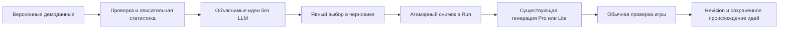

# Аналитика игр и рекомендации для генерации

Статус: **первый выпуск реализован в `feature/game-analytics`**, флаг по умолчанию
выключен. [Результаты проверки и включение](game-analytics-implementation.ru.md).
Основание — запрос владельца
13.11.2026, бонусный пункт 2 в Keys_Bilayn.pdf и §14 сохранённой встречи.
Реализация основана на main@d2a70fd. Документ не разрешает платные испытания
или выкладку. Будущий сбор реальных событий в первый выпуск не входит.

## 1. Результат и границы первого выпуска

Создатель видит, как играли в сопоставимые мини-игры для выбранной аудитории,
выбирает до двух объяснимых идей и учитывает их при создании **одной новой игры**.
Потом можно установить, какие данные и советы действительно попали в запрос модели.

Первый выпуск работает с явно обозначенными демонстрационными данными. Такие
данные разрешены в §14 встречи, но PDF сам по себе этого уточнения не содержит.
В интерфейсе, API, снимках и передаваемом модели контексте сохраняется source=demo.
Демо показывает работу продуктового контура, а не доказательство поведения клиентов.

В выпуск входят: небольшой набор данных, проверка его целостности, статистика,
детерминированные рекомендации, выбор в черновике и неизменный контекст Run/Revision.
В Django остаются вся логика и PostgreSQL-хранение; интерфейс — React/TS/SCSS.
Новых сервисов, языков, фоновых задач и модельных этапов не требуется.

Автоматический сбор действий игроков, A/B-эксперименты, обучение модели и персональные
профили игроков в этот выпуск не входят. Отзывы автора и лайки не превращаются
в число сыгранных партий. Статистика успешных генераций остаётся отдельной метрикой.
Общие пожелания Preference.notes не меняются при выборе рекомендации.

## 2. Пользовательский путь

1. В новом чате пользователь выбирает аудиторию обычным существующим способом.
2. Открывает необязательный блок «Что подсказывают данные». Показаны источник,
   период, объём наблюдений и компактное сравнение механик.
3. Читает совет и основание, например: «В демонстрационных данных для этой
   аудитории короткие раунды чаще доходят до конца. Можно попробовать короткую
   партию с одной ясной целью». Рядом — обе сравниваемые доли и числа наблюдений.
4. Нажимает «Учесть в новой игре». Совет появляется отдельной удаляемой карточкой
   рядом с запросом. Кнопка не вызывает модель и не создаёт Run.
5. При обычной отправке запроса приложение проверяет выбор и сохраняет снимок
   вместе с Run. Число модельных этапов не увеличивается.
6. В истории видны выбранные идеи, их основание и фактический этап передачи.
   Сохранение выбора не выдаётся за отправку, а ответ модели — за реализацию идеи.

Менять аудиторию при выбранных идеях можно: выбор очищается с пояснением,
текст запроса сохраняется. Смена Pro/Lite сохраняет идеи. Правка текста не запускает
скрытый анализ и не снимает выбор: совместимость с явным запросом важнее совета.
Для редактирования существующей игры блок выбора отсутствует; прежний контекст
доступен только для чтения. Новая аналитическая идея не расширяет локальную правку.



## 3. Данные и определения метрик

Единица наблюдения — закрытая игровая сессия с первым начатым раундом. Старт
означает настоящее начало игры, а не просмотр карточки или загрузку iframe.
Конец первого раунда — штатная победа либо поражение; выход до исхода не считается
завершением. Завершение не равно победе и само по себе не доказывает удовольствие.

Каждая строка набора описывает одну версию вымышленной игры и одну когорту:

| Поле | Значение |
| --- | --- |
| case_id | Уникальный ID демонстрационного случая; не UUID реальной Revision |
| family_id | Семейство сопоставимых случаев; варианты одной игры не считаются разными семействами |
| audience | Один ID из generation/audiences.py |
| mechanic | Небольшая метка для анализа: collection, matching, logic, reaction и т. п. |
| device / input | В v1 только mobile / touch; нельзя объединять с desktop/keyboard |
| round_style | short или standard; это свойство сравнения, не вывод по длительности сессии |
| started | Число сессий, в которых начался первый раунд |
| finished | Сессии со штатным завершением первого раунда |
| replayed | Сессии, где после его завершения действительно начат второй раунд |
| duration_observed | Сессии с доступным измерением активного времени первого раунда |
| active_ms_sum | Сумма этого времени до исхода либо выхода; фон и пауза исключены |

Метрики рассчитываются из целых исходных счётчиков:

- Доля завершений = finished / started.
- Доля повторов = replayed / started. В UI явно подписан знаменатель; это не
  replayed / finished и не возврат пользователя на следующий день.
- Среднее активное время = active_ms_sum / duration_observed. Отсутствующее
  измерение не становится нулём. Это не медиана и не показатель «чем дольше, тем лучше».

При started=0 доли равны null, при duration_observed=0 среднее равно null.
Сводные доли строятся через суммы счётчиков, а не среднее процентов строк.
Проценты округляются только для показа до одного знака; сравнения используют
точные целые отношения. Разность долей показывается в процентных пунктах.

Инварианты импорта: строгие целые числа, не bool; 0 <= started <= 1000000;
0 <= replayed <= finished <= started;
0 <= duration_observed <= started; при нулевом duration_observed сумма равна нулю;
0 <= active_ms_sum <= duration_observed * 900000. Ограничение 15 минут — граница
демонабора v1, а не таймер игры. Строки с нарушениями отклоняются целиком.

У набора один период [period_start, period_end) и as_of в UTC, as_of >= period_end.
Незакрытые наблюдения в него не входят. Период вымышленный и явно обозначается;
даты не передвигаются при каждом открытии страницы. Максимум 128 строк и 128 КиБ
канонического JSON. Все ID, enum и уникальность case_id валидируются.
case_id/family_id имеют длину 1–64 и ограниченный алфавит [a-z0-9_-],
название набора — не более 120 символов. Произвольный текст не становится советом.

Метка mechanic — агрегирующий признак для аналитики, а не каталог готовых игр.
Она не выбирает исходники и не подменяет LLM. В наборе нет промптов, кода игр,
готовых ассетов, username, IP, cookie или идентификаторов реальных игроков.

## 4. Рекомендации v1: прозрачные правила

Расчёт выполняет чистая функция Django-кода, без модели и внешних запросов.
Версия recommendation_policy=1 закрепляет пороги, группировки и шаблоны объяснений.

1. Использовать только выбранную audience, один источник, один период и mobile/touch.
   Не подставлять «everyone» за отсутствующие данные другой аудитории.
2. Отдельно сравнивать mechanic при одинаковом round_style и short/standard
   при одинаковой mechanic. Несопоставимые строки показывать без совета.
   Для кандидата mechanic базовая группа — все остальные механики этой когорты,
   а не специально выбранная худшая. Для round_style база всегда standard.
   Название базы и её состав входят в объяснение и ID идеи.
3. Каждая сторона сравнения должна иметь >=100 started, >=3 family_id и >=30 started
   в каждом участвующем семействе. Одно семейство не даёт более 50% started стороны.
   Два сравниваемых набора case_id не пересекаются.
4. Идея механики появляется при разнице завершений >=10 п. п. и повторов >=5 п. п.
   Идея короткого раунда — при разнице завершений >=10 п. п. и отсутствии снижения
   повторов. Встречное направление не превращать в совет «ускорить игру».
5. Показать максимум две идеи. Сортировка: разница завершений, затем повторов,
   затем число семейств, затем стабильный ID. Одновременно не выдавать несколько
   взаимоисключающих вариантов механики либо два варианта одного свойства.
   Если выбраны идея механики и идея темпа, их область mechanic должна совпадать.
6. При нехватке поддержки или отсутствии заметной разницы вернуть объяснимое
   состояние без рекомендаций. Обычная генерация остаётся доступной.

Пороги — проверяемая продуктовая эвристика для демонстрации, не статистическая
гарантия. Проценты из демоданных не имеют доказанной значимости. Даже реальные
наблюдательные данные не позволяют приписать разницу одной механике: различаются
сложность, оформление и игроки. Не использовать «доказано лучше», «повысит удержание»
или «95% уверенности». Для статистических выводов по будущим независимым наблюдениям
нужен отдельный протокол; метод интервалов долей описан у
[NIST](https://www.itl.nist.gov/div898/handbook/prc/section2/prc241.htm).

Совет о механике формулируется условно: «Если это подходит вашей задумке, рассмотрите
сопоставление объектов». Запрос «сделай змейку» не заменяется карточной памятью.
Безопасность или доступность не ухудшаются ради процента повторов. Сама рекомендация
не становится обязательной проверкой и не разрешает ремонт исходников.

Пример проверки арифметики: short — started=240, finished=186, replayed=85;
standard — 240, 141, 46. Доли завершений: 77,5% / 58,8%; повторов: 35,4% / 19,2%.
Разницы: 18,75 и 16,25 п. п. Для совета ещё нужны сведения о трёх семействах
и ограничении вклада; одних этих сумм недостаточно.

## 5. Хранение: одна таблица и два поля снимка

Модель AnalyticsDataset в studio/models.py:

| Поле | Назначение |
| --- | --- |
| id | UUID |
| key, version | Имя набора и положительная версия; совместная уникальность |
| source | В v1 только demo; значение задаёт сервер |
| schema_version | 1 |
| payload | Проверенные metadata и rows, JSONField |
| payload_hash | SHA-256 канонического JSON без самого hash; уникальный |
| enabled | Набор разрешён для нового выбора |
| created_at | Время импорта |

Один enabled-набор на key обеспечивается условным UniqueConstraint; version>0
и source=demo — CheckConstraint. Ограничения моделей описаны в
[Django 5.2](https://docs.djangoproject.com/en/5.2/ref/models/constraints/).
Содержимое версии не редактируется через API/admin. Новый контент — новая версия.
enabled — операционный признак, он не входит в payload_hash.

Добавляются Run.analytics_snapshot и Revision.analytics_snapshot: JSONField,
default=dict. Исторические строки получают {}, статистика для них не выдумывается.
Снимок содержит source, dataset_id/hash/version, policy_version, audience, выбранные
ID, числовое основание, точные советы и готовую ограниченную проекцию для модели.
snapshot_hash считается без поля snapshot_hash. Максимальный размер — 8 КиБ.
Для hash используется существующий generation.requirements.digest; вариант
сериализации закрепляется schema_version, клиент самостоятельно hash не вычисляет.

Обязательная форма снимка v1: version=1; source=demo; dataset_id, dataset_hash,
dataset_version, period_start/period_end/as_of; policy_version; audience;
recommendations[]; model_context; snapshot_hash. В recommendations сохраняются
id, rule_id, область mechanic/round_style, advice и evidence с исходными
счётчиками candidate/baseline, числом семейств, максимальным вкладом семейства,
фильтрами групп и digest отсортированных case_id. Полный список строк не копируется:
он восстанавливается по сохранённым dataset_hash и фильтрам. model_context — готовая строка с
пометкой демоданных, а не указание пересчитать её при отправке. Текущие часы и
случайные поля в digest не входят: одинаковые данные и выбор дают одинаковый hash.

При store_candidate снимок копируется из Run. Edit наследует его из выбранной
source_revision, продолжение — из continued_from, recheck — из Revision.
Это важно для ремикса: у скопированной Revision может не быть собственного Run.
Ремикс сохраняет demo-снимок без раскрытия чужого чата. В публичные карточки полная
диагностика Run не добавляется. Будущие приватные реальные данные нельзя начать
копировать таким способом без отдельного решения о правах и обезличивании.

Отдельная таблица «нажатий применить», очередь и состояние персональных рекомендаций
не нужны: намерение хранит черновик, закреплённый выбор — Run, отправку/ответ —
уже существующая Invocation. Сохраняется привязка к её точному request.
Унаследованный снимок хранит происхождение первоначального создания; он не означает,
что старая идея снова применяется при каждой правке. Проекцию для модели получают
только plan/create с совпадающей audience. Edit/repair/check_repair сохраняют снимок
для аудита и идентичности, но не получают список идей как новую задачу. При смене
аудитории исходное основание остаётся в истории с пометкой «к этой правке не применялось».

## 6. API и идемпотентность

GET /api/analytics/summary/?audience=seniors доступен вошедшим пользователям.
Он возвращает dataset с source/периодом/hash, группы со счётчиками и долями,
recommendations с основанием и data_status=ready/insufficient_data/empty.
При ready список идей тоже может быть пустым: различия недостаточны.

ID идеи — digest(policy_version, dataset_hash, audience, rule_id, candidate_group,
baseline_group, advice, evidence). Текст и числовое основание тоже закреплены:
изменение формулировки не может молча заменить выбранный совет.
API возвращает ID, сервер пересчитывает его при создании Run.
Нет отдельного платного или мутирующего POST «применить».

POST /api/chats/:id/runs/ расширяется необязательным полем:

```json
{
  "analytics_selection": {
    "dataset_id": "df149209-dabb-4ff6-bd93-2837016d8ab2",
    "dataset_hash": "aaaaaaaaaaaaaaaaaaaaaaaaaaaaaaaaaaaaaaaaaaaaaaaaaaaaaaaaaaaaaaaa",
    "policy_version": 1,
    "recommendation_ids": ["bbbbbbbbbbbbbbbbbbbbbbbbbbbbbbbbbbbbbbbbbbbbbbbbbbbbbbbbbbbbbbbb"]
  }
}
```

Это фрагмент обычного запроса с prompt/audience/idempotency_key. Клиент не присылает
текст совета, source или метрики. Неизвестные поля выбора отклоняются. UUID/hash
и policy_version проверяются, IDs уникальны, от одного до двух; порядок IDs несущественен.
Отсутствующее поле и null означают отсутствие выбора. Поле добавляется в fingerprint
только при непустом выборе, чтобы не менять идентичность старых запросов.

Порядок обработки в create_run:

1. Существующие проверки владельца, chat и ключа; нормализовать форму выбора.
2. Если Run с этим ключом уже существует — сравнить нормализованный запрос с его
   исходным fingerprint и вернуть прежний Run. **До проверки актуальности набора.**
   Отзыв набора или новая policy не превращают повтор после потери HTTP в новый расход.
3. Для нового Run выполнить прежние проверки базы/активного задания. Непустой новый
   выбор допускается только для create без source_revision и continued_from.
4. Заблокировать строку точного enabled AnalyticsDataset внутри текущей транзакции;
   проверить key, hash, политику, audience, целостность и пересчитать выбранные идеи.
5. Сформировать снимок только из серверных данных. Run, снимок и существующий outbox
   сохраняются атомарно; задача отправляется существующим on_commit после фиксации.

Согласованность транзакции и отложенных действий соответствует
[механизму Django atomic/on_commit](https://docs.djangoproject.com/en/5.2/topics/db/transactions/).
Не держать блокировку набора во время модели/браузера. Расчёт ограничен размером JSON.
Импорт набора не блокирует Chat/Run и не вводит обратный порядок блокировок.

Ошибки: 400 invalid_analytics_selection для формы/запрещённой операции;
409 analytics_selection_stale для отозванного/изменённого набора, другой audience
или исчезнувшей идеи; 409 idempotency_conflict для другого выбора под прежним ключом.
Действует существующая сессионная авторизация/CSRF; гостю доступ не выдаётся.
Capability analytics.available управляет показом блока. При выключенном флаге GET
возвращает 404 analytics_disabled, при повреждении/недоступности набора — 503
analytics_unavailable; оба состояния имеют понятное необязательное UI-представление.
При сбое аналитики без выбранных идей генерация работает. При сбое проверки уже
выбранных идей запрос отклоняется до Run/Invocation: пользователь может обновить
данные либо явно убрать выбор. Нельзя молча удалить выбранный контекст.

## 7. Интеграция с генерацией и восстановлением

Run.analytics_snapshot копируется в сохраняемый request Invocation под тем же именем.
Ни один повторный вход не перечитывает актуальную аналитику для старого Run.
Для LLM строится только model_context: source=demo, выбранная аудитория, до двух
коротких советов и основание. Лимит всей проекции — 1600 символов; валидатор набора
проверяет худшую допустимую пару, включая предел полного снимка 8 КиБ. Текст одного
совета ограничен 350 символами. Набор, из которого допустимый выбор не помещается
в лимиты, нельзя активировать. Совет не обрезается молча для попадания в лимит.

Точки интеграции:

| Участок | Изменение |
| --- | --- |
| studio/services.py:create_run | Проверка выбора, fingerprint, снимок и наследование |
| studio/tasks.py:request_for/store_candidate | Передача сохранённого снимка и копирование в Revision |
| generation/prompts.py:build_messages | Добавить отдельную analytics-проекцию только при непустом снимке |
| generation/prompts.py:system_prompt | Общая обёртка добавляет ограниченную инструкцию Pro/compact и восстановленному full Lite |
| generation/analytics.py:model_context | Только plan/create совпадающей аудитории; edit/repair/check_repair без новой аналитической задачи |
| studio/response_completion.py:CONTEXT | Включить analytics_snapshot в точное сравнение дозавершения |
| generation/requirements.py:policy_snapshot | Учесть новый код интерпретации/проекции, но не текущий активный набор данных |
| studio/views.py:remix_view и serialization.py | Сохранение demo-снимка и ограниченное отображение истории |

generation/lite_baseline.py остаётся неизменным: новые инструкции добавляются через
существующую обёртку Lite. Full Lite по-прежнему создаёт игру напрямую, затем вызывает
свой отдельный музыкальный этап. Аналитика не становится новым этапом. Музыка получает
прежние запрос/аудиторию/пожелания; игровые советы не дают ей права менять механику.

Приоритет: явный текущий запрос/правка → совместимые пожелания аккаунта → выбранные
идеи аналитики → свободные решения модели. Идеи не становятся «словами пользователя».
В Pro planning 2 их реализация при необходимости описывается как origin=design,
quote=""; источник analytics сохраняет приложение. Не расширять enum планировщика
и не добавлять обязательный ответ модели с отчётом «совет выполнен».

Repair сохраняет прежние requirements/checks. Check_repair исправляет только проверки;
аналитика не обосновывает изменение требований или source repair. Для коррекции
кода и сценариев снимок нужен как происхождение, а не новый список задач.
Контракт игры v9, runtime, число вызовов и gates принятия не меняются.

Для снимка {} не добавлять пустые поля/инструкции в messages. Старые Invocation.request,
raw_response, usage и резервы не переписываются. Получение sent receipt имеет прежний
приоритет. Изменение кода policy_snapshot при выпуске может блокировать **новые**
шаги старого Run по существующим правилам; аналитика не обходит эту проверку и не
обещает автоматической совместимости старых сохранённых политик.
При сравнении контекста дозавершения отсутствие нового поля и {} эквивалентны;
adopt_completion_policy не должен материализовать пустое поле в старом запросе.
Непустой снимок сравнивается целиком: другой dataset/hash/выбор не разрешает
присоединить оплаченный фрагмент к новому контексту.

## 8. Интерфейс и отказоустойчивость

Один раскрываемый блок в новом Studio, без нового пункта основной навигации в v1.
Таблица сравнения лучше большого dashboard: механика/завершения/повторы/время/n.
Подпись «Демонстрационные данные» закреплена при прокрутке панели; период, объём и смысл
метрик доступны в раскрытом блоке. Широкая таблица
имеет доступное компактное представление на телефоне. Цвет не единственный индикатор.

StudioDraft расширяется типизированным analyticsSelection и копией карточек только
для отображения. Сервер не доверяет этим карточкам. Выбор входит в operationKey,
lastPayload и существующий механизм предотвращения двойной отправки.
Назад/вперёд сохраняет его так же, как текущий черновик; сохранение после перезагрузки
не обещается сверх уже существующего механизма хранения StudioDraft.

Ответ GET для прежней audience игнорируется после её смены или перехода в другой чат.
Загрузка/сбой блока не блокирует кнопку создания без выбора. При HTTP-ошибке создания
сохраняются запрос, идеи и уже созданный chat_id; повтор не создаёт второй пустой чат.
При неоднозначном исходе сначала восстанавливается существующий Run по прежнему ключу.
Смена выбора после известного отказа формирует новый ключ; автоматического повтора модели нет.

История различает выбор в Run, подготовленный request, отправку и полученный ответ.
Для sent/unknown нельзя утверждать подтверждённую доставку. Состояния выводятся
из существующих Invocation, а не сохраняются вторым автоматом аналитики. У каждой
соответствующей plan/create Invocation проверяется её собственная analytics-проекция.
Реализация идеи отдельно не подтверждена, пока нет независимой приёмки.
Зелёный статус «совет реализован» из текста модели не выводится.
При отключении блока старые снимки доступны в истории как происхождение результата.
Флаг ограничивает новые выборы. Worker продолжает использовать уже закреплённый
снимок для plan/create без чтения флага и активного набора; остановка такого Run
выполняется обычной отменой, а не скрытым изменением контекста.

## 9. Безопасность, источники и будущая реальная статистика

Первый набор общий и вымышленный, доступен вошедшим пользователям только на чтение.
У пользователя нет HTTP-импорта, редактирования статистики или доступа к чужим Run.
Тексты рекомендаций строятся из серверных шаблонов и enum; нет свободных инструкций
из загруженной статистики. Логи содержат ID/hash и коды ошибок, а не промпты/пожелания.

Публичный HTML и iframe не получают сетевых разрешений, ключей, трекеров или новых
обязательных bridge. Снимок хранится в платформе, не в игровых исходниках. Установленный
экспорт продолжает работать offline; посещение/экспорт не увеличивают демосчётчики.
Автотесты валидатора никогда не считаются реальными игроками.

Будущий сбор реальных событий — отдельный срез после демонстрации. Он потребует
привязки к точной версии, дедупликации событий/сессий, завершения наблюдательного окна,
исключения тестов, явных прав на агрегаты и защиты от накрутки. Сообщение игрового JS
остаётся недоверенным наблюдением, не доказательством победы. Транспорт должен
оставаться в оболочке платформы; генератору нельзя открывать сеть ради аналитики.
source=real не вводится простым переключением флага и не смешивается с source=demo.
До этого выпуска нельзя показывать «статистика наших игроков» или реальное удержание.

## 10. Поставка и критерии приёмки

Feature flag GAMEFORGE_ANALYTICS_ENABLED по умолчанию выключен. Миграция добавляет
AnalyticsDataset и два JSON-поля без изменений старых артефактов: миграция 0025_game_analytics.
API читает единственный enabled-набор с key=hackathon-demo; выбор другого key
клиентом не допускается. При отсутствии набора возвращается empty, без автоимпорта.

Демонабор лежит в studio/data, версия и provenance заданы явно. Команда
load_demo_analytics импортирует его атомарно и идемпотентно: тот же key/version/hash
не дублируется, другой hash под прежней версией отклоняется. Новая версия отключает
прежнюю для **новых** выборов, но не меняет сохранённые Run/Revision. Конкурентные
импорты защищены уникальностью и транзакцией, без частично активированных наборов.
Автоматического наполнения production через миграцию или сетевой загрузки нет.

Файлы реализации: studio/analytics.py (валидация, агрегаты, идеи и снимок),
studio/analytics_views.py (read API), generation/analytics.py (проекция и инструкция),
команда импорта, один компонент AnalyticsSuggestions.tsx и типы. Это функции внутри
существующего приложения, без новых репозиториев или универсального rule engine.

Проверки реализации должны доказывать поведение:

| Группа | Обязательные случаи |
| --- | --- |
| Данные | Нули/null, неверные bool/числа, отрицания, replay>finish, дубли ID, неизвестная audience, hash/размер, импорт дважды и конкурентно |
| Метрики | Взвешенные суммы вместо средних процентов; разные знаменатели времени/повторов; корректные п. п. и округление |
| Идеи | Границы поддержки/вклад одного семейства; несопоставимые когорты; нет разницы — нет совета; стабильные ID и сортировка; максимум два совместимых совета |
| API | Гость/CSRF, подмена текста/счётчиков, чужой чат, stale hash/policy/audience, feature off, отказ до Invocation/outbox |
| Идемпотентность | Потеря HTTP после commit; повтор после смены/отзыва набора; другой выбор под тем же ключом; смена порядка ID; две вкладки |
| Наследование | Edit выбранного draft, resume, recheck, restart worker, сохранённый receipt, дозавершение, ремикс и удаление исходного чата |
| Провайдеры | Pro plan/create/repair, full Lite create/edit, compact; снимок {} не меняет messages; дополнительные Invocation не появляются |
| UI | Смена audience при медленном ответе, удаление идеи, переключение Pro/Lite, ошибка POST и возврат черновика, недублируемый chat_id, доступность на 320/390/1440 px |
| Изоляция | Экспорт без трекеров/новых сетевых разрешений; отсутствие вызова LLM при GET/выборе/снятии идеи; прежние gates и запрет source repair по статистике |

Локальные функциональные прогоны используют fake/имитаторы; регрессии — существующие
Ruff/mypy/Django checks, полный backend без browser/live, frontend lint/tests/build.
Проектные цели, требующие измерения: GET p95 <=200 мс на прогретом локальном стенде
для 128 строк и 10 параллельных читателей; дополнительный контекст <=1600 символов;
дополнительные модельные вызовы = 0. Это цели приёмки, а не текущие результаты.
Здесь ноль означает отсутствие новых обязательных модельных операций. Фактические
ремонты и их расход зависят от результата модели и измеряются отдельно.

Доказательство влияния состоит из двух частей: тест подтверждает точный снимок
в реально отправленном request; независимое проигрывание подтверждает изменение
игры. Первое не заменяет второе. Живой сравнительный пилот проводится только при
новом согласованном бюджете, с теми же запросами и фиксированными критериями;
без него качество следования рекомендациям остаётся неизмеренным.

Срез A (первый день): сквозной набор → API → выбор → снимок → один путь fake,
плюс арифметика, права и идемпотентность. Срез B (второй день): все пути Pro/Lite,
наследование/ремикс, мобильный UI и регрессии. Расписание — оценка объёма, не гарантия.
Не включать флаг, если идемпотентность, сохранение выбора или восстановление не прошли.

Демонстрация готовности: выбрать аудиторию → показать подписанные демометрики →
применить идею → создать новую игру → открыть сохранённое основание → независимо
проверить соответствующий эффект → показать точечную правку и автономный экспорт.
