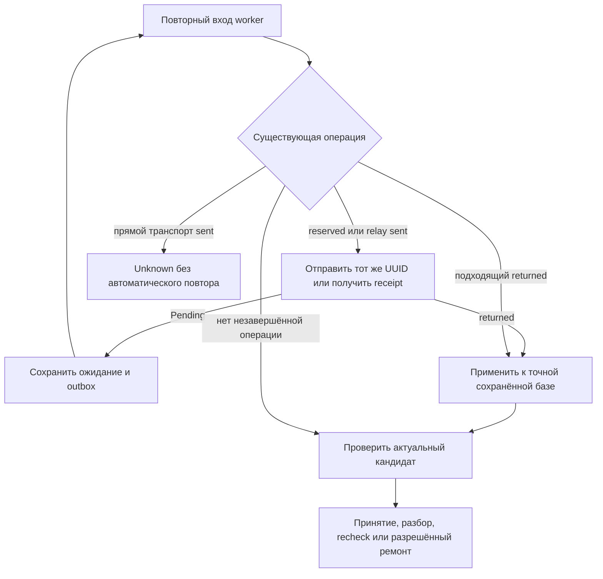

# Первая поставка исправлений харнеса v7

24 октября 2026. S0–S5 из [плана для Sol 6.1](sol61-harness-execution-plan.ru.md)
реализованы. После независимого ревью исправлены четыре замечания; результаты
повторной проверки приведены в конце документа. Компактная генерация второй
поставки не включалась. Модельных вызовов — **0**.

## Исходная точка и границы diff

HEAD в начале: `9a4bc9da0e8fa45dc0d7f3cf3062dca93e4ec7f2`. Прежний v5/v6 уже содержал
большой незакоммиченный diff. Исходные копии 170 файлов и их hash сохранены приватно:
`.data/harness-v7-s0-20261024/manifest.json`, каталог `files/` рядом.

Ревьюировать изменения этой поставки относительно этих копий. Приватные
`changed-files.json` и `changes.patch` рядом содержат список и diff; полный git diff
относительно HEAD включает прежние поставки и не является diff этой работы.

Основные изменённые файлы:

- `studio/tasks.py`, `services.py`, `acceptance.py`, `check_repair.py` — порядок обработки,
  завершение, классификация и выдача разрешения ремонта.
- `generation/schema.py`, `artifacts.py`, `prompts.py`, `feedback.py`, новый
  `generation/code_repair.py` — v7, сохранение неполного checks и диагностика.
- `validation/runner.py`, `service.py`, `checks.py`, `contracts.py`, новые
  `validation/evidence.py`, `diagnostics.py` — независимые свидетельства и их проверка.
- Новые `tests/test_code_repair_v7.py`, `test_artifact_evidence.py`,
  `test_game_regressions.py`, `studio/tests/test_harness_v7.py` и синтетические HTML
  в `tests/fixtures/game_validation/`; дополнены relay/validation/feedback регрессии.
- Существующие тесты скорректированы для новой версии, состава implementation_hash и
  фактических свидетельств обязательных gates в имитаторе.

Адаптеры Codex, relay и vLLM, `scripts/live_eval.py` равны исходным копиям по SHA256.
GPU, конфигурация модели и авторизация не менялись. Рабочая БД и закрытые Run пилота
не изменялись. Для Django-тестов использовалась отдельная локальная тестовая БД.

## S0 Воспроизведение

Исходный целевой набор: **74 passed, 4 deselected**. Первый ограниченный запуск не
имел доступа к сокету локального PostgreSQL; после предоставления локального доступа
тот же набор прошёл. Эти ошибки окружения не считались дефектами приложения.

Новая регрессия прямого check_repair показала преждевременное конечное состояние при
sent Invocation. При разработке варианта продолжения сначала исправлена ошибка самой
тестовой настройки: max_model_calls является свойством, задаётся model_call_limit.
Синтаксическая регрессия на настоящем native-validator показала unverified вместо
javascript_syntax при пустых checks. Сохранены приватные red-логи
`.data/harness-v7-red-s1.log` и `harness-v7-red-s2.log`.

## S1 Завершение существующей операции

`_execute` до оценки старого кандидата выбирает существующую reserved/sent Invocation.
При её наличии ветвь оценки старого отчёта пропускается, используется сохранённый запрос.
Pending снова откладывает Run. Полученный returned применяется к своей базе, затем
проверяется новый кандидат. UUID, запрос и число inference не меняются от опроса.



`finish_run` не разрешает обычное завершение при reserved/sent, а успешное/ручное
завершение — также при неприменённом returned. Защита выполняется под существующими
блокировками и fence. Поздний ответ может сохранить receipt/usage, но не заменить
результат устаревшего исполнителя. Старый неподходящий returned текущего Run отмечается
обработанным с stale_revision без применения к более новой базе.

Истёкший срок и исчерпанный лимит запрещают новые отправки, но не получение уже
отправленного relay receipt. Для прямого транспорта sent после повторного входа
сохраняется unknown; повторный inference автоматически не выполняется.

**Уточнение обработки аварий:** неожиданная ошибка упаковки/хранения после получения
ответа сохраняет failed Run с returned. Явное продолжение применяет этот ответ без
нового вызова. Это сохраняет прежнее проверенное поведение и не создаёт бесконечного
автоматического повтора постоянной ошибки упаковщика. Обычное завершение по старому
игровому отчёту таким исключением не является.

## S2 Независимые gates и разрешение ремонта

Проверка hash/ограничений входа предшествует исполнению. Затем выполняется синтаксис,
после него загрузка и поверхность. Отсутствие start/control/outcome и повторные ID
отмечаются incomplete_checks, но не скрывают ошибку JavaScript.

`artifact_evidence` версии 1 содержит hash, environment, результат синтаксиса/число
скриптов и свидетельства по mobile 390×844 и desktop 1280×800: загрузка, ошибки,
запрещённые запросы и геометрия поверхностей. Сценарные контексты используются повторно;
только для непокрытого viewport добавляется короткая проверка. После исправления R1
она может повторить ввод уже успешного сценария; придуманного нажатия Start нет.
Повтор даёт только обязательное свидетельство артефакта, не новый игровой pass.
Отсутствие Canvas в такой начальной проверке означает недостаток свидетельства:
заставка может создавать Canvas лишь после Start. Это не разрешение переписать код.

Контроллер сверяет envelope и gates. Для полного passed дополнительно нужны факты
сценариев с точной идентичностью требований и выполненными действиями. Положительные
gates при неполном checks не дают автоматического принятия и не открывают ручное
подтверждение пустого/неполного списка требований. Обновлённый implementation_hash
включает оба новых исполняемых модуля; старые отчёты не используются как актуальные.

Неоднозначный effect_mismatch/timeout относится к разбору сценария. Исчерпание
check_repair не превращает его в доказанную ошибку кода. Реальные syntax/runtime
ошибки имеют приоритет перед дефектом селектора; инфраструктурная ошибка требует recheck.
Пересмотренные моделью сценарии сохраняют обязательное явное подтверждение.

### Code repair basis

Новые первые запросы используют контракт v7. Явно сохранена поддержка v2–v6, включая
v6 при увеличении CONTRACT_VERSION. Старые запросы не переписываются новой схемой.

`studio/check_repair.code_repair_basis` выдаёт разрешение только по последнему
актуальному отчёту и его независимому свидетельству. В разрешении сохранены
base_revision, artifact_hash, checks_hash, report_id, report_identity и доказанные
коды javascript_syntax/runtime_or_network/mobile_overflow. Одного сценарного mismatch,
цвета картинки, timeout или отсутствия наблюдения недостаточно.

Разрешение — аргумент приложения; модель не может добавить его в ответ. Перед применением
ответа контроллер повторно сверяет разрешение с актуальным отчётом. Устаревшее
свидетельство блокирует применение без повторной отправки. Материализатор
проверяет привязки и допустимую структуру исходного checks. Транспортный repair
возвращает checks=[]; кандидат наследует весь прежний список, включая порядок и дубли.
Сохраняются design/title. Строгие patch/replace_module, квоты и source_policy действуют.
Без разрешения invalid_baseline_checks остаётся блокирующим. Старый v6 такое разрешение
задним числом не получает.

Сквозные браузерные регрессии подтверждают последовательность create → source repair
при syntax → отдельный разбор checks. Исправленный код с неполными сценариями не принят.

## S3 Диагностика

Для неудачного сценария сохраняются check_id, шаг, запрошенное наблюдение, фактический
тип, before/after/expected и данные из игрового кадра. До 16 видимых элементов
управления имеют короткий текст/атрибуты и координаты. ID-селектор сообщается только
после проверки уникальности. Усечение явно отмечается; полный DOM/window не снимается.

Для state используется существующий безопасный reader собственных data properties.
Getters, закрытые переменные, циклы и неподдерживаемые структуры не обходятся.
Снимок ограничен 8 КиБ UTF-8; отдельный текст — 200 символов. Feedback использует
явный список полей, очищает URL/секреты и ограничивает суммарную диагностику запроса
4 КиБ. Усечение сохраняет валидный структурированный JSON. Исходники и checks
диагностика не меняет, дополнительного модельного вызова не создаёт.

## S4 Независимые примеры и replay

Синтетические grid/memory/snake находятся только в tests. Реальный ввод проверяет
чередование, занятую клетку, победу/ничью, сброс, закрытие несовпавших карт, совпавшие
пары, нажатие видимого центра, последовательные повороты и остановку позиции на паузе.
Повреждённые варианты воспроизводят удалённую кнопку Start, ошибку faceDown,
несовпадение hit-test, игнорирование поворота и неработающую паузу.

У сломанного поворота слабая проверка движения проходит, а независимая проверка
Up→Left падает. Это показывает конкретный ложный pass, не превращая весь модельный
набор в доверенный. Глобальные seed/clock и новая обвязка генерации не вводились.

Дополнительно проверены **7 уникальных сохранённых HTML** на точных hash по их прежним
сценариям. [Сводка replay](evidence/harness-v7-replay-2026-10-24.json) фиксирует отсутствие
новых вызовов и применения к БД. Закрытый manifest пилота остался побайтово неизменным.
Синтаксический grid теперь возвращает javascript_syntax вместе с incomplete_checks.
У остальных сохранились ошибки/неопределённость сценариев. Это повтор прежних сценариев,
а не новая независимая оценка играбельности и не успешный живой пилот.

## Соответствие регрессий плану

| ID плана | Свидетельство |
| --- | --- |
| L01–L03, L06 | `test_check_repair_pending_reentry_keeps_job_and_consumes_receipt_after_deadline`, варианты нового и продолженного Run; настоящий relay-адаптер с HTTP peer double |
| L04 | Существующие crash-after-receipt регрессии check_repair/source_repair и domain storage/materializer errors |
| L05 | Новый конкурентный `test_duplicate_worker_and_stale_fence_keep_one_receipt_and_one_application`, существующие duplicate-delivery и late-receipt тесты |
| L07 | Relay cancellation, cancelled validation и source/module cancellation регрессии |
| L08 | Model-free recheck и pending предка в completion/source_repair |
| L09 | Unknown consent и новое неизвестное обязательство в completion/check_repair; новый direct-sent тест |
| L10 | Unchanged/invalid check reply, stale saved response и явное продолжение после ошибки упаковки |
| G01–G03 | `test_incomplete_scenarios_do_not_hide_javascript_syntax`, `test_independent_receipts_and_bounded_diagnostics` |
| G04 | Bad selector versus runtime в check_semantics и диагностические браузерные случаи |
| G05 | `test_false_gate_flags_or_incomplete_receipts_cannot_enable_confirmation`, passed с ошибкой artifact receipt, прежние cache/validator identity тесты |
| G06 | `test_canvas_created_only_after_start_is_not_inferred_broken_from_initial_probe` и mobile overflow существующего набора |
| G07–G09 | `test_syntax_repair_with_incomplete_checks_then_review_uses_real_browser`, pure v7 inheritance/permission/duplicate cases |
| G10 | Существующие changed-validator/recheck/confirmation tests и guard неполных требований |
| G11 | Явные v2–v7 schema cases, существующие Codex RPC/provider/catalog/wire tests без inference |
| G12 | Check-repair continuation tests и консервативная классификация сценарного mismatch |

## S5 Выполненные проверки

Полные команды и короткие итоги записаны в `.data/harness-v7-*.log`.
[Сводка проверок и неизменности адаптеров](evidence/harness-v7-verification-2026-10-24.json). pytest-процессы,
использующие одну тестовую БД, выполнялись последовательно.

| Набор | Результат |
| --- | --- |
| Исходный целевой backend | 74 passed, 4 deselected |
| Итоговый backend | 498 passed, 49 deselected |
| Native browser, старые и новые сценарии | 46 passed, 139 deselected |
| Native OS boundary и инфраструктура | 6 passed |
| Отдельный Docker: Unix transport, syntax, receipts/diagnostics | 8 passed, 54 deselected |
| UI | 75 passed, 11 файлов |
| Ruff / mypy | Прошли; mypy проверил 33 source files |
| Django check / makemigrations --check | Ошибок нет / новых миграций нет |
| Frontend typecheck / lint / build | Прошли |
| Diff whitespace и локальные ссылки | Прошли |

Основные команды backend и браузера:

```sh
GAMEFORGE_PROVIDER=fake GAMEFORGE_MODEL=fixture VALIDATOR_BACKEND=docker \
  .venv/bin/pytest tests studio/tests -m 'not browser and not live'
GAMEFORGE_PROVIDER=fake GAMEFORGE_MODEL=fixture VALIDATOR_BACKEND=native \
  .venv/bin/pytest tests/test_validation.py tests/test_check_semantics.py \
  tests/test_source_map.py tests/test_game_regressions.py studio/tests/test_completion.py \
  studio/tests/test_source_repair.py studio/tests/test_check_repair.py \
  studio/tests/test_harness_v7.py -m browser -k 'not real_unix_transport'
GAMEFORGE_PROVIDER=fake GAMEFORGE_MODEL=fixture VALIDATOR_BACKEND=native \
  .venv/bin/pytest tests/test_native_validation.py -m 'not live'
GAMEFORGE_PROVIDER=fake GAMEFORGE_MODEL=fixture VALIDATOR_BACKEND=docker \
  VALIDATOR_CONTAINER=gf-mini-validator-harness-v7 .venv/bin/pytest tests/test_validation.py \
  -m browser -k 'real_unix_transport or incomplete_scenarios_do_not_hide or independent_receipts'
```

Docker-образ `gameforge-mini-validator:harness-v7` собирался отдельно. Созданный для
проверки контейнер удалён после тестов; рабочий validator не перезапускался.
Для повторения Docker-команды reviewer сначала создаёт отдельный защищённый контейнер.
Ruff/mypy/Django/frontend команды соответствуют разделу проверок исходного плана.

## Ввод изменений и оставшиеся ограничения

Миграций нет. При вводе в работу нужны перезапуск процессов приложения и обновление
образа валидатора до совпадающего implementation_hash. В этой поставке рабочие
процессы приложения не перезапускались и серверное развёртывание не выполнялось.

Браузерные проверки доказывают поведение фикстур и контракта, не рост качества 27B.
Ограниченные startup gates не доказывают всю будущую партию, а диагностический снимок
не гарантирует, что Lite выберет правильный сценарий. Реальный ввод для произвольной
новой механики по-прежнему может требовать ручного разбора.

Компактный профиль остаётся отдельной поставкой. Новый живой пилот требует нового
согласованного бюджета. Codex сохранён, новых модельных вызовов нет, GPU-сервер не затронут.

## Исправления после независимого ревью: R1–R4

Исходное ревью подтвердило два новых дефекта и два незакрытых сценария плана.
Его семь падавших воспроизведений сохранены в `.data/harness-v7-review/`; исходный
diff S0 не перезаписан. Перед исправлениями сохранены 184 исходных файла и hash в
`.data/harness-v7-review-fixes-20261024/manifest.json`. Diff только этого исправления
лежит рядом в `changes.patch`; повторное ревью выполнено относительно этой копии.

| Замечание | Исправление и регрессия |
| --- | --- |
| R1: desktop-проба до Start давала бесконечное предложение recheck | Непокрытый viewport может повторить реальный ввод уже успешного сценария. Источник и действия записываются в `artifact_evidence.viewports[].probes`; исходные checks и их факты не дополняются. Если наблюдения всё ещё нет, `surface_not_observed` ведёт к разбору сценария, а не `validator_unavailable`. Проверены mobile-only, инструкция до Start, недоступный desktop Start и настоящий desktop runtime-сбой. |
| R2: неверный селектор становился `canvas_missing` и source repair | Незавершённый сценарий не доказывает отсутствующую сцену. Положительное свидетельство другого контекста учитывается отдельно от неудачного ввода. Сквозной путь — create → check_repair → явное подтверждение, с неизменными исходниками. Подтверждённое отсутствие сцены после успешного ввода, runtime и overflow продолжают блокировать принятие. |
| R3: неотправленный Codex-запрос терял попытку при восстановлении | Reserved сохраняет UUID, запрос, номер попытки и резерв бюджета. Проверены Codex/fake с лимитом один вызов и истёкшим сроком. Sent с неизвестным исходом по-прежнему не повторяется автоматически. Отправка проверяет fence, отмену и актуальный срок под блокировкой; устаревшая очистка не может отменить новую отправку. Отмена восстановленного queued-запроса освобождает резерв даже без lease. |
| R4: усечение выдавалось за полное наблюдение | Любое ограничение строк, ключей, массивов, словарей, глубины и общего размера устанавливает `truncated`. Флаг сохраняется при подготовке feedback. Проверены 8/4 КиБ, отсутствие кадра, длинный DOM-текст; укороченный ID больше не выдаёт селектор другого элемента. |

Для v7 отсутствие наблюдения поверхности разрешает только один check_repair и лишь
при актуальном свидетельстве syntax/load/runtime на точных hash и identity. Gates
принятия не ослаблены. Шесть отрицательных случаев отвергают старый отчёт, runtime
ошибку, отсутствующее свидетельство, чужой hash, сбой среды и применение нового
допуска к v6. После исчерпания check_repair нет эскалации к source repair.

При повторном проходе по diff дополнительно проверены границы отмены восстановленного
резерва, конкурирующая очистка, срок внутри блокировки, предстартовая инструкция без
Canvas и ограничение точного DOM-селектора. Найденные в этом проходе случаи исправлены
и включены в регрессии. Нерешённых замечаний в проверенном объёме R1–R4 не осталось.
Это повторное ревью текущим исполнителем; отдельный второй агент не запускался.

### Итоговая проверка исправлений

| Набор | Результат |
| --- | --- |
| Полный backend без browser/live | 519 passed, 62 deselected |
| Native browser: прежние и новые регрессии | 59 passed, 159 deselected |
| Отдельный Docker: Unix protocol, gates, Start и диагностика | 16 passed, 63 deselected |
| Семь исходных воспроизведений независимого ревью | 7 passed |
| Ruff / mypy | Прошли; 33 source files |
| Django check / makemigrations --check | Ошибок нет / новых миграций нет |
| Diff whitespace | Прошёл |

Новые постоянные регрессии находятся в `tests/test_harness_surface.py`,
`tests/test_diagnostics.py`, `studio/tests/test_harness_v7.py`; прежняя проверка
освобождения неотправленного резерва обновлена под его сохранение до отправки/отмены.
Полные логи и [машинная сводка](evidence/harness-v7-review-fixes-2026-10-24.json)
разделяют эту проверку и результаты исходной поставки выше.

```sh
GAMEFORGE_PROVIDER=fake GAMEFORGE_MODEL=fixture VALIDATOR_BACKEND=docker \
  .venv/bin/pytest tests studio/tests -m 'not browser and not live'
GAMEFORGE_PROVIDER=fake GAMEFORGE_MODEL=fixture VALIDATOR_BACKEND=native \
  .venv/bin/pytest tests/test_validation.py tests/test_check_semantics.py \
  tests/test_source_map.py tests/test_game_regressions.py tests/test_harness_surface.py \
  tests/test_diagnostics.py studio/tests/test_completion.py studio/tests/test_source_repair.py \
  studio/tests/test_check_repair.py studio/tests/test_harness_v7.py \
  -m browser -k 'not real_unix_transport'
GAMEFORGE_PROVIDER=fake GAMEFORGE_MODEL=fixture VALIDATOR_BACKEND=docker \
  VALIDATOR_CONTAINER=gf-mini-validator-harness-v7-review .venv/bin/pytest \
  tests/test_validation.py tests/test_harness_surface.py tests/test_diagnostics.py \
  -m browser -k 'real_unix_transport or incomplete_scenarios_do_not_hide or independent_receipts or startup_surface_evidence or dom_text_truncation'
```

Docker-проверки использовали отдельный образ с обновлёнными исходниками поверх уже
установленного `harness-v7`, без загрузки/смены зависимостей. Полная сборка с запрещённой
сетью не смогла восстановить отсутствующий кеш слоя apt; это ограничение сборки,
а не падение тестов. Временный контейнер удалён. Рабочие процессы приложения,
основной образ валидатора, GPU, авторизация и адаптеры провайдеров не изменены.
UI-код не менялся; UI-набор этой итерацией повторно не запускался.

Для ввода исправлений по-прежнему нужны обновление валидатора и перезапуск процессов
приложения. В этой работе развёртывание не выполнялось. Браузерные фикстуры доказывают
закрытие регрессий, но не улучшение качества новых игр 27B без отдельного живого пилота.
