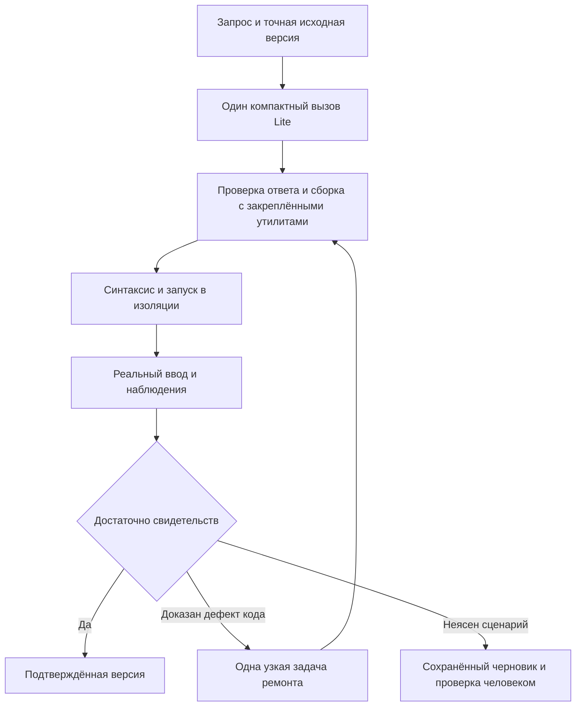

# Исследование сбоев Lite и план улучшения генерации

25 октября 2026. Основа: исходники приложения `bb07e1f`, локальная ветка на `de097fb`,
сохранённые результаты пилотов и чтение облачного стенда. Ниже сохранён исходный план
исследования; фактический итог последующей реализации указан отдельно.

**Уточнение владельца после исследования:** выполнить план полностью и отказаться от
совместимости старых игр. Это заменяет требования сохранения v2–v7 ниже. Ход выполнения
и проверки: [реализация v8](lite-v8-implementation.ru.md). Для нового пилота отдельно
разрешены до 48 вызовов Lite и 180 минут; старые закрытые бюджеты не возобновляются.

**Итог исполнения 25.10:** A0–A5 и B0–B5 реализованы с регрессиями и повторными ревью.
Пилот C закрыт на 33/48 вызовах, 145 мин 2,6 с; неиспользованные 15 закрыты.
Рост качества не доказан, compact выключен по умолчанию. Полный повтор после финальных
исправлений не выполнен из-за сбоя исполнителя.
[Результаты и ограничения](lite-v8-pilot-2026-10-25.ru.md).

**Рекомендация: сохранить существующий контроллер Run/Invocation, исправить выбор
исходной версии и качество свидетельств, затем испытать отдельный компактный профиль
Lite. Приложение должно брать на себя упаковку, ввод, геометрию и исполнение проверок;
модели оставить игровую механику и небольшие изменения.** Обязательная цепочка
planner → coder → critic сейчас увеличит время и не устранит обнаруженные причины.

Первая поставка ниже исправляет конкретные дефекты без inference. Вторая проверяет
архитектурную гипотезу на локальных примерах. Только третья требует нового согласованного
модельного бюджета. Codex остаётся самостоятельным поддерживаемым провайдером.

## Что показывают сохранённые результаты

Облачная БД прочитана в транзакции `REPEATABLE READ, READ ONLY`. Снимок сделан
25.10 в 00:43 по Москве (`2026-10-24T21:43:02Z`). На сервере действовал `bb07e1f`.
Прочитаны Run, Invocation, Revision, CheckReport, RunEvent и журнал текущего worker.
Приватные ответы и игровые исходники сохранены только в `.data/harness-research-20261025/`.
[Обезличенная сводка и идентификаторы свидетельств](evidence/lite-27b-research-2026-10-25.json).

| Выборка | Факты | Что из этого следует |
| --- | --- | --- |
| Локальный пилот v6 | 6 новых игр, 2 базово играбельны, 0 автоматически приняты; ответы полностью обработаны у 2/6 | Была проблема завершения уже отправленных операций |
| Локальный пилот v7 | 6 новых игр, 3 базово играбельны, 0 автоматически приняты; ответы обработаны у 6/6 | Исправление завершения помогло, качество кода и проверок остаётся недостаточным |
| Восстановление проверок в v7 | 0 полностью восстановленных наборов из 6 попыток, включая 2 старые игры | Отдельный check_repair технически работает, но сам по себе не обеспечивает правильных сценариев |
| Облачная история | 10 реальных Run, 32 вызова: 10 с контрактом v2, 17 с v3, 5 с v7; 8 needs_attention, 1 failed, 1 unverified | Это история разных версий и продолжений, её нельзя объявлять процентом качества нынешнего v7 |
| Облачный v7 отдельно | 2 Run в одном чате, 5 вызовов, все settled; 0 активных или неизвестных вызовов во всём снимке | Здесь нет свидетельства потерянного receipt; второй Run — просьба исправить первую игру |
| Проверки развёртывания | 6 fake Run успешно завершены | Подтверждают работоспособность приложения, не качество 27B; исключены из показателей модели |

Источники сравнения: [пилот v6](lite-v6-pilot-2026-10-24.ru.md),
[пилот v7](lite-v7-pilot-2026-10-24.ru.md). Малые выборки 2/6 и 3/6 не доказывают
устойчивого улучшения. Облачные старые ошибки v2/v3 нельзя приписывать текущему коду.

Журнал worker после последнего развёртывания содержит только запуск текущего контейнера;
история генераций восстановлена по сохранённым записям, а не по отсутствующим старым stdout.
Серверы не перезапускались, данные и настройки не менялись, GPU-соединений и новых
модельных вызовов — **0**.

## Подтверждённые причины

### Теряется исходная игра при обычной просьбе исправить черновик

В облачном чате первый Run `57635269…` создал змейку и закончил `unverified`.
После check_repair две проверки подтвердили старт и проигрыш, третья читала
несуществующее `window.game.direction`. Код кандидата сохранился.

Пользователь затем попросил исправить контраст, размер поля и расположение кнопок.
Run `cbe7695e…` получил `operation=create`, `base_revision=null`,
`continued_from=null`; его модельный запрос не содержал предыдущего игрового кода.
Это тот же чат, но приложение предложило модели создать игру по описанию недостатков.
Три вызова заняли около 13 минут 11 секунд, итоговый кандидат не запускался.

Причина видна в коде: обычная отправка в [Studio](../web/src/Studio.tsx) вызывает
`/chats/{id}/runs/`; [create_run](../studio/services.py) берёт `chat.current_revision`
и выбирает create при отсутствии принятой версии. Кандидат наследуется только через
отдельное продолжение. Preview уже показывает черновик, а форма сообщения его не адресует.
**Исправлять нужно связь запроса с показанной версией, а не обучать пользователя другой кнопке.**

### Содержимое файла похоже на игру, но для JavaScript это комментарий

У второго облачного Run:

1. Первый ответ содержит `index.html` из одного doctype и комментарий вместо game.js.
2. Второй ответ содержит game.js из 8468 символов, без переносов, начинающийся с `//`.
   Парсер JavaScript видит **0 инструкций**. Отказ `incomplete_sources` корректен.
3. Третий ответ содержит game.js из 8112 UTF-16 единиц. Первые 787 — объявления
   переменных, следующие **7325, или 90,3%**, — один комментарий до конца файла.
   Парсер видит 24 объявления, но ни одного обработчика или определения игровой функции.
   Синтаксис правильный; проверка непустого исходника пропускает такой кандидат.

Статический разбор выполнен Acorn без исполнения исходников. `json.loads(raw_response)`
содержит те же файлы, что сохранённый ответ, для всех пяти облачных вызовов v7.
Переносы не были потеряны упаковщиком приложения. Системный запрос уже содержит явную
инструкцию о настоящих переносах и опасности `//`; повторить её ещё раз недостаточно.
Все четыре create-ответа облачного v7 содержат game.js без единого переноса.

Источник ограничения: [source_policy.has_code](../generation/source_policy.py) отличает
пустой/комментарийный файл от файла с каким-либо кодом. Это полезная проверка приёма,
но она не доказывает наличие игровой реализации. Красивое форматирование не восстановит
код, который уже находится внутри комментария. Автоматически вставлять переносы по
догадке нельзя: неизвестно, где автор намеревался закончить комментарий.

### Проверка загрузки не равна проверке запуска игры

Облачный отчёт 17 для третьего ответа: `syntax=passed`, `gates_passed=true`,
прозрачный Canvas 300×150, все пять игровых фактов `unverified`.
Кнопку Start перекрывает Restart; чтения gameState недоступны. Решение — review,
исправление кода не разрешено.

В [evidence.gates](../validation/evidence.py) достаточно загруженной страницы,
отсутствия runtime/network ошибок, Canvas положительного размера и отсутствия
горизонтального переполнения. [proven_defects](../validation/evidence.py) и
[code_repair](../generation/code_repair.py) знают syntax/runtime/mobile_overflow.
Перекрытое управление и отсутствие полезной инициализации сюда не входят.
Timeout любого сценария в [acceptance](../studio/acceptance.py) относится к проблемам проверки.

Это не основание объявить любой пустой Canvas ошибкой: стартовое меню и отложенная
отрисовка бывают правильными. Нужны отдельные факты о загрузке, доступности заявленного
ввода и результате запуска. Наличие DOM-элемента или отсутствие исключения недостаточно.
Сам факт timeout тоже недостаточен для ремонта кода: selector мог быть ошибочен.

### Модель одновременно придумывает код и ненадёжный способ его проверить

Первый облачный v7 сравнивал состояние `start/play/over` с текстами «Игра»/«Конец»,
а поворот змейки проверял изменением score. Check_repair исправил два ожидания,
но придумал `window.game.direction`, которого нет в исходнике.

Две последние облачные версии повторно проверены **локальным изолированным Chromium**
на точных artifact hashes. Результаты совпали по сути с облачными: у первой 2 passed
и 1 invalid_check; у второй 5 unverified, блокировка Start, недоступное состояние,
невидимая сцена. Это воспроизведение дефектов проверки, а не полная независимая
приёмка играбельности обеих игр. Native Chromium и облачный Chromium имеют разные версии.

Системная проблема: схема разрешает произвольные строковые state paths, произвольные
ожидания и самостоятельную категорию проверки. Их формальная правильность не гарантирует
ни существования поля, ни соответствия ввода требованию. Повторный вызов той же модели
с тем же широким заданием не создаёт независимого проверяющего.

### Ремонт не получает полезный фрагмент ошибки

В локальном v7 повторный snake трижды сохранял `Assignment to constant variable`.
Браузер указывал колонку 4794, но модельный `source_excerpt` содержал первые 500 символов
строки без проблемного `const offsets`. Полный модуль был во входе; модель ошибочно
ремонтировала свойства `const state`. Потеря локализации подтверждена, но не доказано,
что она была единственной причиной неверного ремонта.

[source_map](../generation/source_map.py) сначала обрезает фрагмент до 1000 символов,
затем [feedback](../generation/feedback.py) обрезает строковое поле ещё до 500.
Требуется окно вокруг точной UTF-16 колонки и проверка конечного модельного запроса.
При распознавании повторного дефекта следует учитывать устойчивый контекст ошибки,
а не только изменившиеся позиции после переписывания файла.

### Основная задержка находится в модельной работе

Пять облачных вызовов v7: 9924 input и 15983 output tokens. Сумма времён Invocation —
1070,33 с, сохранённое время исполнения модели — 1040,70 с, **97,2%**.
Медианное first_output — 1,37 с. Это отношение сумм по пяти вызовам, не p95 и не
доля полного времени пользователя: проверки и промежутки между запросами сюда не входят.

В старой облачной истории есть ответ с 16384 output tokens и `incomplete_response`.
Увеличение лимита и числа попыток может сделать ожидание ещё длиннее. Первый полезный
эксперимент — уменьшить обязательный выход и устранить бесполезные повторения.

Облачный v7 уже использует **json_schema**, max_output=16384, context_window=32768,
alias `qwen38`. Следовательно, совет просто включить structured output не решает
обнаруженные семантические ошибки. Реальные веса 27B, квантование, версия vLLM,
reasoning mode и неявные sampling defaults не подтверждены этим исследованием.
В приложении также не сохраняется отдельным полем точный finish_reason успешного ответа;
адаптер допускает stop, но для следующих экспериментов нужны явные метаданные.

## Что взять из существующих харнессов

| Система и проверенный источник | Полезный механизм | Применение в GameForge |
| --- | --- | --- |
| [Aider, форматы редактирования](https://aider.chat/docs/more/edit-formats.html) | Выбор whole/diff в зависимости от модели; whole проще, но дороже при больших файлах | Маленький модуль и один разрешённый формат на конкретном repair; не выдавать модели длинное меню способов правки |
| [Aider, ArchitectCoder](https://github.com/Aider-AI/aider/blob/5dc9490bb35f9729ef2c95d00a19ccd30c26339c/aider/coders/architect_coder.py) | Решение и оформление правки разделены; editor получает очищенную историю | Узкий контекст ремонта полезен уже сейчас. Второй обязательный вызов остаётся отдельным экспериментом |
| [mini SWE agent, DefaultAgent](https://github.com/SWE-agent/mini-swe-agent/blob/main/src/minisweagent/agents/default.py) | Малый цикл query → action → observation, сохранение траектории, лимиты и остановка повторных ошибок формата | Сохранить наш ограниченный контроллер; после проверки давать один конкретный следующий шаг |
| [SWE agent, ACI](https://swe-agent.com/latest/background/aci/) | Проверка синтаксиса при редактировании и ограниченный просмотр релевантного кода | Проверять патч до перехода к игре; передавать точное окружение ошибки. Проект уже рекомендует mini SWE agent, переносить старый framework незачем |
| [OpenHands, сопоставление действий и наблюдений](https://github.com/OpenHands/software-agent-sdk/blob/acd96e6fa424c02432304395b9208f99be24b54d/openhands-sdk/openhands/sdk/conversation/state.py#L677-L716) | Действия без результата восстанавливаются по журналу, включая ошибки после перезапуска | Сохранить уже исправленное поведение v7 при любых новых форматах и стадиях |

Это инженерные аналогии, не доказательство качества нашей 27B. Aider отдельно предупреждает,
что Architect использует два запроса и увеличивает время/стоимость;
[описание режимов](https://aider.chat/docs/usage/modes.html). Успех пары сильных моделей
на редакторском benchmark нельзя переносить на одну 27B и HTML5-игры.
Shell и свободный доступ агента к окружению из внешних харнессов сюда не переносятся.

[Документация vLLM](https://docs.vllm.ai/en/stable/features/structured_outputs/)
описывает ограничения JSON/грамматики. Наш вывод: ими можно обеспечить форму нового
контракта, но существование `game.direction` и правильность победы должен проверять
исполнитель. Версии и доступные параметры конкретного сервера требуют отдельного подтверждения.

## Предлагаемая архитектура

### Сохранить существующую основу

Django, PostgreSQL, Celery/Redis, relay, учёт вызовов, неизменяемые Revision, история,
публикации и отдельный origin preview остаются. Не нужен новый workflow engine или
замена backend. Вводится версионированный экспериментальный профиль внутри существующего
генератора, а не параллельное приложение.

Для старых игр действуют прежние файлы и контракты. Новый профиль закрепляется в Run,
Invocation и Revision; незавершённый вызов нельзя переинтерпретировать при переключении флага.
Пересборка runtime не должна менять HTML и hashes уже сохранённых игр.

### Компактный профиль Lite

Первый прототип: **один модельный create**, один небольшой модуль механики и короткое
описание его интерфейса. Приложение предоставляет проверенные утилиты Canvas, размеры
viewport/DPR, преобразование координат, pointer/keyboard lifecycle и упаковку offline HTML.

Модель по-прежнему пишет правила, игровое состояние, столкновения, цели, отрисовку и
реакции на ввод. Никаких готовых snake/memory/platformer реализаций в runtime.
Нет обязательных score/lives, кнопки Start, квадратного поля или набора игровых фаз.
Для пошаговой игры update необязателен. Временные игры и игры без меню допустимы.

Минимальный контракт модуля следует зафиксировать до промптов: создание обычного
состояния, обработка нормализованного реального ввода, необязательное обновление времени,
отрисовка. Подключение — обычный локальный classic script; сборщик встраивает его
детерминированно, без eval и сетевых импортов. Проверка наличия экспортов не считается
доказательством игры. Это API утилит, не язык описания готовых жанров.

Описание управления содержит идентификаторы доступных действий, соответствие реальным
клавишам/областям и типизированные доступные наблюдения. Исполнитель проверяет
существование полей и типов на настоящем артефакте. Снимок состояния должен отражать
состояние, используемое игрой; отдельное `testPassed` и управление исходом запрещены.
Объявление поля моделью само по себе не делает его достоверным.



Сохранение черновика и завершение генерации не требуют зелёного статуса всех сценариев.
Подтверждение и публикация продолжают требовать своих свидетельств. Интерфейс должен
отдельно сообщать: обработка закончена; версия сохранена; какие требования проверены;
что именно остаётся проверить или исправить.

### Новый формат исходника как отдельный эксперимент

Сначала оставить JSON Schema, но сократить ответ. Кандидат для проверки —
`source_lines: string[]` для одного модуля: приложение соединяет элементы ровно одним
LF, каждый элемент не содержит настоящих переводов строки. Это делает границы строк
явными и снижает риск, что `//` поглотит весь файл. Модель всё ещё может выдать весь
код одним элементом; такой формат не является гарантией и должен измеряться.

Альтернатива — один исходный файл в строго ограниченном текстовом контейнере. Она
упрощает кодирование строки, но теряет часть структурных гарантий; это следующий
эксперимент, если line array не помогает. Не включать оба формата сразу и не выбирать
мягкий parser после ошибки. Старый content:string не менять для Codex и прежних Run.

Компактный ответ не должен заново описывать design, хеши и неизменные сценарии при
каждом repair. Сервер сам связывает ответ с сохранёнными invocation/base/hash.
Нельзя уменьшать защиту от устаревшей базы: идентичность проверяется приложением,
а не зависит только от того, перепечатала ли модель длинный UUID без ошибки.

### Проверки, которыми управляет приложение

Разделить три уровня: работоспособность артефакта; наблюдаемый эффект конкретного
действия; соответствие всей игры запросу. Первые два часто автоматизируются, третий
для произвольной механики не имеет универсального оракула.

Приложение может компилировать короткие проверки из объявленных действий и наблюдений,
вместо свободных state paths и категорий в каждой строке. Семантика требования и
последовательность победных ходов при этом всё ещё требуют независимой проверки.
Не считать генерацию checks из той же модели независимым тестированием.

Для оценочного набора иметь закрытые от генератора рубрики и отрицательные мутации:
не работает Start, игнорируется поворот, неправильный победитель, не закрывается пара,
счёт меняется без действия, контроль перекрыт, resize сбрасывает партию. Пример с
`passed=true` при отключённой механике обязан провалиться.

Воспроизводимость времени/случайности включать как отдельный режим отчёта с seed и
версией. [Playwright Clock](https://playwright.dev/docs/api/class-clock) различает
`runFor`, исполняющий временные callbacks, и `fastForward`, вызывающий таймеры не более
одного раза. Для движения нужен первый подход. Проверять также обычное время и
несколько seed; не выдавать напрямую выигрышное состояние и не подменять механику.

## Подробный план исполнения

### Поставка A Исправление подтверждённых дефектов без модели

Выполнять последовательно A0–A5. Не менять GPU, relay deployment, авторизацию,
профиль Codex или рабочую облачную БД. Не включать экспериментальный Lite по умолчанию.

#### A0 Зафиксировать базу и воспроизведения

- Прочитать AGENTS, README, требования, архитектуру, этот план и фактический текущий diff.
  Зафиксировать HEAD и hashes затронутых файлов; сохранить чужие изменения.
- Создать минимальные обезличенные fixtures из перечисленных случаев. Приватные игровые
  исходники и промпты не переносить целиком в Git.
- Записать отдельные ожидаемые результаты: ошибка игры, ошибка сценария,
  недостаток свидетельств, проблема среды. Существующий отчёт не переписывать.
- Получить ожидаемые падения новых регрессий до исправления. Зафиксировать исходные
  команды тестов, состояние отдельной тестовой БД и версии браузера/валидатора.

Результат: manifest, небольшие fixtures и начатый отчёт реализации с привязкой A1–A5
к тестам. Модельных вызовов ноль; сбор данных не создаёт Run.

#### A1 Привязать сообщение к редактируемой версии

Основные файлы: `studio/services.py`, `models.py`, `views.py`, `serialization.py`,
`tasks.py`, `web/src/Studio.tsx`, API-типы и тесты этих путей.

1. Передавать из формы точные `source_revision_id` и artifact hash показанной версии.
   В запросе явно различать новую игру и изменение выбранной игры; не определять это
   по наличию принятой версии или по текстовому поиску слова «исправь».
2. Проверять принадлежность чату/пользователю, актуальность, отсутствие активного Run.
   При устаревшем выборе возвращать конфликт, а не незаметно переходить к create.
3. Разделить в модели данных **исходник редактирования** и **принятую версию для проверки
   конкурентного изменения**. Текущий `Run.base_revision` участвует в проверках публикации/
   принятия; нельзя просто записать туда непринятый кандидат и сломать эти инварианты.
   Предпочтительно отдельное nullable поле источника и версия семантики; старые Run
   сохраняют прежнее поведение. Точные имена согласовать с фактической схемой.
4. Обычная пользовательская правка черновика — edit с сохранённым исходником, а не
   автоматический repair с навечно фиксированными требованиями. Во входе нужны исходный
   замысел, новая правка, файлы и релевантные требования; весь чат не нужен.
5. Отдельные continue/recheck сохраняют свою семантику и не подхватывают чужие pending.
   Источник и его hash входят в fingerprint идемпотентности.
6. Preview остаётся доступен для непринятой версии. Принятую рабочую версию и публикацию
   обновлять только после положенного решения приложения/человека.

Приёмка: accepted A и показанный candidate B → edit читает B, до успешного принятия
current остаётся A. При отсутствии accepted edit всё равно читает B. Чужой/устаревший
источник отклоняется; потеря HTTP202 не дублирует вызов; выбор исторической версии
обрабатывается явно. Проверить полный путь формы, API и сохранённого Invocation.request,
а не только вычисление operation в unit-тесте.

#### A2 Исправить диагностику и отделить неполноту от неисправности

Основные файлы: `generation/source_map.py`, `feedback.py`, `source_policy.py`,
`validation/runner.py`, `diagnostics.py`, `evidence.py`, `studio/acceptance.py`,
`generation/code_repair.py` и связанные тесты.

1. Формировать фрагмент вокруг точной колонки, с явными началом/концом окна и единицами
   смещения. Учитывать UTF-16, emoji, CRLF и экранирование `</script`. Если mapping не
   доказан — сохранять координаты экспорта. Не выдавать предполагаемый файл за точный.
2. Сохранить полезное окно после всех фильтров feedback и общей квоты. Проверить именно
   `build_messages(request)`: проблемный токен должен находиться в переданном тексте.
3. Добавить статическую диагностику комментарийного хвоста/только объявлений. Это
   подозрение, не универсальное доказательство неполноты: легальный код может запускаться
   через initializer, обработчик, другой файл или пользовательское действие.
4. Для каждого доступного обязательного маршрута ввода сохранять target, hit-test,
   перехватывающий элемент, viewport, фазу подготовки и факт выполненного действия.
   Доказанный перехват заявленного доступного управления отличается от отсутствующего
   selector, невыполненного setup и намеренно закрытого меню.
5. Ввести явные результаты загрузки, доступности управления и старта. Не переименовывать
   прежний зелёный surface в подтверждённую игру. Пустая сцена до Start не является ошибкой.
6. Разрешать узкий code repair по новому типу дефекта только после его доказательства
   на актуальном hash/report; расширить allowlist согласованно во всех слоях. При
   неоднозначности сохранять review, а не отправлять код на случайное переписывание.

Регрессии: облачный комментарий после объявлений; корректная игра с комментариями;
Start под Restart; ошибочный selector; меню, которое сначала надо закрыть; пустая сцена
до законного старта; повторная инициализация/resize; длинная строка с const offsets после
emoji. Устаревший отчёт не открывает repair. Изменённые checks не считаются ремонтом кода.

#### A3 Сделать восстановление проверок предметным

Основные файлы: `generation/check_repair.py`, `prompts.py`, `validation/checks.py`,
`diagnostics.py`, `runner.py`, `studio/acceptance.py`.

1. Перед check_repair формировать ограниченную таблицу фактически найденных контролов
   и допустимых наблюдений: существование, тип, значения до/после и момент получения.
   Не обещать обнаружение всех закрытых переменных. DOM остаётся допустимым источником.
2. Проверять ссылку на наблюдение до длинного сценария, учитывая поля, появляющиеся
   только после setup. Отсутствие поля до Start не равно отсутствию после Start.
3. В узком ремонте проверок предлагать ссылаться на проверенный идентификатор наблюдения;
   новое произвольное поле требует проверки существования, а не доверия ответу модели.
4. Сохранять исходное требование, категорию и весь обязательный набор. Если сценарий
   не восстановить без изменения кода, завершать с конкретным непроверенным эффектом.
5. Для пригодного к ручной проверке кандидата показывать понятный список эффектов,
   hash и актуальный отчёт. Неполные checks и доказанные дефекты не превращать в pass.
   Новую политику работы с частичной спецификацией вводить версионированно, не через
   ослабление текущей confirmation_report для старых игр.

Регрессии: облачный `window.game.direction`; неправильный тип; закрытая переменная;
getter; динамическое поле; относительное наблюдение после checkpoint; сценарий,
проходящий без полезного ввода; правильная игровая победа при неправильных модельных ходах.
При check_repair/recheck файлы, artifact hash и требования неизменны.

#### A4 Улучшить учёт и остановку бесполезного ремонта

Основные файлы: `generation/providers/relay.py`, `vllm.py`, `service.py`,
`studio/tasks.py`, `acceptance.py`, `scripts/evaluation.py`.

- Сохранять actual model id и finish_reason из доступного completion, формат ответа,
  hashes prompt/schema, переданные лимиты, явные параметры sampling и признак неизвестных
  defaults. Не запрашивать inference ради метаданных и не выдумывать веса по alias.
- Разделять время ожидания/исполнения/получения/проверки по доступным отметкам. Не называть
  разницу elapsed−inference точной длиной очереди. Unknown учитывать отдельно от нуля.
- Сигнатуру повторного дефекта строить из класса ошибки, причинного фрагмента и шага
  воспроизведения; позиционный сдвиг сам по себе не означает прогресс. Разные ошибки
  с одинаковым текстом нельзя преждевременно объединять.
- После двух подтверждённых повторов одного дефекта завершать с сохранённым лучшим
  сопоставимым кандидатом и объяснением. Порог не увеличивает общий лимит 1+3 вызова.
- Выбирать формат ремонта приложением: точный блок либо один существующий разрешённый
  малый модуль. Сохранять hashes остальных файлов; большая перепись ради цвета запрещена.

Регрессии: тот же const-дефект после сдвига; новый const-дефект в другом месте;
выявленная следующая ошибка после исправления первой; length/stop; поздний receipt;
отмена и неизвестный расход; отказ формата остаётся учтённым вызовом.

#### A5 Общая проверка и пакет ревью

Запустить затронутые unit/API-тесты, регрессии переходов Run/Invocation, реальные
изолированные браузерные fixtures и frontend-тест формы отправки черновика. Затем
один полный набор backend и frontend по актуальным командам README. Тестовую PostgreSQL
не разделять между одновременно запущенными pytest.

Обязательные сохранённые инварианты: v2–v7 читаются прежним образом; receipt применяется
не более одного раза; recheck не вызывает модель; отмена не принимает поздний код;
публикация неизменна при неудачной правке; Codex adapter/schema тесты проходят без входа
и inference; native и Docker-validator дают ожидаемый класс результата. Недоступную
среду честно указать, не заменять результат утверждением.

Ревью-пакет: точный baseline/diff, миграции и совместимость, таблица каждой регрессии
до/после, hashes fixtures, два вида браузерных свидетельств, ограничения. Отдельно
проверить, что A2/A3 не создали ложного принятия. Обновить документацию фактического
контракта; этот план не заменять отчётом об успехе до выполнения.

Предпочтительные места регрессий:

| Изменение | Существующие тесты для расширения |
| --- | --- |
| A1 | `studio/tests/test_domain.py`, `test_completion.py`, `test_concurrency.py`, `web/src/Studio.test.tsx` |
| A2 | `tests/test_source_map.py`, `test_generation_feedback.py`, `test_source_repair.py`, `test_artifact_evidence.py`, `test_game_regressions.py`, `studio/tests/test_harness_v7.py` |
| A3 | `tests/test_check_semantics.py`, `test_diagnostics.py`, `test_check_repair.py`, `studio/tests/test_check_repair.py` |
| A4 | `tests/test_generation_providers.py`, `test_relay_api.py`, `studio/tests/test_relay.py`, `test_call_budget.py`, `test_saved_response.py` |

Перед следующими командами проверить локальную тестовую PostgreSQL и действующие
настройки без вывода секретов. Не направлять тесты на облачную БД, не менять `.env`.
Точный список новых browser-тестов добавить в команду; исключённый Unix transport
проверить отдельно в подготовленной Docker-среде.

```sh
GAMEFORGE_PROVIDER=fake GAMEFORGE_MODEL=fixture VALIDATOR_BACKEND=docker \
  .venv/bin/pytest tests studio/tests -m 'not browser and not live'
GAMEFORGE_PROVIDER=fake GAMEFORGE_MODEL=fixture VALIDATOR_BACKEND=native \
  .venv/bin/pytest tests/test_native_validation.py -m 'not live'
GAMEFORGE_PROVIDER=fake GAMEFORGE_MODEL=fixture VALIDATOR_BACKEND=native \
  .venv/bin/pytest tests/test_validation.py tests/test_check_semantics.py \
  tests/test_game_regressions.py tests/test_source_map.py tests/test_artifact_evidence.py \
  studio/tests/test_completion.py studio/tests/test_harness_v7.py \
  studio/tests/test_source_repair.py studio/tests/test_check_repair.py \
  -m browser -k 'not real_unix_transport'
.venv/bin/ruff check gameforge studio generation validation scripts tests
.venv/bin/mypy generation validation --ignore-missing-imports
.venv/bin/python manage.py check
.venv/bin/python manage.py makemigrations --check --dry-run
npm test --prefix web
npm run lint --prefix web
npm run build --prefix web
git diff --check
```

Это команды будущей реализации A, не заявление, что полный набор выполнен в исследовании.
В текущем исследовании выполнены статический разбор и два изолированных replay.

### Поставка B Экспериментальный компактный профиль

Начать после ревью A. Новые названия ниже предварительные, окончательные фиксируются
в ADR и схеме без изменения старых контрактов.

| Этап | Работа | Критерий готовности без модели |
| --- | --- | --- |
| B0 | Версия профиля, runtime и manifest; выключенный по умолчанию feature flag | В сохранённом вызове однозначно определены parser/schema/runtime; флаг не меняет pending и старые HTML |
| B1 | Малый runtime Canvas/ввода, привязанный к версии и встроенный в экспорт | Пошаговая и временная fixtures работают на mobile/desktop, offline; resize не меняет состояние, blur снимает удержание, mapping рисования и касания совпадает |
| B2 | Короткий create с одним модулем; сначала content:string | Тот же набор требований и поведения выражается без генерации HTML/CSS-обвязки и длинного design; нет готовых механик в runtime |
| B3 | Отдельный вариант source_lines и адаптер сборки | Round-trip точных байтов; ограничения размера, Unicode, комментарии, пустой/обрезанный массив, неверный тип; никакого автоматического восстановления по догадке |
| B4 | Типизированные действия/наблюдения и компилятор коротких проверок | Реальные события; отрицательные мутации не проходят; отсутствие доказательства остаётся unverified; невозможно forceWin/testPassed |
| B5 | Узкие edit/repair, отчёт и отключение профиля | Рабочие модули сохраняются, stale base отклоняется; Codex/старый Lite доступны; выключение флага не мешает завершить существующий вызов |

Общая оболочка — главный архитектурный эксперимент; новый wire-формат — отдельная
переменная. Сначала сравнить старый профиль и компактный при одном content:string,
затем сравнить string/lines при одинаковой оболочке. Не приписывать общий эффект
одной причине, если несколько изменений всё же измеряются одним пакетом.

Для B2 ориентир, а не доказанный предел модели: примерно 150–250 читаемых строк механики,
один JS-модуль до нынешних 12 КиБ и короткая декларация. Размер лимита проверить на
разных механиках, не урезать требования молча. При невозможности уложиться — понятное
предложение упростить запрос. Обязательное деление каждой игры на пять модельных модулей
увеличивает ошибки стыков и пока не нужно.

Codex может продолжать использовать полный свободный HTML/CSS/JS-путь. Выбор провайдера
и выбор формата артефакта — разные настройки. Общие приёмка/учёт остаются общими;
узкий runtime не должен стать обязательным ограничением возможностей Pro.

### Поставка C Живое сравнение по новому бюджету

Старые бюджеты закрыты. Текущий запрос разрешает исследование, не новый inference.
После A/B согласовать отдельный эксперимент. Возможный диагностический формат на
**до 24 вызовов и 90 минут**:

1. Три фиксированных запроса × два варианта × до четырёх вызовов = максимум 24.
   Те же grid/snake/memory пригодны для сопоставимости; зафиксировать промпты и рубрики
   до начала, перемежать порядок вариантов, не менять код во время опыта.
2. Контроль — исправленный A, эксперимент — компактный профиль с тем же форматом строки.
   Это 6 новых игр без повторений, диагностический опыт, не доказательство процента качества.
   Сравнение string/lines проводить отдельно, не выдавать его за часть этого A/B.
3. Остановить новые отправки на заранее установленной отметке, например 75 минут,
   оставить время на квитанции/проверку. Лимит применяется **до** отправки, не обрывает
   полезный оплаченный ответ. Существующий receipt учитывается и после запрета новых вызовов.
4. Проверить каждый кандидат независимым реальным вводом, включая промежуточные.
   Не добавлять вызовов поверх четырёх для «спасения» неудобного примера. Игры без кандидата
   и неудачи включать в знаменатель. Результаты fake не смешивать.
5. Отдельным следующим опытом проверить небольшую пользовательскую правку черновика,
   восстановление checks без изменения кода и новую механику вне этих трёх семейств.
   Нельзя заявлять эти свойства доказанными только по трём create-промптам.

Метрики: первое сохранение; первая независимо играбельная версия; полное завершение
вызовов; подтверждение требований; auto/manual отдельно; ложный отказ/принятие;
code/check repair отдельно; отклонения формата; количество изменённых байтов; input/output
и вызовы на рабочую игру; пользовательское время и время модели.

Безусловный критерий остановки внедрения — известный отрицательный пример получает
проверенный статус, теряется источник/история или дублируется оплаченный вызов.
Для решения о качестве нужна большая последующая выборка: например 12 запросов ×
2 повторения × 2 варианта = 48 игр, до 192 вызовов при прежнем лимите. Это отдельный
бюджет, не скрытое расширение малого пилота. Цели доли успеха и времени фиксировать
до такого опыта; нынешние данные не обосновывают обещание 90% или p95.

## Что отложить

| Идея | Решение сейчас | Когда возвращаться |
| --- | --- | --- |
| Более подробный промпт без других изменений | Недостаточно: инструкция о переносах уже есть | Только как малая измеряемая правка после устранения дефектов приложения |
| Обязательный planner → coder → critic | Не вводить | Если компактный один проход остаётся плохим, сравнить ограниченный GameSpec → code с тем же бюджетом |
| Полноценный движок или DSL всех жанров | Не вводить | Если утилиты недостаточны; сначала доказать сохранение генерации правил моделью и покрытия новых механик |
| RAG каталога готовых игр | Не вводить | Допустимы короткие примеры API утилит, не подмена генерации подбором шаблона |
| Больше repair и больший output limit | Не использовать как основное лечение | После данных о конкретном обрыве и с измерением полезного результата на вызов |
| Смена весов, sampling, quantization, vLLM | Вне этой поставки | После идентификации фактической модели и отдельного согласованного эксперимента; GPU сейчас не трогать |
| Автоматический переход на Codex при неудаче Lite | Не включать скрыто | Только явный выбор пользователя с отдельным учётом; доступность облачного Pro пока не подтверждена |

## Порядок дальнейшей работы

**Следующее поручение на реализацию — A0–A5 целиком с регрессиями и отчётом для ревью,
без модели и развёртывания.** Приоритет внутри поставки: адресация черновика, точная
диагностика, доказательство запуска/доступности ввода, проверка наблюдений, учёт.

После ревью — B0–B5 за выключенным флагом, затем C с новым разрешённым бюджетом.
Прежние S0–S5 из [плана исполнения](sol61-harness-execution-plan.ru.md) уже поставлены;
повторно реализовывать их или отменять их инварианты не требуется. Новые данные уточняют
прежнюю поставку II: сначала исправить потерю редактируемого черновика и комментарийные
псевдоисходники, затем уменьшать задачу модели. Результат должен измеряться по рабочим
играм и верным решениям приложения, а не по числу тестов или конечных Run.
