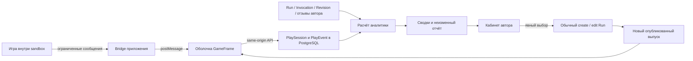

# Продуктовая аналитика GameForge: полное проектирование

Дата: 14.11.2026. Ветка: `feature/game-analytics`.
Статус: **спроектировано по запросу владельца; функции ниже ещё не реализованы**.
Реализованы демонстрационные рекомендации v1 и техническая наблюдаемость; их границы
сохраняются. Документ задаёт следующий выпуск, не новую редакцию регламента конкурса.

## 1. Продуктовый результат и границы

Менеджер получает замкнутый рабочий путь:
**создать → опубликовать → увидеть использование и отзывы → выбрать изменение →
получить новую версию → сравнить результаты**. Решение об изменении принимает автор.
Статистика не запускает ремонт, новую генерацию, принятие или публикацию автоматически.

Покрываются все шесть направлений из обсуждения:

| ID | Направление | Результат для автора |
| --- | --- | --- |
| PA1 | Воронка игры | Где прекращается наблюдаемое использование: открытие, старт, завершение, повтор |
| PA2 | Эффективность механик | Сопоставление механик по завершениям, повторам, времени и жалобам |
| PA3 | Соответствие аудитории | Результаты игр, предназначенных для выбранной аудитории, с учётом устройства и ввода |
| PA4 | Сравнение версий | Разница показателей двух точных версий и история выбранной доработки |
| PA5 | Качество генерации | Время до принятого результата, первая попытка, доработки, известный/неизвестный расход |
| PA6 | Обратная связь | Отдельные оценки автора, игроков, жалобы и реакции на публикацию |

Источники пожелания организатора: [встреча, §05](sources/organizers/meet_transcript.txt),
§07 и §14; [согласованные требования](requirements.ru.md#бонусы-и-границы).
Синтетические данные разрешены для демонстрации, но не выдаются за поведение клиентов.
Наблюдения и качество реализации усиливают защиту; результат конкурса не гарантируется.

Выпуск работает внутри нынешнего Django/DRF, PostgreSQL, Celery/Redis и React/SCSS.
Новый аналитический сервис, Kafka, ClickHouse, Rust/Go, обучение и дополнительный
обязательный модельный этап не нужны. Общий лимит модельных вызовов не увеличивается.
WebView Билайна и автономные HTML не считаются подключёнными источниками событий.

## 2. Что уже есть и что действительно требуется

| Сейчас в коде | Используем | Добавляем |
| --- | --- | --- |
| `Run`, `Invocation`, `Revision`, `CheckReport` | Генерация, usage, стоимость, проверки, точные версии и цепочки продолжений | Время первого принятия, ясные определения показателей, owner-scoped read API |
| `AnalyticsDataset`, `studio/analytics.py` | Демонабор v1, описательные сравнения, проверяемые основания рекомендаций | Отдельные реальные сводки и снимки v2; существующий demo-only constraint не ослабляется |
| `Run/Revision.analytics_snapshot` | Неизменное основание выбора при создании | Версионированный real-контекст и отдельное основание пользовательской доработки |
| `Publication.revision` | Явная публикация и переключение снимка | Неизменные аналитические выпуски публикации: старую сессию нельзя перепривязать к новой версии |
| `Feedback` | Отзыв автора о выбранной версии и существующая обработка пожеланий | Отдельный отзыв игрока; разделение оценок и отсутствие новых вызовов извлечения пожеланий |
| `Like` | Текущие реакции на публикацию | Показ на уровне публикации; старые лайки не приписываются отдельной версии |
| `GameFrame`, `PhonePreview`, `PublicGame`, `RevisionPlayer`, `GameQuickView`, `Studio` | Общая оболочка, iframe, управление звуком | Единый сборщик с явным контекстом каждого места запуска |
| `generation/preview.py`, `preview_view` | Вставка доверенного кода приложения перед игрой | Малый отдельный bridge с закреплёнными версией и hash |
| Prometheus/Grafana/Tempo/Loki | Здоровье сбора, ошибки, очереди, доступность | Только технические показатели нового контура; финансовый ledger и продуктовые факты остаются в БД |

Принципиальные найденные ограничения: публикация меняет revision через PATCH;
Feedback доступен владельцу чата; у Revision нет `accepted_at`; demo schema и
`generation/analytics.py` принимают только source=demo. Обходить эти ограничения
подстановкой полей или переименованием источника нельзя.

## 3. Как это встроено в интерфейс

В боковой панели рядом с лентой/шаблонами появляется **Аналитика**. На телефоне — тот же
пункт в существующем меню. Это обычный раздел приложения с действующей авторизацией.

| Экран / маршрут | Содержимое | Основное действие |
| --- | --- | --- |
| `/analytics` — Обзор | Открытия, старты, завершения, повторы, качество данных, динамика; список собственных игр | Открыть результаты игры |
| `/analytics/mechanics` — Механики и аудитории | Сопоставимые группы, размер выборки, фильтры, основания советов | Создать игру с выбранной идеей |
| `/analytics/games/:gameKey` — Игра | Воронка, выпуски и версии, устройства/ввод, отзывы, рекомендации | Сравнить версии / подготовить доработку |
| `/analytics/games/:gameKey/compare` | Две версии, одинаково определённые показатели и разницы в п. п.; контекст изменения | Сохранить сравнение / открыть новую версию в чате |
| `/analytics/generation` — Генерация | Модели, стадии, приёмка, продолжения, сроки и стоимость | Найти проблемное задание |

PA6 представлен вкладкой **Отзывы** на странице игры и сводкой проблем на обзоре.
PA3 представлен фильтром и сравнением аудиторий на экране механик, а не отдельной
копией dashboard. Глобальная финансовая/техническая информация видна только staff;
обычный автор видит собственные задания и публикации.

Общие фильтры: источник (реальный сбор / демонстрация), период 7/30 дней или свой,
целевая аудитория игры, игровая область экрана, наблюдавшийся ввод, игра/версия.
Фильтры конкретного раздела: механика/формат раунда либо provider/model/profile.
Смена источника сбрасывает несовместимые сравнения; объединённого режима real+demo нет.

В `Studio` возле выбранной версии появляется действие **Результаты**. Оно открывает
страницу этой точной версии. История показывает, на основании какого отчёта и какой
правки создан новый вариант. Переход в аналитику не теряет черновик чата.
В карточке собственной публикации — **Статистика**; чужому посетителю она не показывается.
В существующем `AnalyticsSuggestions` сохраняется явный выбор не более двух идей.

На публичной странице после завершения раунда либо по кнопке **Оценить игру**
показывается необязательная компактная форма вне iframe. Она не прерывает игру,
не открывается повторно после отказа и не закрывает управление/кнопку звука.

Каждый экран имеет состояния: выключено, загрузка, нет наблюдений, недостаточная
выборка, предварительные данные, устаревший сбор, неполное наблюдение, ошибка,
нет доступа. Ноль, отсутствие данных и неподдерживаемый показатель различаются.
Мобильные таблицы заменяются карточками; график имеет текстовую сводку и доступную
таблицу. Клавиатура, фокус после модального окна, обе ориентации телефона обязательны.

## 4. Идентичность игры, версии и выпущенной публикации

`game_key` — серверный стабильный UUID аналитической игры, связанный с собственным
чатом. `family_key` — серверное происхождение для группировок: доработки и ремиксы
одного корня не становятся независимыми играми. Пользователь не задаёт family_key.
Разные владельцы сохраняют раздельные права даже при одном происхождении. Если
происхождение старого ремикса после удаления исходной публикации восстановить нельзя,
family_trust=unknown; такие записи не создают независимые семейства для советов.

При публикации или смене версии создаётся неизменный `PlayRelease`:
owner, game_key/family_key, publication UUID, revision UUID, artifact_hash, номер
выпуска, время, снимок метаданных и capture policy. Publication хранит текущий
`analytics_release_id`. Все операции выполняются с существующей блокировкой владельца.
Предыдущий выпуск становится retired, его события и содержимое не переписываются.

Сессия получает PlayRelease **до** загрузки iframe и навсегда остаётся с ним. API не
определяет её revision повторным чтением текущего Publication.revision. Обновление
публикации во время загрузки не смешивает версии: bootstrap сверяет точный hash.
Подписанный короткоживущий play-ticket из GET публикации разрешает bootstrap именно
показанного выпуска; срок 2 минуты, назначение только публичный сбор. Старый ticket
после удаления/блокировки публикации не открывает новую сессию.

При обычном обновлении уже созданная сессия заканчивает своё ограниченное окно на
старом выпуске. При снятии публикации новые сессии запрещены; существующие могут
дослать ранее разрешённые события до TTL. При стирании продуктовой статистики токены
отзываются сразу. Аналитические FK не защищают игровые артефакты от обязательного
операторского удаления: `SET_NULL` + UUID/hash snapshots, а не новые `PROTECT`.

Одинаковые bytes, опубликованные несколько раз, не создают новые независимые
семейства. Для сравнения версий ключ — Revision UUID + hash, с отдельными выпусками и
версиями классификации; сравнение того же артефакта не выдаётся за улучшение кода.

## 5. Метаданные и смысл аудитории

При публикации автор может подтвердить **основную механику** и **формат раунда**.
Начальный словарь механик: существующие collection/matching/logic/reaction плюс
other/unclassified. Расширение — новая версия taxonomy. Это метки анализа,
не каталог готовых игр и не ограничение того, что может сгенерировать модель.

Из плана/метаданных можно показать неподтверждённый вариант классификации без нового
модельного запроса. До подтверждения автором — unclassified, без рейтинга механик.
Короткий/обычный раунд — заявленный формат; его нельзя определять по измеренному
времени и затем этим же временем доказывать преимущество коротких игр.
Изменение меток создаёт новый выпуск метаданных для будущих сессий.

`target_audience` берётся из выбранной аудитории игры. Подпись:
**Результаты игр, предназначенных для …**. Возраст, занятия и свойства посетителя
не выводятся из устройства или названия игры. Собранные сеансы не доказывают,
что фактические игроки принадлежат выбранному сегменту.

Отдельно записываются coarse host-device, область игры portrait/landscape/desktop,
наблюдавшийся input touch/keyboard/pointer/mixed/unknown. Виртуальный телефон на
desktop не превращает пользователя в mobile/touch. Если ориентация/ввод изменились,
сессия отмечается mixed; узкие сравнения её не включают. Raw UA и координаты не нужны.

## 6. Сбор данных и граница доверия



Важное различие: наличие bridge не означает, что игра вызывает round API.
`expected_capture` описывает намерение генератора; `capture_evidence.capabilities`
описывает наблюдавшееся испускание событий в уже существующих игровых сценариях.

Игра сохраняет sandbox allow-scripts, opaque origin и CSP connect-src none.
Bridge — приложение-owned script перед игровым JS, аналогичный механизму audio control.
В нём нет URL сбора, cookie, write-token, идентификатора пользователя или API-ключа.
Он отправляет только ограниченные сообщения родителю; сеть использует GameFrame.
Прямое открытие preview, валидатор и автономный экспорт не создают игровые сессии.

Новая policy `rounds_v1` закрепляется в Run до формирования запроса и переносится
в Revision/PlayRelease с bridge version/hash. Уже отправленные request/receipt не
переписываются. Неизвестный hash/несовместимый capture protocol даёт no-support,
а не тихую подстановку другой версии helper. Версия игрового JSON-контракта v9 и
compact runtime 2 в этом проектировании не меняются.

В существующие plan/create инструкции добавляется только описание необязательного
API: `globalThis.GameForgeTelemetry?.registerCapture('rounds_v1')`, `startRound()`,
`finishRound(outcome)` с enum win/loss/completed и `abandonRound(reason)` с enum
restart/menu. Все вызовы через optional chaining; регистрация — заявление игры о
поддержке протокола, без свободного payload.
Bridge сам выдаёт возрастающий номер раунда; произвольные payload, score и строки
игра не отправляет. Первый вызов start создаёт раунд; повторный start активного
раунда игнорируется, второй finish игнорируется. Для сброса незавершённого раунда
сначала abandonRound, затем start; abandon не увеличивает finished. Новый start
после штатного finish — replay. Смена уровня/сцены не является новым раундом.
Для другого жизненного цикла нужна явная следующая версия capture policy.

Механика выполняет свои переходы независимо от наличия SDK. Методы helper не бросают
ошибок в игру. В экспорт не добавляется сборщик/сеть; optional calls работают и при
отсутствующем helper. Отсутствие событий само по себе не разрешает repair, замену
исходников или checks. Старые игры получают только наблюдения оболочки; для событий
раундов автор явно создаёт новую доработку точной версии.
Музыкальный этап и извлечение пожеланий не получают эти инструкции.

Основные gates проходят без аналитического SDK, чтобы подтвердить работу экспорта
и независимость механики. После них по включённому флагу выполняется отдельный
read-only capture audit: тот же сохранённый набор сценариев в изолированном браузере
с доверенным init script, не меняющим HTML bytes/artifact_hash. Bounded recorder
сохраняет только enum-события из браузера; никаких сетевых endpoints, секретов или
host-функций у игрового кода не появляется. Он сопоставляет register/start/finish с
start/outcome сценариями того же проверенного артефакта. Replay capability требует
наблюдения в существующем restart-сценарии. Недостающие сценарии не дописываются.
Повторный browser run ограничен существующими watchdog/очередью/изоляцией, имеет
отдельную длительность и не скрывается внутри времени модели. Он не находится в
критическом пути получения пригодной игры и не входит в лимит модельных вызовов.

Задание живёт в отдельном `PlayCaptureAudit` с lease/fence/idempotency, без игрового
Run/Invocation; оно не занимает активный ValidationTask и не мешает ручной проверке.
После сбоя — ограниченный повтор read-only аудита, без нового запроса модели.
Результат хранится в `PlayCaptureAudit` и его проекции `Revision.play_capture_evidence`: точные artifact hash,
bridge hash, исходные report identity/checks hash, ID сценариев, audit ID/длительность
и результат. Исходный CheckReport/его verdict и identity не переписываются.
Пока audit не готов, доступны открытия и видимое время, round metrics=unavailable.
Если публикация уже существует, успешный audit создаёт новый immutable analytics
release тех же игровых bytes с подтверждёнными capabilities. Переключение выполняется
под блокировкой только если Publication всё ещё указывает на тот же UUID/hash;
результат старого audit не переключает публикацию на прежнюю игровую версию.
Старые sessions остаются с прежним release; показатели с разным охватом не смешиваются.
Это отдельная диагностическая возможность. Основные gates/checks не зависят от неё:
missing/failed/unverified capture даёт неподдерживаемый показатель, не source repair.
Регистрация без такого наблюдения не даёт нулевую долю стартов/побед как будто сбор
исправен. Аудит подтверждает только доступный сценарий передачи событий, не честность
игры во всех состояниях. Событие победы остаётся недоверенным по отношению к наградам.


Bridge также наблюдает isTrusted ввод без записи символов/координат, ограниченные
коды runtime-error и видимость. GameFrame проверяет event.source, schema, protocol,
artifact_hash и новый случайный frame_nonce для каждого монтирования/перезапуска.
У opaque iframe event.origin может быть null: одна проверка origin недостаточна.
Родитель передаёт nonce конкретному contentWindow; '*' допустим только для этого
несекретного handshake, как у существующего audio preference. После reload старый
nonce недействителен; аудио и Escape продолжают работать независимо.

Подлинность окна и nonce не доказывает правдивость игровой логики. Игра может вызвать
API сама: round/outcome остаются **заявленными игровыми событиями**, а не независимой
проверкой победы, качества или основанием начислять вознаграждения. Переходы не
определяются парсингом DOM, чтением закрытого state или выполнением getters.

## 7. Сессии, события, доставка

Один visit — одно явно открытое игровое представление в конкретной вкладке; перезагрузка
создаёт новый visit. Ротация signed preview URL при неизменном hash не сбрасывает игру
и сессию. Переключение реального артефакта закрывает старую сессию. Поддержку reload
суммированием разных visits не придумываем: default единица измерения — сеанс, не человек.

Контекст создаётся сервером: public_player, creator_preview, test или demo. Studio,
RevisionPlayer и GameQuickView имеют preview-контекст; основной PublicGame — public.
Свои просмотры вошедшего автора исключаются из public-фильтра. Известные E2E/тестовые
аккаунты и установки помечаются сервером; клиент не может выбрать traffic=real.
Provider=fake показывается отдельно в генерации, но сам по себе не доказывает, что
игрок ненастоящий. Анонимный web-сбор не является доказательством уникального человека.

| Событие | Источник | Смысл |
| --- | --- | --- |
| play_opened | API bootstrap | Попытка открыть конкретный выпуск; один session row |
| frame_loaded | Оболочка | iframe вызвал load; не доказательство готовности механики |
| bridge_ready | Bridge + проверка окна | Доступен правильный протокол наблюдения |
| input_seen | Bridge/оболочка | Был наблюдаемой категории ввод, без содержимого |
| round_started | API игры через bridge | Начался первый/следующий раунд |
| round_finished | API игры через bridge | Явный win/loss/completed этого раунда |
| round_abandoned | API игры через bridge | Незавершённый раунд сброшен; отдельно от finish |
| heartbeat | Оболочка | Накопленное видимое время и последний обработанный seq |
| play_closed | Оболочка best effort | Явное закрытие, если браузер успел доставить |
| runtime_error | Bridge | Только bounded code, без message/stack/source |

Write-token 256 бит создаёт host через crypto до bootstrap, хранит только в памяти;
сервер хранит его hash. Он ограничен одним сеансом и 60 минутами, не даёт read-доступа.
Idempotency key bootstrap сохраняется с fingerprint release/hash/token-hash: потеря
ответа и точный повтор возвращают прежний session_id; иной запрос даёт 409.
Токен не включается в URL, iframe, postMessage, логи или browser storage.

Доставка: batch до 32 событий / 32 КиБ, одна отправка в полёте, раз в 5 секунд,
повтор с backoff, bounded memory queue до 256 событий. Для закрытия — fetch keepalive
с CSRF header; sendBeacon без CSRF не используется. Потеря последнего пакета возможна
и влияет на полноту, а не на возможность играть. Seq присваивается при первой
отправке; отправленный пакет до ACK неизменен. Схлопывать можно только ещё не
пронумерованные heartbeat, чтобы не создавать собственные gaps. При заполнении очереди можно
схлопнуть ещё не отправленный heartbeat до последнего cumulative значения; потерю lifecycle-событий
обозначаем отдельно и исключаем из оснований автоматических советов.

Каждое событие имеет seq, монотонное время относительно visit и строгие enum-поля;
сервер добавляет received_at и все dimensions. Unique(session_id, seq), payload_hash:
одинаковый повтор подтверждается без пересчёта, другой payload того же seq — 409.
Batch атомарен; небольшой out-of-order буфер до 64 seq сворачивается по непрерывному
порядку. Пробел в sequence отмечается как неполное наблюдение. Редуктор проверяет
переходы round и не увеличивает finished/replayed по повторной доставке.

Активное время оболочки считается при видимом документе и видимой минимум на 50%
игровой области. Промежутки без heartbeat более 15 секунд не достраиваются целиком.
Клиентское cumulative время ограничивается возрастом сессии по серверу, допустимым
интервалом и foreground-окном. Это оценка видимого времени, не доказательство внимания
или времени прохождения. Фоновая вкладка, скрытый preview и пропавший heartbeat
не превращаются в минуты активности. Закрытие без исхода не считается поражением.

## 8. Метрики, периоды и качество данных

Все даты API — UTC, интервалы [from,to). Для cohort используется время play_opened.
`as_of`, metric_policy_version, capture policy, source, фильтры, numerator/denominator
и причины недоступности возвращаются вместе с показателем.

В policy 1 основная воронка имеет окно **30 минут с открытия**, плюс 10 минут на
запоздавшую доставку. Это окно измерения, не таймер игры: игра не останавливается.
Для окончательных долей берутся только сеансы с полностью закрытым окном. Свежие
сеансы показываются отдельными предварительными числами; нельзя включать только
быстро завершившиеся и тем самым завышать успешность. После watermark поздние события
не переписывают сохранённый отчёт. Они учитываются в диагностике late-events.

| Показатель | Определение / знаменатель |
| --- | --- |
| Открытия | Уникальные созданные сеансы допустимого public-контекста |
| Доступность player | Сеансы с bridge_ready / открытия; iframe load отдельно |
| Доля стартов | Сеансы с первым round_started и наблюдавшимся вводом / открытия с поддержкой rounds_v1 |
| Завершения | Сеансы с событием finish первого раунда в окне / начатые сеансы |
| Повторы | Сеансы с новым start после finish первого раунда в окне / начатые сеансы |
| Победы | Сеансы с первым outcome=win / первые завершения с outcome win или loss |
| Видимое время | Сумма измеренного foreground времени в окне / число сеансов с пригодным измерением |
| Неполное наблюдение | Сеансы с gaps/потерей пакетов/несовместимым ABI; отдельное число и доля |
| Ошибки | Сеансы с наблюдавшимся runtime_error / сеансы с error-capable bridge |
| Оценка игрока | Среднее и распределение 1–5, число оценок; выбранные причины / число оценивших |

Auto-start до первого ввода сохраняется, но получает qualified-start при последующем
наблюдавшемся вводе до его finish в том же окне. Раунды, полностью прошедшие до
первого ввода, остаются auto-only. Первый подходящий раунд является первым qualified
раундом воронки; финал auto-only не доказывает сыгранную партию.
Если ABI не поддерживается, старты/финалы/replay — null с причиной unsupported_capture;
число открытий остаётся доступным. Явное отсутствие completion event — «завершение не
наблюдалось», не утверждение об удовольствии, поражении или уходе игрока.

Для started нужны проверенные capability round-start + input, для finish — end,
для replay — restart. Они читаются из совпадающего capture_evidence; handshake
только подтверждает правильные bytes bridge. Для доли стартов учитываются все
открытия выпуска с подтверждённой поддержкой round-start,
включая не сумевшие загрузить bridge; нельзя исключением таких загрузок улучшить
воронку. Policy=none, отсутствие регистрации или пригодного capture audit дают
unsupported_capture, а не 0% завершений. Такие игры не добавляются в знаменатель завершений. Показываем
долю охвата наблюдением; сопоставление групп разрешено только при одинаковом contract.
0/0 возвращает null. Групповые доли считаются из сумм целых счётчиков; проценты не
усредняются. Разница долей — процентные пункты. Для времени denominator собственный.
Общий рейтинг, смешивающий минуты, победы, лайки и себестоимость, не вводится.
Повтор раунда внутри visit не называется D1/D7-удержанием. Возврат на другой день
потребует отдельного решения об идентичности посетителя и зрелой когорты.

При неполной доставке первичная воронка показывает доступные факты с пометкой.
Порог пригодности для советов: не менее 90% полных сеансов в каждой стороне,
одинаковое определение окна/метрик и достаточно закрытых наблюдений. Это продуктовая
эвристика, не уровень статистической достоверности. Неизвестные исходы не становятся
нулевыми значениями времени или доказанными проигрышами.

## 9. PA2/PA3: сравнение механик и аудиторий

Срез: один владелец, источник, период и metric/capture/taxonomy policy; одна целевая
аудитория, одинаковые viewport/input/round_style. Неподтверждённые метки, test/preview,
неполные или ещё открытые окна не участвуют в основании советов.

Для рекомендации о механиках стартуем с ограничений текущей demo policy: минимум
100 started и 3 независимых family_key с каждой стороны, минимум 30 started на
семейство, не более 50% вклада одного семейства. Варианты и ремиксы одного корня
не увеличивают число независимых семейств. В межмеханическом совете одно семейство
не участвует одновременно в обеих сторонах; связанные варианты анализируются в PA4. База — все остальные сопоставимые
механики, не специально выбранная худшая. Короткий раунд сравнивается с обычным
той же механики. Порог примера: +10 п. п. завершений и +5 п. п. повторов для механики;
для короткого формата — +10 п. п. завершений без снижения повторов.

До порога показываются группы, числа и причины отсутствия совета. Для разных
аудиторий — отдельные колонки/карточки, без вывода о реальном возрасте игроков.
Длинное время само по себе не повышает оценку механики: оно может означать затруднение.
Публичного рейтинга других авторов и общего доступа к их данным в этом выпуске нет.
Staff может видеть общую обезличенную сводку; она не становится автоматически
источником рекомендаций для других владельцев.

## 10. PA4: версии и цикл доработки

Автор выбирает две собственные Revision одной аналитической игры. Default — соседние
опубликованные версии; периоды и число закрытых сеансов видны рядом. Отчёт перечисляет
изменившиеся метаданные, несовпадающие устройства/ввод/полноту и доступные общие срезы.
Несопоставимые группы показываются раздельно без общей стрелки «стало лучше».

Для двух версий достаточно одного семейства, поскольку вывод относится только к
этой игре; обобщать его на механики по этому сравнению нельзя. При n<30 started с
любой стороны показываются только предварительные описательные числа без совета
победителя. Даже при большем n обычное до/после — наблюдаемая разница, не причинное
доказательство. Контрольный A/B со случайным распределением — отдельное последующее
расширение, не скрытая зависимость выпуска.

Действие **Подготовить доработку** создаёт `AnalyticsImprovement` с immutable report,
точной source_revision UUID/hash, выбранной причиной и текстом предлагаемой правки.
Первая библиотека советов — небольшие серверные правила с основаниями; например
жалоба на читаемость предлагает увеличить текст/контраст. Низкая доля завершений сама
по себе не диагностирует ошибку механики и не разрешает автоматическую правку.

Пользователь видит текст, редактирует его и нажимает обычную отправку в Studio.
Запрос использует существующий edit API с точным source_revision/hash; принятая
Run.base_revision отдельно защищает конкурентное принятие. Отчёт не даёт прав на
исходники. Если показанная версия изменилась — явный 409 и обновление основания,
а не переключение на последнюю версию без ведома автора.

В Run сохраняется отдельный `improvement_snapshot` с report hash/правилом/выбором;
исходный `analytics_snapshot` продолжает описывать происхождение создания игры.
Передача основания в существующий POST Run — необязательное поле
`improvement_selection={id,hash}`. Сервер проверяет владельца/источник/точную версию
и включает выбор и окончательный отредактированный prompt в fingerprint. Связь
proposal → Run фиксируется в одной транзакции. Точный idempotent повтор возвращает
прежний Run до проверки актуальности отчёта; новая отправка с изменившимся основанием
останавливается. Продолжение наследует уже сохранённое основание.
Публикация остаётся отдельным явным действием. Статусы цикла выводятся из связанных
Run/Revision/Release: подготовлено, отправлено, кандидат, принято, опубликовано,
сбор данных, сравнение готово. Модельный ответ или сохранённый hash не доказывает
качество доработки. Неуспех оставляет рабочую и опубликованную версии прежними.

## 11. PA5: генерация и экономика

Данные берутся из durable моделей; из Prometheus не восстанавливается продуктовая
история. Раздельные срезы: create/edit, provider/model/profile, model_profile Lite/Pro и generation_profile full/compact,
automatic/manual acceptance, model fake/live, период создания корневого Run.
Check-only ValidationTask и импорт/ремикс готового снимка не считаются генерацией.

Единица результата — корневое действие пользователя с его цепочкой continued_from.
Показываются и первичный Run, и успех после явного продолжения; дочерний Run не
создаёт вторую независимую успешную игру. Отменённые, unknown, failed, незавершённые
и needs_attention видны отдельно. Главная доля принятия на as_of считается от всех корневых действий периода; рядом
полный расклад active/attention/unknown/failed/cancelled/accepted. Условная доля среди
завершившихся показывается отдельно с собственным знаменателем. Пауза needs_attention
не объявляется навсегда закрытой: последующее продолжение меняет следующий отчёт,
но не сохранённый прежний snapshot. Мгновенный процент не объявляется итоговым.

| Показатель | Определение |
| --- | --- |
| Автоприёмка | Действия с автоматически принятой Revision / все корневые действия выбранного типа на as_of; отдельно условная доля среди завершившихся |
| Ручное принятие | Действия с Revision.verification=manual; отдельный ряд |
| Первая попытка | Принят первый кандидат после первого code-producing create/edit, без последующих create/edit/repair/check_repair/checks_create; штатные plan/music допустимы |
| Доработки | Отдельно code repair, scenario check_repair/checks_create и явные пользовательские edits |
| Время результата | От корневого created_at до первого принятия; очередь, transport, browser и упаковка отдельно |
| Вызовы | Уникальные Invocation с sent_at; receipt polling и перепоставка Celery не новые вызовы |
| Известная стоимость | Сумма cost_usd всех Invocation цепочки, включая план, музыку, неудачные попытки и ремонт |
| Средняя себестоимость принятого результата | Известные расходы всех действий когорты / число принятых результатов; рядом полнота стоимости и unknown liabilities |

Добавляется `Revision.accepted_at`, заполняемый атомарно при настоящем первом принятии.
Копирование уже принятого снимка в ремикс/restore не создаёт нового факта генерации.
Для старых записей достоверные факты восстанавливаются из сохранившихся событий;
если точного времени нет, duration=null с historical_timestamp_missing, а не created_at.
Историческая ручная приёмка определяется по Revision.verification, не по одному Run.status.

Стоимость Decimal, округление при показе. Вместе возвращаются known_cost,
reserved_ceiling, unknown_ceiling, unpriced_call_count и pricing_coverage. Незавершённые
вызовы не включаются одновременно в две корзины; общая арифметика ledger остаётся
единственным источником бюджетного допуска. Unknown не трактуется как 0 долларов.
Неизвестная стоимость делает себестоимость неполной оценкой, а не окончательным счётом.
Обработка отзывов имеет отдельную строку общеплатформенных расходов и не приписывается
игровому Run. Собственный расход автора и общий бюджет staff разделяются.

Сравнение моделей описательное: сложность запросов, аудитории и выбор модели могут
отличаться. Успешные gates не доказывают красоту, FPS и приятность музыки.

## 12. PA6: отзывы и реакции

Существующий Feedback автора сохраняет нынешние права и фоновое извлечение пожеланий.
Для текущей оценки автора выбирается последняя запись по (user,revision); истории
предыдущих сохранений не превращаются в дополнительные голоса. Изменённый rating
старой строки нельзя задним числом показывать как дневную оценку в прошлом.
В первом выпуске это явно текущая авторская оценка, без выдуманной исторической кривой.

`PlayerFeedback` привязан к конкретным PlaySession/PlayRelease/Revision/hash. Rating 1–5,
до трёх кодов причин из controls/readability/difficulty/pace/audio/technical_issue;
optional text до 300 символов хранится приватно. Одна текущая оценка на session,
повтор PUT обновляет её идемпотентно. Ввод текста не становится инструкцией модели.
Новые LLM-вызовы, preference extraction и сообщения игрового чата не создаются.

В сводке раздельно: число оценивших, распределение звёзд, среднее и доли причин.
PlayerFeedback показывается на as_of для выбранной когорты sessions. Обновления
рейтинга отражаются в следующей сводке; прошлое состояние сохраняется только в ранее
созданном report, историческая кривая из текущего изменяемого row не строится.
Оценки людей, решивших ответить, имеют самоотбор; высокая средняя оценка не заменяет
воронку. Для советов по жалобам нужен минимум 10 оценок в группе и повторяющаяся
конкретная причина. Метрики малых групп видны владельцу с размером выборки; публично
и другим авторам индивидуальные отзывы/сессии не выдаются.

Like относится к Publication и может пережить смену revision: показываем его на
уровне публикации. Старые реакции не используются как лайки новой версии/механики.
Свободный текст доступен владельцу соответствующего выпуска с экранированием,
не попадает в OTLP, публичный HTML, рекомендации или общие сводки.

## 13. Хранение и расчёт

Новые таблицы создаются сквозными этапами вместе с потребителем, без пустых слоёв.
Названия ниже — план реализации, не уже существующие Django models.

| Модель | Минимальные данные и ограничения |
| --- | --- |
| GameAnalyticsIdentity | game_key UUID, owner, source_chat SET_NULL, immutable family_key, created_at; unique source_chat |
| PlayRelease | owner/game/family, publication SET_NULL + UUID snapshot, revision SET_NULL + UUID/hash snapshot, release_seq, metadata/taxonomy/capture snapshots, state/time; unique(publication UUID,release_seq), содержимое неизменно |
| PlaySession | release, creation_key/fingerprint, token_hash/expiry, server-context, server/coarse client dimensions, timestamps, capabilities, contiguous seq, first-round/replay/visible-time summary, quality flags; unique(release,creation_key) |
| PlayEvent | session, seq, monotonic_ms, server received_at, event/payload_hash, строгие enum/counters; unique(session,seq), index(session,seq) |
| PlayCaptureAudit | revision SET_NULL + UUID/hash, исходный report/checks identity, bridge policy/hash, status, fence/lease/attempt/duration, bounded evidence; unique(revision UUID/hash,report identity,bridge hash), без принятия/ремонта |
| PlayerFeedback | session unique, release, rating/reasons, private text, created/updated; update только по scoped write-token |
| AnalyticsDaily | owner/date/release/context/cohort/policy, целые numerators/denominators, time sums/counts, coverage/watermark/build hash; unique всех dimensions |
| AnalyticsReportSnapshot | UUID, owner/scope, source, filters, as_of/watermark, metric/capture/taxonomy policies, aggregate facts/hash; immutable |
| AnalyticsImprovement | owner/game, source UUID/hash, report/hash, rule/selected amendment snapshot, submit idempotency/fingerprint, run/target SET_NULL; без второго автомата генерации |

Добавляемые поля: Publication.analytics_release, Revision.accepted_at,
Run/Revision.play_analytics_policy, Revision.play_capture_evidence,
Run.improvement_snapshot. Номера миграций назначаются
по состоянию ветки при реализации. Старым игровым исходникам ничего не подставляется.
Данные счёта модели и неизвестного расхода не переносятся и не удаляются аналитикой.

Синхронный ingest под короткой блокировкой session: проверить batch → сохранить новые
события → свернуть contiguous последовательность → ACK next_seq. Redis только для
лимитов; PostgreSQL определяет принятые факты. Возврат успеха — после commit.

Агрегация каждую минуту, мелкими пакетами, в отдельной очереди Celery `analytics` и
worker того же app image с threads/concurrency=2. У процесса нет provider keys; нет Run/Invocation.
Отдельный consumer необходим, чтобы четыре долгих model task не остановили расчёт.
Он добавляется при реализации фонового capture audit/rollups; это процесс существующего приложения.
Обычный model worker явно слушает `-Q celery`, analytics worker — `-Q analytics`.
Для audit действует глобальный предел один активный browser job, claim с lease/fence
и неблокирующий DB admission: остальные задания откладываются, оставляя второй слот
для rollups. Длительные audits не заполняют оба слота и не вытесняют модельные задачи.
Advisory lock и транзакционная замена дневных групп защищают от двух beat/повторной
доставки. Пересчитываем суммы из финализированных sessions, не прибавляем повторно.
Пропущенные дни выбираются по watermark; ручная rebuild-команда использует те же функции.

Чтение нескольких групп и создание отчёта выполняются из согласованного DB snapshot.
Отчёт фиксирует as_of, coverage и факты; более поздний rebuild не подменяет уже выбранное
основание. API не запускает дорогое восстановление истории или модельные вызовы.

Начальная retention policy: raw events и player free text 30 дней, session summaries
и daily aggregates 90 дней, выбранные report/improvement snapshots — вместе с историей
владельца. Очистка пакетная; сначала финализация, затем удаление raw. Без доступного
источника пересчёт возвращает raw_unavailable, не нулевые данные. Retention показывается
в UI. Операция стирания продуктовой статистики не затрагивает финансовый ledger.

## 14. API, права и отказоустойчивость

Планируемые endpoints; они не считаются действующим API до реализации.
Existing `/api/analytics/summary/` остаётся demo v1, с прежней семантикой выбора.

| Метод / URL | Права / результат |
| --- | --- |
| GET `/api/product-analytics/overview/` | Вошедший владелец; свои сводки, freshness и coverage |
| GET `/api/product-analytics/mechanics/` | Свои сопоставимые группы и советы; source обязателен |
| GET `/api/product-analytics/games/:gameKey/` | Владелец игры; версии, воронка, отзывы |
| GET `/api/product-analytics/games/:gameKey/compare/` | Владелец; left/right UUID/hash, фильтры и объяснение сравнимости |
| GET `/api/product-analytics/generation/` | Собственные факты генерации; scope=all только staff |
| POST `/api/product-analytics/reports/` | Фиксация видимых фильтров и серверных фактов, без импортируемых чисел |
| POST `/api/product-analytics/improvements/` | Собственный report + source UUID/hash + rule; идемпотентная подготовка |
| PATCH `/api/publications/:id/analytics-metadata/` | Владелец + expected revision/hash; новый metadata release |
| POST `/api/play/sessions/` | Публичный короткий ticket + обязательные Origin/CSRF; вернуть session_id/expiry/capabilities |
| POST `/api/play/sessions/:id/events/` | Scoped write-token + Origin/CSRF, bounded batch; ACK next_seq |
| PUT `/api/play/sessions/:id/feedback/` | Scoped write-token + Origin/CSRF; одна оценка |

Bootstrap не принимает owner, audience, mechanic, revision override, traffic=real или
произвольный endpoint. Read API не принимает чужие агрегаты как основание рекомендации.
Период чтения ограничен доступными 90 днями; списки пагинируются (до 100 строк),
сравнение принимает ровно две версии. Snapshot фактов ограничен 64 КиБ; модельная
проекция отдельно ограничена 8 КиБ. Произвольные SQL/group-by/поля JSON не принимаются.
Между владельцами — 404; недостаток staff permission — 403. Изменение версии/основания —
409. Превышение body — 413; rate limit — 429; временный отказ записи — 503 с retry.

Для anonymous POST обязательна явная CSRF-проверка: одной DRF SessionAuthentication
недостаточно, она не обеспечивает её для гостя. CORS для ingest не включается.
Лимиты: bootstrap 10/минуту на анонимный first-party browser и transient IP bucket;
events до 12 requests/минуту/session, body 32 КиБ, 32 события, не более 100 раундов и
2000 принятых событий/session; feedback один row/session. IP не хранится в аналитике,
в Redis bucket — краткоживущий HMAC. Глобальный ingress limit защищает bootstrap;
обход guest identity возможен, абсолютная защита от накрутки не заявляется.

При отказе limiter/DB ingest закрывается с 503; игра продолжает работать, клиентский
buffer ограничен, пропуски видны. Отказ аналитики не запрещает обычный create/edit
без выбранного основания. Уже выбранное/отправленное основание не заменяется другим.
Read-only наблюдательная DB-роль не получает доступ к PlayEvent/текстам отзывов.
В Prometheus только общие показатели ingestion/rejections/gaps/lag/build failures,
без session/user/revision labels; play events не отправляются в Loki и Tempo.

Реальный снимок другого владельца не копируется в публичный payload/экспорт/remix.
Для cross-owner remix нового формата остаётся игровая версия и безопасное указание
происхождения; private real evidence удаляется из нового контекста. Существующие
общие demo v1 snapshots продолжают наследоваться. Capture policy наследуется с
игровым кодом; отзыв/совет другого владельца не становится новой задачей ремикса. Это проверяется отдельно: текущий
remix код копирует analytics_snapshot, и для нового real-типа потребуется явная защита.

### Примеры планируемых сообщений

Bootstrap принимает только ticket и сведения для идемпотентной записи. Значения ниже
символические; секрет генерирует host, он не константа и не публикуется в отчёте.

```yaml
# POST /api/play/sessions/, X-CSRFToken обязателен также для гостя
play_ticket: SERVER_SIGNED_RELEASE_TICKET
creation_key: HOST_GENERATED_UUID
write_token: HOST_CRYPTO_RANDOM_256_BITS
# ответ
---
session_id: SERVER_UUID
release_id: SERVER_RELEASE_UUID
artifact_hash: EXACT_REVISION_HASH
expires_at: UTC_ISO_TIMESTAMP
expected_capture: rounds_v1
```

```yaml
# POST /api/play/sessions/:id/events/
# Headers: X-GF-Play-Token + X-CSRFToken; credentials остаются в host
protocol: 1
events:
  - seq: 7
    type: round_finished
    monotonic_ms: 23800
    round_ordinal: 1
    outcome: win
# ответ после commit
---
accepted_through: 7
next_seq: 8
```

Все сообщения имеют строгую schema с additionalProperties=false. Поле outcome
допустимо только для round_finished; round_ordinal выдаёт bridge. Сервер добавляет
revision/owner/cohort сам. Сообщение не содержит score, prompt, stack или пользовательский текст.

```yaml
# Элемент read API, пример нормального нулевого знаменателя
metric: first_round_finish_rate
value: null
unit: fraction
numerator: 0
denominator: 0
reason: zero_denominator
source: real
metric_policy_version: 1
window_minutes: 30
provisional: false
# unsupported_capture возвращает null также вместо неизвестных счётчиков
```

Обёртка ответа дополнительно содержит filter fingerprint, from/to, as_of,
observed_through, session/cohort counts, coverage, freshness и warnings. Нельзя
показывать процент без доступного знаменателя или с другой policy соседней версии.

## 15. Связь с существующей генерацией и рекомендации

`AnalyticsDataset` остаётся неизменным demo v1. Для real используется
AnalyticsReportSnapshot; source нельзя получить заменой enum у старого набора.
Существующий renderer получает явный versioned envelope от двух адаптеров; источники
не смешиваются при подсчёте, фильтрации, fallback и передаче в модель.
Real read API возвращает доли 0..1 с unit=fraction; действующий demo v1 остаётся
с процентами 0..100. Преобразование выполняет явный adapter, не эвристика renderer.
Для real delta_pp=(right-left)*100; отсутствие значения не преобразуется в 0.

Для новых create рекомендаций проектируется `analytics_snapshot.version=2`:
source kind/owner scope, report UUID/hash, as_of/window, policies, не более двух
серверных идей и bounded model_context. Лимиты прежние: snapshot до 8 КиБ,
model_context до 1600 символов. Все тексты — серверные шаблоны с enum и числами,
без сырых отзывов, URI или произвольных инструкций из данных.

`generation/analytics.py` явно валидирует v1 demo либо v2 real. Guidance различает
источники; нельзя отправлять real с текстом «DEMONSTRATION». Run закрепляет snapshot
до первой отправки, Revision наследует его. Получение старого receipt остаётся
приоритетным; новая политика не переписывает сохранённый request и не повторяет unknown.
План/create получают только совместимые явно выбранные идеи. Edit/repair не получают
новую аналитическую задачу автоматически; доработка из PA4 — обычный одобренный
пользователем amendment плюс отдельный provenance snapshot.

Приоритеты сохраняются: явный запрос → совместимые пожелания → выбранные идеи.
Нет model-on-view, извлечения жанра отдельной моделью, дополнительных ролей и платного
аналитического фонового обзора. Статистика/самоотчёт модели не меняют gates/checks,
RequirementManifest, лимит исправлений, способ получения receipt или право публикации.

## 16. План реализации: сквозные этапы

Оценка для фокусной недели; порядок зависимостей обязателен, сроки не гарантия.
В каждом этапе backend, UI и проверки поставляются вместе. Не открываем реальные
модельные испытания без нового доступного согласованного бюджета.

| Этап | Ориентир | Полезный результат и критерий выхода |
| --- | --- | --- |
| A1: PA5 + навигация | День 1 | Read API из ledger, accepted_at, экран Генерация, owner/staff права; правильно разделены manual/auto/unknown и продолжения |
| A2: выпуски + PA1 openings | День 2 | PlayRelease/Session и общий GameFrame collector; public/preview/test разделены, обновление публикации не смешивает версии |
| A3: PA1 rounds | День 3 | Закреплённый bridge, optional hooks full/compact, фоновый capture audit без новых сценариев, input/видимость/batch reducer; offline export и старая игра работают без SDK |
| A4: PA6 | День 4 | Отзыв игрока вне iframe, вкладка отзывов, авторские оценки и лайки корректно разделены; без новых LLM-вызовов |
| A5: PA2/PA3 | День 5 | Idempotent rollups, общий Overview и механики/аудитории, согласованные окна и insufficient_data; все числа восстанавливаются из фактов |
| A6: PA4 + применение | День 6 | Две версии и immutable report, подготовка явного edit, сохранение provenance, защита cross-owner remix, рекомендация при новом create |
| A7: приёмка и показ | День 7 | Fake HTTP/isolated browser E2E, сбои/дубли/права, мобильный UI, отдельный подписанный demo-сценарий и инструкция запуска |

Флаги по умолчанию выключены: GAMEFORGE_PRODUCT_ANALYTICS_ENABLED (read UI),
GAMEFORGE_PLAY_COLLECTION_ENABLED, GAMEFORGE_PLAY_ROUND_EVENTS_ENABLED,
GAMEFORGE_PLAYER_FEEDBACK_ENABLED, GAMEFORGE_REAL_ANALYTICS_IDEAS_ENABLED. Capability UI отдельно
показывает capture support и полноту. GAMEFORGE_ANALYTICS_ENABLED сохраняет demo v1.
При выключении сбора новые сессии не создаются; уже выпущенным write-token разрешено
дослать в прежних пределах, кроме отдельного emergency revoke. Выключение не обрывает
игру и не запускает генерацию. Выбранные snapshots остаются историей.

Миграции аддитивные. Existing publication backfill создаёт выпуски с
capture=none/metadata=unclassified; игровых событий прошлого не выдумываем.
Backend сбор доступен раньше включения UI; новые model policies включаются только
для новых Run. Старые сохранённые квитанции и финансовые неизвестности сохраняются.

## 17. Проверки и приёмка всех направлений

| Область | Обязательная проверка |
| --- | --- |
| Арифметика | 0/0=null, неусреднённые проценты, разные знаменатели времени, п. п.; демо и реальные данные раздельно |
| Время | UTC/from-inclusive/to-exclusive, 30+10 минут, незакрытые cohorts, late/gaps, скрытая вкладка и потеря закрытия |
| Дедупликация | Потерянный bootstrap response, двойной POST, другой payload того же seq, reorder, retry после commit, два aggregate worker |
| Версии | Publication PATCH между GET/bootstrap/finish, одинаковый hash разных Revision, изменение меток, удаление публикации/артефакта |
| Bridge | Baseline без SDK и audit с SDK не подменяют друг друга; чужой iframe, null origin, старый nonce/reload, неподдерживаемая schema/hash, спам, повтор start/finish; отсутствие SDK не ломает механику; один register без реальных hooks не даёт поддерживаемые метрики |
| Изоляция | CSP/sandbox прежние, токен остаётся у host, сеть игры недоступна, экспорт без трекера работает offline, валидатор не создаёт sessions |
| Права | Чужие game/report/revision UUID, scope=all, guest CSRF, XSS в отзыве, public payload и cross-owner remix не раскрывают real evidence |
| Генерация | Create/edit/continue/manual acceptance, plan/music без лишних вызовов, repeated receipt/unknown не отправлены заново, полная cost coverage не выдумывается |
| Отзывы | Авторские повторные строки не голоса, PlayerFeedback PUT идемпотентен, лайк публикации не переносится на revision, жалобы не запускают preference model |
| Сравнения | Только доступные версии, source/cohort/capture mismatch, n<30, одно семейство не вывод о механиках, выбор всех остальных как базы |
| Советы | Строгий server snapshot/hash до Run, stale choice 409, bounded контекст, нет советов на плохой полноте/малой выборке, никаких auto repair/publish |
| Сбои | PostgreSQL/Redis/аналитический worker недоступен, переполнен buffer, rollback, restart; игра и обычная генерация продолжаются |
| UI | 320px portrait, landscape, desktop без touch; keyboard-only, доступная таблица, восстановление фильтров/черновика, все empty/error states |

Сквозная приёмка на disposable fake-стенде: создать → принять → опубликовать v1 →
сыграть/закончить/повторить → оставить отзыв → увидеть реальные web-события в тестовом
контексте → обновить публикацию на v2 во время старого сеанса → проверить два выпуска →
сравнить → выбрать изменение → обычный edit точного UUID/hash → принять/опубликовать →
экспортировать и проверить offline. Тестовые часы/фикстуры закрывают окна; источник
отчёта остаётся test, не real. Проверки платной модели и физического WebView — отдельные.

Для защиты: заранее импортированный **явно демонстрационный** набор показывает
полноценное сравнение с достаточной выборкой; несколько живых сеансов отдельно
показывают поступление настоящих web-событий и состояние предварительных данных.
Историю эффекта не изображаем накопленной за две минуты. Техническая панель Grafana
демонстрирует здоровье сбора, продуктовая — основания выбора автора.

## 18. Карта изменений при реализации

- `studio/models.py`, новые migrations: девять моделей и перечисленные metadata поля.
- `studio/product_analytics/`: scope/definitions, ingest/reducer, rollups, reports,
  suggestions, API serializers/views и tasks; один Django-модульный контур.
- `studio/views.py`, `serialization.py`: immutable release при publish/update,
  public play-ticket, accepted_at, защита новых real snapshots при remix.
- `studio/services.py`, `tasks.py`: фиксация capture/improvement policy до отправки,
  обычные create/edit и долговечный учёт; никакого отдельного аналитического Run.
- `validation/runner.py`, `service.py`, `studio/validation_tasks.py`: дополнительный
  bounded capture audit после основных проверок, отдельный evidence без
  изменения их verdict и автоматических решений о ремонте; тот же набор сценариев.
- `generation/analytics.py`, `prompts.py`, `preview.py`, новый публичный bridge script:
  явные версии контекста, optional round ABI, безопасная preview-вставка.
- `web/src/components.tsx`, `PublicGame`, `GameQuickView`, `RevisionPlayer`, `Studio`:
  единый hook сбора с контекстом; не несколько независимых счётчиков iframe.
- `web/src/ProductAnalytics/`, `AnalyticsSuggestions`, `types.ts`, `App.tsx`, SCSS:
  страницы, карточка игры/сравнения, player feedback, источники и состояния.
- Compose/CI/scripts: отдельный analytics consumer без provider secrets, safe flags,
  миграции/backfill/rebuild/purge и полный fake acceptance.
- Prometheus/Grafana: bounded метрики ingest/lag/errors; финансовые допуска и
  продуктовые read-права не переносятся в систему технической телеметрии.

Критерий выпуска: все PA1–PA6 связаны с текущим приложением и воспроизводимыми фактами,
представлены в UI и пройдены сквозными проверками; ни один придуманный результат,
дополнительный paid-вызов или новое право игры на сеть не скрывается под словом аналитика.

## 19. Проверенные технические источники

- [DRF SessionAuthentication](https://www.django-rest-framework.org/api-guide/authentication/#sessionauthentication):
  anonymous запрос требует отдельного решения CSRF; полагаться только на SessionAuthentication нельзя.
- [MDN postMessage](https://developer.mozilla.org/en-US/docs/Web/API/Window/postMessage):
  проверка источника сообщений и точного формата; секреты не передаются opaque iframe.
- [Celery routing](https://docs.celeryq.dev/en/stable/userguide/routing.html):
  task_routes и отдельный consumer очереди analytics в том же приложении.

Точные ограничения, пороги и модель данных выше — решения проектирования GameForge,
а не требования этих источников и не заявление о статистической значимости.
