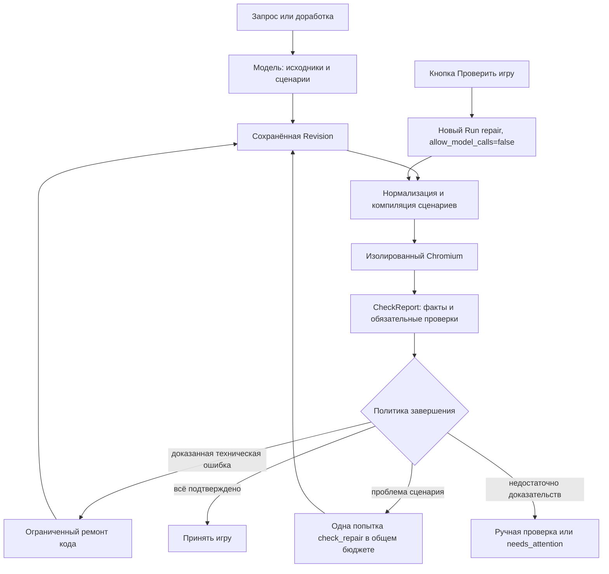

# Ревью автоматических проверок и план исправлений

Дата: **28 октября 2026**. Статус: **исследование завершено, исправления ещё не реализованы**.

Локальный исходный код: `7118125` (продуктовые изменения `ed35431`). Облако:
`/opt/gameforge/releases/20261028-ed35431`. Работа на облаке была только для чтения.
GPU и отдельный Codex Worker не затрагивались. Реальных модельных вызовов — **0**.

## 1. Вывод

Проблема подтверждается. «Проверить игру» сейчас означает «продолжить незавершённый
Run с запретом модельных вызовов». Это не самостоятельная проверка выбранной версии.
Пользователь видит ещё один будто бы генерационный диалог и почти не видит отчёт.
При этом есть реальные дефекты валидатора и тупики его политики завершения.

Нужны три связанных изменения:

1. Исправить достоверность исполнения сценариев и идентичность результатов.
2. Выделить проверку версии в самостоятельное действие с понятным отчётом.
3. Разделить игровые требования, сценарии их проверки и основания для ремонта кода.

Просто переименовать кнопку недостаточно. Увеличить число повторов тоже недостаточно:
некоторые повторы исполняют тот же неправильный сценарий и принципиально не могут
изменить результат. Объявлять любую такую игру неисправной также неверно.

## 2. Что проверено

- Прочитаны генерация/доработка, check repair, компилятор сценариев, браузерный
  исполнитель, IPC-служба, контроллер отчётов, принятие результата, API и React UI.
- Прочитан минимизированный журнал Run/RunEvent/Invocation и CheckReport за последние
  три дня. Основной облачный срез: **28.10, 19:17 МСК**. Промпты, сообщения пользователей,
  исходники игр, секреты и полные private_diagnostics массово не выгружались.
- У девяти выбранных отчётов отдельно прочитаны сценарии и ошибки для диагностики.
  Проверены хеши идентичности отчётов №63–77 без запуска игр на сервере.
- Проверена сводка журналов app/worker/validator за шесть часов: в доступном ограниченном
  хвосте нет `run_failed`, traceback или ошибок валидатора. Эти логи скудны;
  основные доказательства находятся в сохранённых отчётах, а не в stdout контейнеров.
- Нажата кнопка в существующем локальном чате: сервер отклонил старый формат,
  хотя UI заранее предлагал действие. Локальных сохранённых игр v9 на момент проверки нет.
- На **отдельной временной тестовой БД** открыт настоящий интерфейс текущего приложения,
  нажата «Проверить игру», получен результат штатного native-валидатора. Проверено
  достижение победы тремя кликами. Тестовая сцена явно помечена как заглушка;
  реальный provider заблокирован. Рабочая локальная БД не изменялась.
- Три браузерных диагностических запуска на искусственной сцене воспроизвели
  ложный pass ожидания неизменности и неверную классификацию клавиши.
- На локальном временном сокете воспроизведена блокировка probe длинной проверкой.
- Существующие целевые регрессии: **84 passed, 16 deselected**. Это не подтверждает
  отсутствие найденных проблем: в текущих тестах для них не хватает случаев.

Доказательства: [машиночитаемая сводка](evidence/validation-review-2026-10-28.json),
[снимок тестового интерфейса](evidence/validation-review-ui-2026-10-28.jpg).
Приватные диагностические материалы и воспроизведения: `.data/check-system-review-2026-10-28/`.

Это не новый live-пилот качества генерации. Сохранённые игры не были заново пройдены
во всех режимах. Физический телефон и WebKit в этом ревью не проверялись.

## 3. Как устроена система сейчас

### Артефакт и сценарии

`Revision` сохраняет файлы/HTML, hash, `checks`, manifest требований и признаки
принятия. Модель обычно придумывает и реализацию, и проверочные действия.
`review_checks` исправляет лишь однозначное представление числового наблюдения.
`CheckProgram` проверяет язык сценария: до 12 сценариев, до 30 действий,
до 10 секунд заданных ожиданий на сценарий, один `checkpoint`, финальный `wait_for`.

Есть обязательные категории start/control/outcome, мобильные start и touch-control.
DOM и безопасно читаемое состояние используются как наблюдения. Getters не вызываются.
Самоотчёт `passed` игры не считается результатом.

### Браузер

Сценарии исполняются по очереди в отдельных контекстах Chromium. В обычном прогоне
seed/clock не закреплены, если не задан специальный профиль. Для успешно прошедших
control/outcome дополнительно выполняется пара с одинаковыми seed/clock:
исходные действия и вариант без последнего измеряемого ввода. Это может означать
до трёх исполнений одного сценария, плюс проверку недостающего viewport.

Исполнитель отдельно собирает доказательства синтаксиса, загрузки, сетевых/JS-ошибок,
видимой Canvas-сцены и отсутствия мобильного переполнения. Для compact добавляются
регистрация модуля и доступность управления. Эти доказательства нужны и при плохих
сценариях; они не доказывают правильность игровых правил.

### Решение и восстановление

`studio.acceptance.assess` направляет доказанные технические дефекты в code repair,
ошибки инфраструктуры — в повтор проверки, сомнительные игровые ожидания — на review.
Допустимый check repair сохраняет исходники и идентичность требований, но затем
устанавливает `checks_review_required`: даже прошедшие новые сценарии требуют человека.
Это сознательная защита от подгонки тестов под игру, а не самостоятельный баг.

Ручное подтверждение требует актуальных обязательных доказательств, полного набора
сценариев, hash игры, ID отчёта и совпадения проверяющей среды. Текущая модель данных
смешивает происхождение доказательств, принятие версии и состояние генерационного Run.

### Кнопка

`POST /api/runs/{id}/recheck/` вызывает `create_run(check_only=True)`.
Создаётся операция `repair`, копируется исходный prompt, пишется новое сообщение
«Вы», ставится общая задача генерации. Модель действительно запрещена.
Успешный результат может принять кандидата и сменить текущую версию.
Кнопка недоступна после `succeeded` и для выбранной исторической версии.

API передаёт report с facts/findings/assessment, но основной интерфейс его не показывает.
Пользователь обычно получает общий текст и, при разрешении, список для ручного подтверждения.
«Можно играть» над preview определяется наличием URL, а не доказанным качеством игры.

## 4. Подтверждённые замечания

### R1 · P1 · Занятый валидатор становится «недоступным», отчёт получает неверную identity

Места: `validation/daemon.py:73–87`, `validation/service.py:22–27`,
`studio/tasks.py:480–494,849–863`, `studio/views.py:266–267`.

IPC-daemon обслуживает и probe, и долгую проверку последовательно. Probe имеет
таймаут 10 секунд. Во время другой проверки он получает `…:unavailable`.
Именно этот результат попадает в `check_identity` перед исполнением следующей проверки,
а сам отчёт затем содержит нормальную среду Chromium.

**Доказательства:** в искусственном опыте здоровая служба с задачей 11,5 секунды
отвечает на probe таймаутом за 10,002 секунды и снова здорова после задачи.
Облачный отчёт **№72** имеет identity, в точности вычисленную с `:unavailable`,
и не совпадает с identity его фактической среды. Остальные проверенные №63–77 совпали.

**Последствия:** лишние ожидания и повторы, неверная свежесть отчёта; проверка identity
при ручном подтверждении отвергнет такой отчёт, когда остальные условия допуска выполнены.
Это не сбой GPU и не повод менять исходники игры.

### R2 · P1 · Временной инвариант может получить ложный успех

Место: `validation/runner.py:539–567`.

`wait_for` завершает ожидание при первом совпадении для всех операторов, включая
`unchanged`. Сценарий «значение не меняется 500 мс» завершается при значении 0 сразу,
не замечая изменения до 1 через 180 мс.

**Доказательство:** весь короткий набор с такой регрессией получил `passed`;
тот же набор с фактическим `wait 500` обнаружил изменение и получил `failed`.
Отдельно нужно проверять изменение и возврат к исходному значению: сравнения только
двух концов интервала тоже недостаточно для утверждения «не менялось».

**Последствия:** ненадёжные проверки паузы, запрещённого хода, остановки движения
после отпускания и других свойств, которые должны сохраняться во времени.

### R3 · P1 · Доработки упираются в неразрешимый предел сценариев

Места: `generation/check_repair.py:30–33,115–119`, `studio/tasks.py:887–896`,
`studio/serialization.py:109–120`.

Новые сценарии ставятся перед унаследованными. Весь набор сохраняется, но браузеру
передаются только первые 12. Check repair также не может запросить более 12
уникальных обещаний. Ветка review может запретить и продолжение, и ручное принятие,
оставляя «Проверить» как повтор того же тупика.

**Облако:** №71 содержит 13 сценариев, №76 — 14. В №76 обязательный start R01 стоит
четырнадцатым: полный набор его содержит, но исполнитель получает префикс без него
и сообщает `missing_mobile_start`/`missing_effects`. На срезе для этого Run доступны
recheck, но не continue/confirm. Нельзя исправлять это молчаливым удалением требований.

### R4 · P1 · При обычной правке исчезает закреплённый список требований

Места: `generation/requirements.py:16–30`, вызов в `studio/services.py` при source edit.

`manifest(previous=..., amendment=..., plan=None)` сохраняет amendments и hash
предыдущего manifest, но новый `requirements` берёт из отсутствующего plan: `[]`.
Сами старые checks обычно наследуются, однако независимая от них закреплённая
структура обещаний теряется. Проверка покрытия пустого списка сообщает `uncovered=[]`.

**Воспроизведение:** даже «сделай круг красным» превратило manifest с одним
обязательным исходом в manifest с нулём требований. Это не доказательство, что
каждая доработка удаляет механику; это потеря защиты от такого удаления.

### R5 · P2 · Ошибка сценария классифицируется как поломка инфраструктуры

Места: `validation/check_program.py` проверка key; `validation/runner.py:264–273,583–588`;
`studio/acceptance.py:29–30`.

Компилятор допускает непустую строку `key="ц"`, Playwright её не поддерживает,
общий обработчик создаёт `browser_error`. `assess` выбирает recheck, а не исправление
сценария. Повтор идентичен и снова упадёт.

**Облако:** №63, R3: `Keyboard.press: Unknown key: "ц"`. Искусственный browser-прогон
воспроизвёл `failed → action=recheck`. Нельзя автоматически подменять такую клавишу
латинской: это может поменять смысл управления.

### R6 · P2 · Действие проверки выдаёт себя за новую генерацию и скрывает результат

Места: `studio/services.py:458,528–529`, `studio/serialization.py:117–120`,
`web/src/Studio.tsx:348–365,625–633,826–869`, `web/src/RunMessage.tsx:64,80–109`.

**Реальный UI на временной БД:** нажатие добавило второй идентичный исходный запрос
от имени пользователя. Появились «Генерация выполняется», «Остановить генерацию»,
время генерации и подпись модели. Через 5 секунд — «Игра готова…» и исчезновение
«Проверить игру». При этом Invocation=0, Revision осталась одна. Подробностей трёх
проверок пользователь не увидел.

Для неподдерживаемого старого локального формата кнопка доступна и лишь после нажатия
получает 409. Поддерживать легаси не требуется; неверный доступный action нужно убрать.

Дополнительно: явный recheck не принуждает обход passed-cache
(`studio/tasks.py:863`). Это подтверждено чтением ветки кода, не отдельным live-опытом.
Текущий обычный успешный Run вообще запрещает повторную проверку.

## 5. Ограничения архитектуры, не сводимые к одному багу

### Смысл проверки модель предлагает сама

В исследованных отчётах coverage — `model_proposals_only`.
Manifest проверяет совпадение ID/описания/категории/viewport, а не семантическую
связь действий и исхода. Совпадение текста требования не делает сценарий независимым.

Показательные случаи:

- В №75 R06 и R07 имеют **одинаковые действия и наблюдение**, но ждут соответственно
  поражение и победу. Такой набор не является надёжным доказательством двух исходов.
- R06, R07 и small-hole используют `wait_for` перед `key_up`, хотя текущий язык
  разрешает его только последним. №74 и повтор №75 сохраняют те же ошибки.
- `orbit-visible` проверяет видимость счётчика, хотя обещание касается наличия добычи
  на орбите. Это слабое наблюдение: видимый счётчик сам по себе не доказывает механику.
- В №68 финальный текст был обнаружен и без последнего действия. Это не обязательно
  ошибка механики: чтение текста без проверки видимости допускает скрытый заранее
  существующий финальный экран. Требуется проверка видимого перехода, а не ослабление
  защиты от самоотчёта.

### Повтор без изменений редко помогает дефектному сценарию

Облачный Run `2a52a3b9…` от **28.10, 18:18:47 МСК** проверил ту же Revision,
получил отчёт №75 за 58,928 секунды и завершился `check_review_required`.
У предыдущего №74 — тот же identity и тот же список проблем. Вызовов модели в recheck — 0.
Это нормальное техническое исполнение кнопки, но пользователь не узнаёт,
почему ещё одно нажатие обычно ничего не изменит.

### Цена проверки и её покрытие не видны

В основном срезе 16 сохранившихся облачных отчётов: 13 unverified, 1 failed,
2 passed; длительность 33,816–155,316 с, медиана 55,383 с. Здесь есть повторные,
перенесённые и ремонтные отчёты. **Это не доля успешных генераций** и не репрезентативный
бенчмарк. Длительность контроллера включает ожидания транспорта/очереди.

Каждый control/outcome может проигрываться трижды. Сценарии последовательны,
контексты открываются заново, время подготовки повторяется. При этом длительный
исход часто вообще не достижим в пределах 10 секунд модельного маршрута.
Проверка игры со случайной расстановкой по жёстким задержкам хрупка.

### Слишком грубое понятие «готово»

Техническая работоспособность, подтверждённые эффекты, полнота требований,
изменение тестов моделью и ручное одобрение сведены к нескольким статусам.
Успешно восстановленные сценарии намеренно требуют человека, но UI не объясняет
разницу между «игра сломана», «сценарий неправильный» и «тесты прошли, нужно ваше решение».
Исправление тестов и исправление игры — разные операции, даже если источник ошибки
в начале ещё неизвестен.

## 6. Целевая архитектура

Оставить Django/Celery/Redis и существующую изоляцию. Не вводить отдельные внешние
микросервисы или обязательную цепочку новых модельных ролей.

### Проверка как самостоятельное задание

Добавить `ValidationTask` с явной ссылкой на Revision и, для автоматического запуска,
на генерационный Run. Кнопка адресует **выбранную версию и её hash**, а не последний Run.

Минимальные данные задания: origin (`automatic`/`manual`), idempotency key, snapshot
артефакта/сценариев/требований/политики, queued/started/finished/cancelled, факт запуска
браузера, среда фактического исполнения и report ID. Отчёт не изменяется задним числом.

Ручная проверка никогда не создаёт Invocation, не ремонтирует код/сценарии, не копирует
исходный запрос в чат и не меняет автоматически текущую версию. Автоматическая
генерация использует тот же исполнитель, но отдельно решает о ремонте и принятии.
Отменённая или запоздалая проверка не может обновить статус другой версии.

Предлагаемый API:

- `POST /api/revisions/{id}/validations/` — новая проверка точного hash, fresh по умолчанию.
- `GET /api/validations/{id}/` — состояние, этап, результат, продолжительность очереди.
- `POST /api/validations/{id}/cancel/` — отмена именно проверки.
- Получение уже сохранённого отчёта — чтение, не замаскированный новый запуск.

Допуск владельца, CSRF, идемпотентность и дедупликация одновременных одинаковых
проверок остаются серверными. Проверка исторической версии не восстанавливает её.

### Раздельные результаты

Хранить и показывать четыре независимые составляющие:

1. Базовая работоспособность: загрузка, синтаксис, runtime, геометрия, ввод.
2. Сценарии: что исполнено, какой эффект наблюдался, где invalid/blocked/not_run.
3. Покрытие требований: подтверждено, не подтверждено, не проверялось.
4. Происхождение: исходные/восстановленные моделью сценарии, ручное подтверждение,
   диагностический seed/clock, реальное обычное исполнение.

Пользовательские формулировки: «Проверено 4 условия», «2 условия требуют вашей проверки»,
«Не удалось выполнить сценарий», «Проверка ожидает очередь». Технические детали —
в раскрываемом отчёте. «Можно открыть игру» не должно означать «всё проверено».

### Требования отдельно от исполнимых маршрутов

Требование имеет стабильный ID, происхождение и явный статус superseded при
разрешённой смене правила. Сценарий содержит один маршрут и несколько конкретных
утверждений со ссылками на эти требования. Совпадение ID не означает доказанный смысл.
Частичная проверка явно перечисляет непроверенное; автоматически зелёного результата
при пропущенных обязательных эффектах нет.

## 7. План исполнения

### V0. Зафиксировать воспроизведения до изменений

Сделать постоянные регрессии по R1–R6. Искусственные сцены и технические минимальные
фикстуры пригодны для репозитория; частные игровые исходники и credentials не переносить.

Обязательные тесты: позднее изменение/изменение-и-возврат при unchanged; unsupported
key; probe во время проверки; identity из фактической среды; 13/14 сценариев со start
в конце; сохранение manifest при перекраске; recheck без дублирования сообщения,
модели, новой Revision и продвижения текущей версии.

Сначала показать, что новые проверки ловят исходную реализацию. Не заменять настоящий
браузер mocked-pass там, где проверяется исполнение действий или ожиданий.

### V1. Исправить среду, очередь и identity

Файлы: `validation/{daemon,protocol,service}.py`, `studio/tasks.py`, подтверждение в views.

- Обслуживать запрос состояния независимо от длинной задачи. Лимит исполнения
  браузеров задавать отдельно; первоначально допустим **один браузер и явная очередь**.
  Параллельная генерация Pro при этом сохраняется. Не поднимать concurrency наугад
  при облачном лимите валидатора 1 GiB / 2 CPU.
- Различать queued/busy/unavailable. Таймаут исполнения начинается с реального старта,
  ожидание очереди учитывается отдельно и ограничено явно.
- Проверять совместимость среды перед допуском; итоговый identity получать из
  проверенной фактической квитанции исполнения. Никогда не сохранять полноценный
  отчёт под ключом `:unavailable`. Смена версии в очереди требует явного reschedule.
- Не делать сетевой probe внутри транзакции ручного подтверждения с блокировкой Chat.
  Проверка свежести должна опираться на достоверную версию среды/receipt.
- Отмена останавливает соответствующий процесс проверки и освобождает слот;
  повторная доставка задания не должна применять поздний результат.

Приёмка: 1/2/4 параллельных запроса; probe отвечает менее чем за 1 секунду в
контролируемом тесте с занятым браузером; нет identity `unavailable` у завершённых
отчётов; сценарии timeout/cancel/restart не ломают следующие проверки.

### V2. Исправить язык ожиданий и классификацию ошибок

Файлы: `validation/{check_program,runner,checks}.py`, схемы/промпты generation, acceptance.

- Развести «условие наступило за срок» и «условие сохранялось весь интервал».
  `unchanged` с временным окном проверять на всём окне с документированной частотой
  наблюдений; нельзя обещать непрерывность между измерениями.
- Поддержать ограниченные промежуточные ожидания условия и несколько утверждений
  внутри маршрута. Общий бюджет времени/шагов остаётся ограниченным.
- Проверять клавиши и параметры ввода до браузера. Ошибка языка → scenario_invalid,
  падение браузера/IPC → infrastructure_error, JS-ошибка игры → code_failure.
- При скрытом финальном DOM требовать подходящее наблюдение видимого перехода;
  текст в скрытом узле сам по себе не доказывает наступление финала.
- Записать семантику каждого оператора, seed/clock и временных границ в версии политики.

Приёмка: R2 и R5 исправлены в настоящем изолированном браузере; сценарии pause/release/
invalid-move не получают ложный pass; промежуточное ожидание не требует ускорять игру.

### V3. Выделить ValidationTask и переделать кнопку/отчёт

Файлы: модели/миграция, services/tasks/serialization/views, `Studio.tsx`, `RunMessage.tsx`, types.

- Ввести описанный выше API и общий исполнитель для автоматических и ручных проверок.
- Показывать действие у выбранной поддерживаемой версии, включая уже принятую.
  Неподдерживаемый формат обозначать заранее; старый исполнитель не возвращать.
- Вместо нового диалога — карточка «Проверка версии N»: очередь, текущий сценарий,
  пройденные/проблемные/неисполненные условия, фактическая длительность.
- Разделить «Открыть последний отчёт» и «Проверить заново». Явная новая проверка
  не выдаёт cache hit за новое исполнение.
- Ошибка самого сценария объясняет, что ещё один неизменный повтор не чинит его.
  Действия «Исправить игру», «Восстановить сценарии», «Проверил вручную» имеют
  отдельные полномочия и правдивое пояснение о возможном обращении к модели.
- Ручное подтверждение привязать к конкретным условиям/report/hash; модельный
  check repair не превращать в автоматический независимый успех.

Приёмка: UI 320/390/1440, Chromium/WebKit, reload во время проверки, двойной клик,
переключение версии/чата, отмена. Нет нового user prompt, Invocation или изменения
current_revision от кнопки; отчёт остаётся доступен после успеха.

### V4. Сохранить требования при edit и убрать тупик 12 сценариев

Файлы: `generation/{requirements,check_repair,artifacts,compact,schema}.py`, связанные tasks/tests.

- Наследовать предыдущие требования при обычной правке. Изменения правил описывать
  явным delta: сохранено/добавлено/заменено и почему это разрешено запросом пользователя.
  Пустой manifest не считать полным подтверждением естественного запроса.
- Отделить requirement ID от scenario ID; один маршрут может проверять несколько
  атомарных утверждений. Это позволяет уменьшать число запусков без потери обещаний.
- Убрать `checks[:12]`. Составлять явный план проверки с приоритетом startup,
  mobile input и затронутого поведения; неисполненное помечать not_run.
- Задать два бюджета: быстрая автоматическая проверка и расширенный ручной запуск.
  Остальные группы выполнять ограниченными пакетами с сохранением прогресса, а не
  бесконечно повторять первые 12. Автоматический pass требует всего обязательного покрытия.
- Предусмотреть разрешённое пользователем устаревание старых сценариев после смены
  механики. Нельзя сохранять противоречащие новой игре ожидания навсегда и нельзя
  удалять их молча для зелёного отчёта.

Приёмка: 5 последовательных малых правок, более 12 требований, дубликаты ID,
замена механики, полная сохранность нетронутых требований, одинаковое поведение full/compact.

### V5. Сделать сценарии воспроизводимыми и отделить их ремонт от ремонта механики

- Вместо длинных слепых задержек — состояние подготовки, реальный ввод, конкретный
  наблюдаемый эффект. Фиксированный seed/clock допустим как явно отмеченный режим,
  связанный с hash/отчётом; обычное управление также проверяется без этого режима.
- Короткая траектория должна быть исполнимой. Противоположные исходы с одинаковой
  траекторией — повод для диагностики, а не двух положительных галочек.
- Каузальную пару использовать там, где сценарий действительно утверждает эффект
  конкретного действия. Не сводить любой временной исход к удалению последнего нажатия.
  Не убирать защиту от константного счётчика/скрытого текста ради большей доли pass.
- Сначала независимые обязательные проверки, затем сценарии. При mismatch отдельно
  хранить: исправен ли сценарий, воспроизводима ли подготовка, что наблюдалось и насколько
  это подтверждает дефект кода. Не выводить необходимость code repair из одного mismatch.
- Разрешённый check repair меняет представление/маршрут, но не обещания/ожидаемый смысл.
  Изменение наблюдения или ожидания должно иметь журнал и уровень доверия, а не только
  совпадающий текст requirement. Неподтверждённая семантика остаётся ручной.
- При технически подтверждённой ошибке — существующий ограниченный ремонт исходников.
  Дополнительная диагностика/модельная попытка только по условиям и в прежнем общем
  бюджете; не добавлять обязательного «судью» ко всем генерациям.

Приёмка: сценарии случайных карт/движения, таймерного исхода, паузы, скрытого финала,
реальной ошибки механики и заведомо неправильного теста. Отдельно измерить ложные
pass, ложные отказы и случаи, где вывод остаётся неопределённым.

### V6. Сократить задержку и добавить измерения

- Разделить queue, browser startup, scenario, diagnostic pair, screenshot и total.
- Не тратить дополнительные каузальные прогоны на некомпилируемые/неисполнимые сценарии.
  Обязательные независимые gates при этом сохраняются.
- После появления нескольких утверждений группировать общую подготовку в маршрут,
  сохраняя изоляцию разных игровых состояний. Не переиспользовать загрязнённый context.
- Повторяемые результаты неизменного набора отображать как повтор без прогресса,
  а не как ещё одну неудачную генерацию. Самостоятельный fresh запуск остаётся доступен.
- Вести метрики по разным классам исходов; без промптов, токенов и исходников в обычных логах.

Приёмка: сравнить тот же фиксированный корпус до/после, p50/p95 и число browser contexts.
Для коротких сцен целевой бюджет автоматической проверки задать по измеренному baseline;
не обещать одинаковые секунды для произвольной игры. Рост ложных pass недопустим.

### V7. Повторное ревью и выпуск

- После V1–V2 отдельно ревью среды/достоверности; после V3 — UX и гонок; после V4–V6 —
  требований, ремонта и всей цепочки принятия. Не ждать конца большой переделки.
- Проверить Codex CLI/API и Lite через транспортные заглушки: одна семантика проверок,
  сохранены учёт, отмена, bounded repair, unknown без повторной отправки, общий лимит 4/5.
- Обновить policy identity. Старые отчёты пометить устаревшими, не выдавать за свежие.
  Если контракт сценариев меняется, оставить один текущий исполнитель; неоднозначные
  старые сценарии требуют восстановления, а не скрытого легаси-пути.
- Удаление несовместимых игровых данных — только если действительно необходимо,
  после backup; учёт вызовов/расхода не удалять. Это план, удаления сейчас не выполнялись.
- До облачного выпуска: backup, сверка новых миграций, совместимость app/validator,
  отсутствие активной работы при несовместимом переключении, возможность отката.
- Сначала offline-корпус и UI. Новый живой Pro/Lite пилот — только с новым бюджетом.
  Прежние разрешения не возобновляются. В пилоте отдельно учитывать создание,
  перепроверку без модели, ремонт сценариев, ручную играбельность и стоимость.

## 8. Рекомендуемая последовательность поставок

**Первая:** V0–V3. Устранить ложный pass, неправильную identity и повтор заведомо
неисправных сценариев; дать пользователю честное самостоятельное действие и отчёт.
R4 о потере требований закрыть небольшим сохраняющим тестом/исправлением сразу,
не откладывая защиту до всей переработки V4.

**Вторая:** остальная V4 и V5. Разобрать накопление/устаревание сценариев, корректные
временные маршруты, требования при edit и границу между ремонтом теста и игры.

**Третья:** V6–V7. Оптимизировать по измерениям и проверить выпуск, сохраняя достоверность.

Механика остаётся произвольной и создаётся моделью. Общими становятся язык проверок,
ограничения исполнения, происхождение доказательств и понятный пользователю отчёт.
