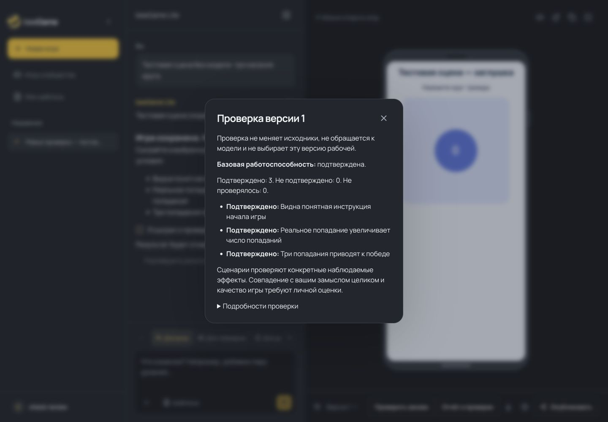

# Самостоятельная проверка игры: первая поставка

28.10.2026. Основание: [ревью и план V0–V7](validation-review-and-plan-2026-10-28.ru.md).
Первая реализация поверх `7118125`; итоговый `bd1f48b` установлен в облаке.
GPU и Codex Worker не обновлялись. [Результат выкладки](evidence/cloud-validation-v4-2026-10-28.json).
Реальных модельных вызовов — **0**. Это первая поставка плана, а не завершение V0–V7.

## Результат для пользователя

«Проверить игру» запускает отдельное задание для выбранной версии. Оно не создаёт
сообщение, Run, Invocation или новую Revision, не исправляет исходники и не выбирает
версию текущей. Действие доступно и для принятой игры. «Проверить заново» действительно
исполняет сценарии заново; «Отчёт о проверке» только открывает сохранённый результат.

В отчёте видны очередь, прогресс, подтверждённые/неподтверждённые/неисполненные условия,
базовая работоспособность и время. Отмена прекращает только проверку. После отмены
прежний отчёт явно подписан как прежний. Смена политики делает старый отчёт неактуальным.
Успех сценариев не объявляется доказательством всей играбельности или качества оформления.

## Что реализовано

| Область | Изменение и граница доказательства |
|---|---|
| V0 | Постоянные регрессии R1–R6, включая настоящие изолированные браузерные сцены. Перед исправлением зафиксированы пять падающих unit-проверок и два браузерных воспроизведения временного ложного pass. |
| V1 | Независимое обслуживание health/control, ограниченная очередь и один renderer. Очередь отделена от watchdog исполнения; отмена останавливает процесс. Receipt задаёт фактическую identity, успешный `:unavailable` запрещён. Несовместимый controller отклоняется до очереди. |
| V2 | Политика checks 4: `unchanged` наблюдается всё окно, появились ограниченные `await_condition`/`assert`; неподдерживаемая физическая клавиша — ошибка сценария до запуска браузера. Скрытый DOM-текст не доказывает видимый игровой эффект. |
| V3 | ValidationTask/ValidationRequest, общий исполнитель с автоматической проверкой, отдельные API и интерфейс. Дедупликация, адресация Revision/hash, восстановление прогресса, защита от поздних результатов, явное ручное принятие. Разделение пользовательских действий ремонта остаётся следующей поставке. |
| Часть V4 | Manifest сохраняется при обычной правке. Вместо первых 12 проверяются пакеты до 12 из сохранённого набора до 48; startup/mobile input/outcome имеют приоритет, остаток получает `not_run`. |

Игровой контракт остаётся v9; full/compact, Lite, Codex CLI и Pro через API сохранены.
Новая модельная стадия не добавлена. Prompt-инструкции остаются в прежних лимитах размера.

## Исполнитель и жизненный цикл

`POST /api/revisions/{revision_id}/validations/` принимает `artifact_hash` и
`idempotency_key`, возвращает задание с HTTP 202. `GET /api/validations/{id}/`
возвращает его состояние. `POST /api/validations/{id}/cancel/` отменяет ручное задание.
Владелец чата, CSRF и soft delete проверяются. Старый Run recheck endpoint возвращает
410: он больше не является способом создать новую проверку.

Snapshot закрепляет исходники по hash, сценарии, manifest, helpers, политику и код
валидатора. Активное задание одно на Revision; разные ключи повторного клика ссылаются
на него, старый ключ никогда не создаёт новую работу. После окончания новый ключ
означает новое исполнение. Outbox сохраняется в БД; повторная доставка безопасна.

Worker получает fence/lease. Отмена, удаление чата, смена Run fence и потеря lease
исключают публикацию позднего результата. Завершённые пакеты автоматического задания
сохраняются и используются при восстановлении того же Run. Потерянная ручная проверка
становится infrastructure_error; бесконечного скрытого перезапуска нет.

Автоматический Run вызывает тот же исполнитель, но решение о ремонте/принятии
остаётся у Run. Присоединение к ручному заданию не передаёт ему права генерации.
При необходимости экспериментальной Pro-съёмки сохраняются фактические кадры,
в том числе при объединении нескольких пакетов. Проверка не даёт модели доступ к хосту.

Daemon ограничивает очередь восемью заданиями и 24 управляющими соединениями.
Ожидание очереди — максимум 1200 секунд; watchdog исполнения начинается после старта.
Native backend использует общий файловый lock между worker-процессами. Игра по-прежнему
работает в одноразовой среде без секретов/сети. Для управляемых заданий нужны private
socket или native backend: прекращение одного `docker exec` клиента не гарантирует
завершения браузера, поэтому этот транспорт для таких заданий отклоняется.

Бюджеты пакетов: automatic 120 секунд, manual 360 секунд исполнения, без очереди.
Они проверяются **между пакетами**, а не являются жёстким общим deadline. Первый пакет
запускается всегда, выполняющийся ограничен собственным watchdog (до 600 секунд).
Это ограничение честно сохранено; оптимизация времени относится к V6.

## Семантика сценариев

`wait_for` с `unchanged` проверяет инвариант на всём заданном интервале с шагом
наблюдения около 25 мс. Это дискретное наблюдение: непрерывность между измерениями
не доказана. При первом несоответствии результат отрицательный; раннего pass нет.
Другие операторы используют достижение условия за срок.

Промежуточные `await_condition`/`assert` принимают тот же ограниченный язык наблюдений
и абсолютные операторы. Никакого произвольного JS/eval. Суммарный лимит 30 шагов и
10 секунд остаётся; assert не считается вводом игрока. Неисполненная предпосылка
останавливает маршрут как ошибку сценария, а не разрешает автоматически менять код.
В compact наблюдение должно быть объявлено контрактом модуля.

Физические клавиши проверяются по поддерживаемому Playwright-набору; кириллица не
транслитерируется. Сохраняются причинная пара, обычная случайность и независимые gates.
Однозначные числовые исправления представления журналируются и не меняют ожидание.

## Повторное ревью

Ревью выполнено тем же агентом по итоговому diff и регрессиям; независимым внешним
ревью его не называем. Дополнительно найдены и исправлены:

1. Старый worker мог отменить возобновлённое задание. Финальная отмена теперь тоже
   проверяет собственный fence; добавлен тест смены владельца во время исполнения.
2. Объединение пакетов теряло Pro visual evidence. Сохраняется фактическая съёмка
   того же hash/environment; проверено также присоединение к ручной проверке.
3. Отменённое задание показывало старый отчёт без пояснения; поздний poll мог вернуть
   интерфейс в checking. Добавлены подпись прежнего отчёта и монотонное обновление.
4. Запрос подтверждения чужого Run мог запустить probe до проверки владельца.
   Проверка доступа перенесена перед probe; добавлена регрессия с запретом вызова среды.
5. Celery мог не зарегистрировать новую задачу до начала потребления очереди.
   Добавлен явный импорт при старте и регрессионная проверка регистрации.

Проверены отсутствие модельных вызовов/автопринятия, hash/CSRF/ownership, stale identity,
сохранение результатов при отмене/рестарте, full/compact и прежние пути Codex.

## Проверки

- Полный offline backend: **1047 passed**, 130 deselected, 95.20 с. Один последующий
  тест несовместимой среды вошёл в отдельный финальный набор.
- Финальные регрессии очереди и ValidationTask: **24 passed**, 2 deselected, 6.70 с;
  это пересекающийся набор, числа не складываются с полным прогоном.
- Изолированный native Chromium: **16 passed**, 80 deselected, 56.25 с; включает
  full/compact с 14 сценариями и промежуточными условиями.
  После последних правок протокола повторный целевой native-набор: **6 passed**,
  22 deselected, 26.20 с.
- Frontend: **145 passed**, lint, TypeScript и production build прошли.
- Ruff, mypy (49 модулей), Django check, makemigrations --check прошли.
- UI на отдельной тестовой БД: запуск, reload, открытие отчёта, свежая проверка,
  отмена; размеры 320/390/1440. Переполнения и JS-ошибок нет. После действий остались
  одна Revision, один прежний Run и два прежних сообщения; Invocation — 0.

UI проверен встроенным Chromium. WebKit/физический iPhone в этой поставке не проверены.
Браузерная сцена синтетическая; она не доказывает качество реальных генераций.
Полный suite не включает платный пилот и отдельный контейнерный браузерный корпус.
Первый совместный запуск двух Django pytest ошибочно использовал одну test DB;
его результаты отброшены. Приведены последовательные чистые прогоны. Финальный UI
стенд использовал собственную БД и закрылся без предупреждений очистки.

## Что остаётся по плану

- Остальная V4: разделить requirement ID/scenario ID, явные разрешённые delta при
  смене механики, устаревание сценариев без молчаливого удаления обещаний. Теперь
  14 **валидных** сценариев исполняются; model check_repair пока ограничен 12 уникальными
  требованиями. Полное устранение этого тупика не заявляется.
- V5: воспроизводимые маршруты, диагностика противоречий, отдельные понятные действия
  ремонта сценариев и ремонта кода с точными полномочиями. Новый assert сам по себе
  не превращает модельные тесты в независимый смысловой oracle.
- V6: измерить и сократить задержки на реальном корпусе; не ослаблять доказательства
  ради большего pass rate. Текущая очередь ограничивает нагрузку, а не ускоряет браузер.
- V7: WebKit, контейнерный интеграционный прогон, отдельное ревью и согласованный
  выпуск app + validator. Живой Pro/Lite пилот требует нового бюджета.

## Локальное обновление и выпуск

Миграции 0023/0024 добавляют задания/ключи и fence автоматического Run; игровые данные
не удаляются. Перед локальным обновлением проверено отсутствие активных Run и
reserved/sent Invocation. Пять старых returned receipts сохранены.
Создан backup `.data/validation-v4-backup/before-0023-20261028T175834Z.dump`,
SHA-256 `d3261fdb6ad1e339ea0914c4543158e0c486efe5ddab44088219e1846d727589`;
каталог архива прочитан `pg_restore --list`. Это проверка читаемости, не тест восстановления.
Миграции применены, app/preview/worker/beat перезапущены. Native sandbox/Chromium,
HTTP health (200) и регистрация задачи в работающем Celery прошли.
Активных Run/вызовов нет; пять прежних returned receipts сохранены.

Для облачного выпуска выполнены backup, проверка отсутствия активной работы, миграции
и согласованное обновление app/worker/validator: implementation hash включает код
контроллера, daemon и native-изоляции. Старый validator будет отклонён. Облачная
выкладка завершена на `bd1f48b`; rollback требует согласованной пары образов.

При подготовке выпуска найден дополнительный дефект Compose: сокет был подключён
только к worker, хотя ручное подтверждение проверяет среду из app. Для app добавлены
`VALIDATOR_SOCKET` и read-only mount приватного `validator-ipc`; наружу порт не открыт,
Docker socket не предоставлен. Проверка identity из настоящего контейнера app входит
в обязательную приёмку выпуска.

Первое облачное переключение остановлено при нагрузочной проверке: на Chromium 156
пара `clock.install(fixed)` → `pause_at(fixed)` иногда получала «Cannot fast-forward
to the past». Старые образы автоматически восстановлены, база не перезаписывалась;
миграции 0023/0024 остались как добавочные таблицы. Исправление: установить часы на
сутки раньше и остановить в заданный момент **на пустой странице, до загрузки игры**.
Запас больше полного watchdog, а оба причинных прогона начинают игру в одном времени.
Никакие игровые таймеры не пропускаются при подготовке. Четыре регрессии моделируют
задержку RPC от 1 мс до 601 с. Семантика advance-and-pause проверена по
[документации Playwright](https://playwright.dev/python/docs/api/class-clock#clock-pause-at).

Итоговая облачная приёмка: очередь 1/2/4 запроса, probe 1–5 мс при занятом браузере,
14/14 сценариев в двух пакетах, отмена/следующий запуск, unsupported key как ошибка
сценария, отрицательный результат позднего изменения. Настоящий API ValidationTask
выполнен из app с браузером в откатываемой транзакции; постоянных тестовых записей нет.
HTTP: все 22 публичных файла точны, приватные API закрыты гостю, HTTPS-preview 200
без cookies и с CSP sandbox. Модельных вызовов нет. До выпуска исправление часов
прошло 9 unit-проверок и 12 проверок в изолированном native Chromium.

Команды и API также добавлены в README. [Машинная сводка](evidence/validation-v4-2026-10-28.json).
